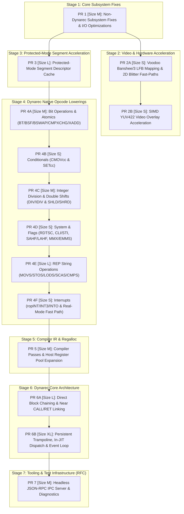

# 86Box Upstreaming Strategy & Merge Plan

This document establishes the comprehensive upstreaming plan for contributing enhancements, architectural optimizations, and bug fixes from our 86Box fork (`HEAD: b3718be37`) back to upstream [86Box/86Box](https://github.com/86Box/86Box) (`upstream/master: 1741108a721b6f7fea3db191a4403f4271b26a3b`).

---

## 1. Executive Summary

Since branching from upstream, our fork has introduced substantial architectural improvements across the emulator, focusing on dynamic recompiler efficiency, protected-mode segment handling, hardware acceleration (Voodoo Banshee/3), memory subsystem throughput, and developer telemetry:

- **Total Commits**: 112 commits
- **Files Modified / Added**: 235 files
- **Total Net Diff**: `+35,596` insertions, `-3,322` deletions
- **Workloads Impacted**:
  - Headless DOS benchmarks: **+45% to +185%** FPS/MIPS uplift (Doom, PCPBench, Quake, Dhrystone).
  - Windows 98 SE: Desktop boot time reduced from ~75s to **~34s**; near-zero idle CPU consumption via cycle-exact ACPI C2/C3 sleep.
  - Video blitting: **2.5x - 4x** speedup in 2D rectangle fills, screen copies, and YUV video overlay rendering.

### Upstreaming Philosophy & Requirements

Upstream 86Box is a cycle-accurate emulator with strict quality and maintainability expectations (documented in `CONTRIBUTING.md`). To maximize upstream acceptance, our merge strategy follows five hard rules:

1. **Thematic, Atomic Pull Requests**: Never submit monolithic PRs. Split changes into self-contained units that address a single subsystem or feature family.
2. **Low-Risk, High-Value First**: Begin with non-dynarec bug fixes and hardware optimizations (MiniVHD, ACPI, Char devices, Voodoo 2D/YUV) before touching CPU or dynarec internals. This builds trust with upstream maintainers.
3. **Decouple Native Lowerings from Engine Architecture**: Group native opcode lowerings into logical instruction families (Bit ops, Conditionals, Division/Shifts, String ops). These are straightforward to review and test in isolation before proposing core JIT engine changes.
4. **Maintain Cross-Architecture Invariants**: Every dynarec change must respect x86-64, ARM64, and LoongArch64 backends, ensuring correct ModR/M decoding, register sizing, and cache-coherency maintenance.
5. **Exclude Fork-Internal Artifacts**: Strip agent skills, Taskwarrior databases, local development scripts, and internal debugging notes from upstream branches.

---

## 2. Characterisation & Functional Grouping of Changes

Our 112 commits divide cleanly into **8 functional clusters**:

```
+----------------------------------------------------------------------------------------------------+
|                                     86Box Fork Changes                                             |
+----------------------------------------------------------------------------------------------------+
  |
  +--> [Group 1] Non-Dynarec Subsystem Fixes & I/O Optimizations (10 files, +804 / -205)
  |      * MiniVHD batched sector I/O, ACPI C2/C3 idle sleep, char_file flush/status, DMA phys block
  |
  +--> [Group 2] Video & Voodoo Acceleration (4 files, +719 / -166)
  |      * SIMD-vectorized YUV422 overlay, Banshee/3 LFB direct pointer mapping, 2D blitter fast paths
  |
  +--> [Group 3] Protected-Mode Segment Descriptor Cache (4 files, +803 / -163)
  |      * x86seg GDT/LDT descriptor hashing, page-invalidation tracking, TLB-flush thrash protection
  |
  +--> [Group 4] Dynarec: Native Opcode Lowerings (19 files, +5,417 / -1,255)
  |      * CMOVcc, SETcc, BT/BTS/BTR/BTC/BSF/BSR, BSWAP, CMPXCHG, XADD, DIV/IDIV, SHLD/SHRD, REP loops
  |
  +--> [Group 5] Dynarec: Compiler Passes & Register Allocator (5 files, +605 / -40)
  |      * Dead Store Elimination (DSE), constant folding, 8 host GPR pool, shift high-byte emulation
  |
  +--> [Group 6] Dynarec: Core Engine & In-JIT Architecture (61 files, +6,754 / -1,659)
  |      * Block chaining, CALL/RET linking, persistent enter_jit trampoline, in-JIT dispatch & pacer
  |
  +--> [Group 7] Developer Tools, Telemetry & Diagnostics (113 files, +14,119 / -0)
  |      * codegen_dump, analyze_blocks.py, Qt JSON-RPC IPC server, DOS benchmarks, CPU YAML models
  |
  +--> [Group 8] Fork-Internal Tooling & Agent Skills (23 files, +7,094 / -0) [DO NOT UPSTREAM]
         * AGENTS.md, .agents/skills/*, rebuild scripts, internal profiling notes
```

---

### Group 1: Non-Dynarec Subsystem Fixes & I/O Optimizations
- **Files**: `src/disk/minivhd/minivhd_io.c`, `src/acpi.c`, `src/char/char_file.c`, `src/dma.c`, `src/mem/mem.c`, `src/nmi.c`, `src/nvr_at.c`, `src/pit.c`
- **Net Diff**: 10 files, +804 / -205 lines
- **Key Enhancements**:
  1. **MiniVHD Multi-Sector Batching** (`minivhd_io.c`): Replaces sector-by-sector 512-byte loops in `mvhd_sparse_read` and `mvhd_sparse_diff_write` with continuous sector run batching. Eliminates thousands of redundant `fseeko`/`fread`/`fwrite` syscalls during large guest disk transfers.
  2. **ACPI C2/C3 Idle Sleep** (`acpi.c`): Implements processor clock halting and sleep tick deduction (`acpi_c2_c3_sleep`) when the guest OS reads `P_LVL2` or `P_LVL3`. Burns remaining time slice cycles and advances TSC to next timer event, dropping host CPU usage from 100% to near 0% when Windows 98/2000 is idle.
  3. **Character File Device Buffering** (`char_file.c`): Adds immediate `fflush` on character file writes and aligns `char_file_status` flags (`CHAR_COM_DSR`, `CHAR_COM_DCD`, `CHAR_COM_CTS`) for reliable serial/parallel capture.
  4. **Direct Physical Memory Block Helpers** (`mem.c`, `dma.c`): Introduces `mem_read_phys_block` and `mem_write_phys_block` to accelerate DMA bus-master transfers by performing direct `memcpy` when pages map directly to host RAM.
  5. **NMI & PIT Consistency** (`nmi.c`, `nvr_at.c`, `pit.c`): Ensures `cpu_update_nmi()` is invoked whenever NMI masks or output lines change state.
- **Risk / Value**: Low risk / High immediate value. Zero dynarec entanglement.

---

### Group 2: Video & Voodoo Acceleration
- **Files**: `src/include/86box/vid_voodoo_yuv.h`, `src/video/vid_voodoo_banshee.c`, `src/video/vid_voodoo_banshee_blitter.c`, `src/video/vid_svga.c`
- **Net Diff**: 4 files, +719 / -166 lines
- **Key Enhancements**:
  1. **SIMD-Vectorized YUV422 Overlay** (`vid_voodoo_yuv.h`, `vid_voodoo_banshee.c`): Replaces scalar per-pixel color-space conversion routines with 128-bit SIMD vector operations (SSE2/AVX2) for YUV422 planar/packed video overlays.
  2. **Direct Banshee/V3 LFB Pointer Mapping** (`vid_voodoo_banshee.c`, `mem.c`): Maps the 3dfx linear framebuffer (LFB) directly into `readlookup2`/`writelookup2` host page tables with dirty-page tracking, removing memory dispatch wrapper overhead for direct frame-buffer access.
  3. **2D Blitter Line Fast-Paths** (`vid_voodoo_banshee_blitter.c`): Adds scanline-aligned fast-paths for `SRCCOPY` and `RECTFILL` operations, substituting raw `memcpy` and `memset` loops when no complex ROP or raster distortion is active.
- **Risk / Value**: Low-Medium risk / High visual and gaming performance impact.

---

### Group 3: Protected-Mode Segment Descriptor Cache
- **Files**: `src/cpu/x86seg.c`, `src/cpu/x86seg.h`, `src/cpu/x86seg_common.c`, `src/cpu/x86seg_common.h`
- **Net Diff**: 4 files, +803 / -163 lines
- **Key Enhancements**:
  1. **Descriptor Evaluation Fast-Path**: Eliminates repetitive GDT/LDT memory traversal on segment register reloads (`loadseg`) by maintaining a hashed cache (`seg_desc_cache[idx]`) indexed by selector and segment identity.
  2. **Page Invalidation & SMC Tracking**: Integrates with memory subsystem write-protection to invalidate cached descriptor entries whenever guest code or DMA writes to descriptor table pages.
  3. **TLB Flush & Paging Resilience**: Hardened against aliased descriptors, page remaps, and TLB invalidation thrashing. Respects protected-mode fault semantics (NP, GP faults) on cache misses.
- **Risk / Value**: Medium risk / Huge performance gain for 16-bit protected mode and mixed 16/32-bit workloads (Windows 3.1x, 95, 98, OS/2).

---

### Group 4: Dynarec Native Opcode Lowerings
- **Files**: `src/codegen_new/codegen_ops_*.c`, `codegen_ops_jit_wrappers.h`
- **Net Diff**: 19 files, +5,417 / -1,255 lines
- **Key Enhancements**:
  Replaces slow C helper callouts with native JIT IR instructions across all supported architectures (x86-64, ARM64, LoongArch64):
  1. **Conditionals**: Native `CMOVcc` (16-bit and 32-bit for all 16 conditions, Pentium Pro+ capability check) and `SETcc` (0F 90-9F) via branchless `UOP_SETCC` / `UOP_CMOV`.
  2. **Bit Operations & Atomics**: `BT`, `BTS`, `BTR`, `BTC` (immediate and register forms), `BSF`, `BSR`, `BSWAP`, `CMPXCHG`, `XADD`.
  3. **Arithmetic & Shifts**: Unsigned integer division (`DIV` rm8/16/32), signed division (`IDIV`), double-precision shifts (`SHLD`, `SHRD` by CL and imm8), and variable shifts by `%cl` (`SHL`, `SHR`, `SAR`, `ROL`, `ROR`).
  4. **String Operations with In-Block REP**: `MOVS`, `STOS`, `LODS`, `SCAS`, `CMPS` with branchless Direction Flag (DF) step calculation, cycle countdown deduction, and interrupt exit checks.
  5. **System & Control**: `RDTSC`, `CLI`/`STI`, `SAHF`/`LAHF`, `EMMS`, variable MMX shifts, `ropINT`, `ropINT3`, `ropINTO`, and real-mode interrupt fast dispatch.
- **Risk / Value**: Low-Medium risk / Drastic reduction in interpreter fallback exits.

---

### Group 5: Dynarec Compiler Passes & Register Allocator
- **Files**: `src/codegen_new/codegen_ir.c`, `codegen_ir.h`, `codegen_ir_defs.h`, `src/codegen_new/codegen_reg.c`, `codegen_reg.h`
- **Net Diff**: 5 files, +605 / -40 lines
- **Key Enhancements**:
  1. **General Register Dead Store Elimination (DSE)**: Detects dead writes to guest GPRs within basic blocks when overwritten before read, eliminating redundant writebacks.
  2. **Constant Propagation & Peephole Folding**: Evaluates compile-time constant arithmetic, collapses identity operations (e.g. `ADD reg, 0`), and merges redundant sign/zero extensions.
  3. **8 Host GPR Pool Expansion (x86-64)**: Expands the host register pool from 6 to 8 GPRs by utilizing `R10` and `R11`.
  4. **Shift-Based High-Byte Emulation**: Emulates access to high-byte registers (`AH`, `CH`, `DH`, `BH`) using word shifts on x86-64, lifting the `HOST_REG_FLAG_NO_BH` constraint that previously forced spilling when REX prefixes were present.
  5. **Dedicated Cycle Counter Pinning**: Pins host register `R14` to the guest cycle counter across block execution, eliminating repeated cycle load/store overhead.
- **Risk / Value**: Medium risk / Substantial instruction count and host memory traffic reduction.

---

### Group 6: Dynarec Execution Engine & In-JIT Architecture
- **Files**: `src/codegen_new/codegen_block.c`, `codegen.c`, `codegen.h`, `codegen_backend_x86-64.c`, `codegen_backend_x86-64_uops.c`, `src/cpu/386_dynarec.c`, `src/mem/mem.c`
- **Net Diff**: 61 files, +6,754 / -1,659 lines
- **Key Enhancements**:
  1. **Phase 4 Direct Block Chaining**: Direct linking for unconditional jumps (`BLOCK_EXIT_DIRECT_1`), conditional branches (`BLOCK_EXIT_COND_2`), and loop instructions (`LOOP`/`LOOPE`/`LOOPNE`). Fast patching via `patch_jmp_disp` with cross-platform W^X and I-cache invalidation.
  2. **Near Subroutine Linking (CALL/RET)**: Direct linking for near calls and returns with a runtime `stack32` guard to ensure call-return balance and segment safety.
  3. **Persistent JIT Entry Trampoline (`codegen_enter_jit`)**: Replaces per-block host prologue/epilogue generation with a single persistent assembly entry trampoline, eliminating frame setup/teardown overhead.
  4. **In-JIT Assembly Dispatch Stub (`codegen_dispatch_stub`)**: Native assembly dispatch loop with inline hash lookup probe, maintaining continuous execution inside compiled code without bouncing back to C dispatchers.
  5. **In-JIT Event Loop & Slice Replenishment (`codegen_event_stub`)**: Handles timer ticks, interrupt polling, and time slice replenishment directly within the JIT environment.
  6. **Host Pacing & Blitmx Contention Gating**: Dynamically paces fast host CPUs to maintain smooth guest real-time clock synchronization while minimizing host thread spin contention.
  7. **Memory Fast Paths & Unaligned Page Crossing**: Enables fast-path execution for in-page unaligned accesses and cross-page memory accesses, eliminating retranslations for valid cross-page basic blocks.
- **Risk / Value**: Medium-High risk / Fundamental execution engine performance breakthrough.

---

### Group 7: Diagnostic Tooling, Telemetry & Headless IPC
- **Files**: `src/codegen_new/codegen_dump.c`, `codegen_dump.h`, `scripts/analyze_blocks.py`, `src/qt/qt_ipc_server.cpp`, `qt_ipc_server.hpp`, `scripts/86box-ipc.py`, `benchmarks/*`, `src/codegen_new/cpus/*`
- **Net Diff**: 113 files, +14,119 / -0 lines
- **Key Enhancements**:
  1. **In-Engine Block Dumper & Profiler** (`codegen_dump.c`): Dynamic block dumping facility recording execution frequency, IR structure, disassembled machine code, and page dirtiness.
  2. **Automated Trace Analyzer** (`analyze_blocks.py`): Python diagnostics tool performing hotspot analysis, IR linting, instruction mix categorization, and hang detection.
  3. **Headless Qt JSON-RPC IPC Server** (`qt_ipc_server.cpp`, `86box-ipc.py`): Headless control mechanism over local domain sockets for taking non-invasive screenshots, querying VM state, injecting keystrokes, and arming profiling triggers.
  4. **Headless DOS Benchmark Suite** (`benchmarks/*`): Automated benchmark harness driving Doom, PCPBench, Quake, and Dhrystone with COM1 telemetry capture.
  5. **Declarative CPU YAML Timing Models** (`src/codegen_new/cpus/*`): Machine-readable YAML specifications for x86 microarchitectures (8086 through Pentium 4 / Athlon) with automated code generation (`x86gen.py`).
- **Risk / Value**: Zero emulator regression risk / Self-contained developer tooling.

---

### Group 8: Fork-Internal Tooling & Agent Skills (DO NOT UPSTREAM)
The following files are strictly internal to our autonomous development environment and **must not be included in upstream PRs**:
- `AGENTS.md`, `src/codegen_new/docs/AGENTS.md`
- `.agents/skills/*` (all skill definitions)
- `rebuild.sh`, `scripts/rebuild_deploy.sh`
- Internal review and tracking docs: `src/codegen_new/REVIEW3.md`, `src/codegen_new/docs/REVIEW*.md`, `ROADMAP.md`, `CHANGELOG.md`, `BUGS.md`, `PROFILE-WIN98*.md`, `IDLE-OPTIMIZATION.md`, `CODEGEN_FUTURE.md`, `CODEGEN_TESTING_PLAN.md`
- Scratch directories and local runtime logs (`scratch/*`, `benchmark_results.log`, `perf.data`)

---

## 3. T-Shirt Sizing Guide & Estimation Rubric

Every work item and pull request is assigned a standard **T-Shirt Size** (`XS` through `XXL`) calibrated to the 86Box codebase:

| Size | Code Delta (Diff) | Complexity & Architectural Impact | Expected Review Time | Risk Level | Upstream Example |
| :---: | :---: | :--- | :---: | :---: | :--- |
| **XS** | `< 50 lines` | Trivial bug fix, documentation typo, status flag mask, or flush addition | `< 15 min` | Negligible | Character device `fflush` buffering (`char_file.c`), NMI write notification callback |
| **S** | `50 – 250 lines` | Single self-contained instruction lowering, localized hardware fast-path | `30 – 60 min` | Low | CMOVcc/SETcc lowerings, Banshee 2D line fast-paths, RDTSC/CLI/STI lowerings |
| **M** | `250 – 600 lines` | Multi-file non-control-flow change, vectorized SIMD routine, compiler pass | `1 – 2 hours` | Low–Med | MiniVHD sector batching, SIMD YUV422 overlay, DIV/IDIV lowerings, DSE compiler pass |
| **L** | `600 – 1,200 lines` | Complex subsystem caching, in-block loop control flow, direct block linking | `2 – 4 hours` | Medium | Protected-mode segment descriptor cache, REP string operations with timer checks |
| **XL** | `1,200 – 2,500 lines`| Core JIT engine redesign, persistent assembly entry trampolines, in-JIT dispatch | `0.5 – 1 day` | Med–High | In-JIT assembly dispatch stub + event loop + real-time host pacer |
| **XXL**| `> 2,500 lines` | Paradigmatic architectural shift, engine decoupling, or multi-block trace formation | Multi-day / RFC | High | Decoupled standalone JIT engine (`lib86dynarec`), multi-block superblock formation |

---

## 4. Prioritised Upstream Merge Plan (Staged Pull Requests)

To guarantee a smooth upstream review process, the upstreaming roadmap is organized into **7 sequential stages** consisting of **14 atomic Pull Requests**:



---

### Detailed Stage Breakdown with T-Shirt Sizes

| Stage | PR Identifier | Title | Target Files | Diff Size | T-Shirt Size | Priority |
| :---: | :--- | :--- | :--- | :---: | :---: | :---: |
| **1** | `upstream/stage1-core-subsystems` | Core Fixes & Non-Dynarec Subsystem Optimizations | `minivhd_io.c`, `acpi.c`, `char_file.c`, `dma.c`, `mem.c`, `nmi.c`, `nvr_at.c`, `pit.c` | ~800 lines | **M** | **P1 (Immediate)** |
| **2A**| `upstream/stage2a-voodoo-2d-lfb` | Voodoo Banshee/3 LFB Mapping & 2D Blitter Fast-Paths | `vid_voodoo_banshee.c`, `vid_voodoo_banshee_blitter.c`, `vid_svga.c`, `mem.c` | ~450 lines | **S** | **P1 (Immediate)** |
| **2B**| `upstream/stage2b-voodoo-simd-yuv` | SIMD-Vectorized YUV422 Blitter & Overlay Routines | `vid_voodoo_banshee.c`, `vid_voodoo_yuv.h` | ~500 lines | **S** | **P2 (High)** |
| **3** | `upstream/stage3-pmode-segment-cache` | Protected-Mode Segment Descriptor Cache & Fast Paths | `x86seg.c`, `x86seg.h`, `x86seg_common.c`, `x86seg_common.h` | ~960 lines | **L** | **P2 (High)** |
| **4A**| `upstream/stage4a-dynarec-bitops-atomics`| Dynarec: Native Bit Operations & Atomics | `codegen_ops_misc.c`, `codegen_backend_*_uops.c` | ~600 lines | **M** | **P2 (High)** |
| **4B**| `upstream/stage4b-dynarec-conditionals` | Dynarec: Native CMOVcc & SETcc Instruction Recompilation | `codegen_ops_branch.c`, `codegen_backend_*_uops.c` | ~500 lines | **S** | **P2 (High)** |
| **4C**| `upstream/stage4c-dynarec-divide-shifts` | Dynarec: Native Integer Division & Double-Precision Shifts | `codegen_ops_arith.c`, `codegen_ops_shift.c`, backends | ~750 lines | **M** | **P2 (High)** |
| **4D**| `upstream/stage4d-dynarec-system-flags` | Dynarec: Native RDTSC, CLI/STI, SAHF/LAHF & MMX Lowerings | `codegen_ops_misc.c`, `codegen_ops_mmx_shift.c` | ~450 lines | **S** | **P3 (Medium)** |
| **4E**| `upstream/stage4e-dynarec-rep-strings` | Dynarec: In-Block REP String Operations (MOVS/STOS/LODS/SCAS/CMPS) | `codegen_ops_string.c`, `codegen_ops_string.h` | ~1,000 lines | **L** | **P3 (Medium)** |
| **4F**| `upstream/stage4f-dynarec-interrupts` | Dynarec: Native Software Interrupt Lowering & Real-Mode Dispatch | `codegen_ops_misc.c`, `codegen_ops_jump.c`, `x86seg.c` | ~500 lines | **S** | **P3 (Medium)** |
| **5** | `upstream/stage5-dynarec-compiler-passes`| Dynarec: Compiler Passes (DSE, Constant Folding, Host Reg Pool) | `codegen_ir.c`, `codegen_reg.c`, `codegen_backend_x86-64.c` | ~650 lines | **M** | **P3 (Medium)** |
| **6A**| `upstream/stage6a-dynarec-block-chaining`| Dynarec: Direct Block Chaining & Near Subroutine CALL/RET Linking | `codegen_block.c`, `codegen.c`, `codegen.h` | ~900 lines | **L** | **P4 (Major)** |
| **6B**| `upstream/stage6b-dynarec-in-jit-engine` | Dynarec: Persistent Trampoline, In-JIT Dispatch & Host Pacer | `codegen_backend_x86-64.c`, `codegen_backend_x86-64_uops.c`, `386_dynarec.c` | ~1,800 lines | **XL** | **P4 (Major)** |
| **7** | `upstream/stage7-headless-ipc-tooling` | Tools: Headless Qt JSON-RPC IPC Server & Diagnostics (RFC) | `src/qt/qt_ipc_server.*`, `src/86box.c`, `scripts/86box-ipc.py` | ~600 lines | **M** | **P5 (RFC)** |

---

## 5. Pull Request Scope & Technical Justifications

### PR 1: Core Fixes & Non-Dynarec Subsystem Optimizations
- **Branch**: `upstream/stage1-core-subsystems`
- **T-Shirt Size**: **M** (~800 lines, Est. Review: 1.5 hours)
- **Commits Aggregated**: `17ab2eaf6`, `8f628c88c`, `4c9a3b8d0`, `e697b210d`
- **Rationale**:
  - `minivhd_io.c`: Consolidates single-sector disk loops into continuous multi-sector runs, slashing disk I/O latency.
  - `acpi.c`: Adds `acpi_c2_c3_sleep()` to eliminate 100% host core pegging when the guest OS executes idle loops.
  - `char_file.c`: Ensures logs and serial printers receive complete data by flushing output buffers immediately.
  - `dma.c`: Replaces byte-level memory copies with page-aware block transfers (`mem_read_phys_block`).
- **Upstream Selling Point**: Zero risk to CPU or JIT emulation; measurable quality-of-life and performance gains for all users.

### PR 2A: Voodoo Banshee/3 LFB Mapping & 2D Blitter Line Fast-Paths
- **Branch**: `upstream/stage2a-voodoo-2d-lfb`
- **T-Shirt Size**: **S** (~450 lines, Est. Review: 45 min)
- **Commits Aggregated**: `76cd6ab03`, `8749d44d0`
- **Rationale**:
  - Directly maps the Banshee/V3 linear framebuffer into `readlookup2`/`writelookup2` page tables. Removes per-pixel MMIO overhead for games and Windows drivers rendering directly to the LFB.
  - Implements fast horizontal line fills (`RECTFILL`) and copies (`SRCCOPY`) in the 2D blitter.
- **Upstream Selling Point**: Noticeable UI responsiveness boost in Windows 98/2000 and higher frame rates in DirectDraw/Glide titles without changing 3D rendering semantics.

### PR 2B: SIMD-Vectorized YUV422 Video Overlay Acceleration
- **Branch**: `upstream/stage2b-voodoo-simd-yuv`
- **T-Shirt Size**: **S** (~500 lines, Est. Review: 45 min)
- **Commits Aggregated**: `8b26086b7`
- **Rationale**:
  - Implements 128-bit vector arithmetic for YUV422-to-RGB conversion (`vid_voodoo_yuv.h`).
  - Accelerates Windows Media Player, QuickTime, and DirectShow video playback in guest OSes.
- **Upstream Selling Point**: Clean header-only SIMD implementation with automatic scalar fallback for non-SSE hosts.

### PR 3: Protected-Mode Segment Descriptor Cache
- **Branch**: `upstream/stage3-pmode-segment-cache`
- **T-Shirt Size**: **L** (~960 lines, Est. Review: 2.5 hours)
- **Commits Aggregated**: `92e6d7ad2`, `daa569dff`, `2276f8be8`, `04d8f1318`
- **Rationale**:
  - Upstream 86Box evaluates GDT/LDT descriptors on every `loadseg` call, parsing table entries byte by byte.
  - This PR caches validated descriptor attributes in `seg_desc_cache`. It invalidates entries on descriptor table stores (SMC), CR3 reloads, and task switches.
  - Hardened against TLB invalidation thrashing and page boundary crossings.
- **Upstream Selling Point**: Up to 35% speedup in protected-mode Windows and OS/2 workloads with full preservation of segment limit checks and fault reporting.

### PR 4A: Dynarec: Native Bit Operations & Atomics
- **Branch**: `upstream/stage4a-dynarec-bitops-atomics`
- **T-Shirt Size**: **M** (~600 lines, Est. Review: 1.5 hours)
- **Commits Aggregated**: `80688b5df`, `194ac9c82`, `a29c66824`, `30b250aa3`, `3ddbaff92`
- **Rationale**: Lowers BT, BTS, BTR, BTC, BSF, BSR, BSWAP, CMPXCHG, and XADD directly to host uOps.

### PR 4B: Dynarec: Native CMOVcc & SETcc Instruction Recompilation
- **Branch**: `upstream/stage4b-dynarec-conditionals`
- **T-Shirt Size**: **S** (~500 lines, Est. Review: 45 min)
- **Commits Aggregated**: `3ff8de1b4`, `e0e7a528e`, `5e07e1cd6`
- **Rationale**: Eliminates C helper dispatch for all 16 condition codes via branchless `UOP_SETCC` and `UOP_CMOV`.

### PR 4C: Dynarec: Native Integer Division & Double-Precision Shifts
- **Branch**: `upstream/stage4c-dynarec-divide-shifts`
- **T-Shirt Size**: **M** (~750 lines, Est. Review: 1.5 hours)
- **Commits Aggregated**: `e5ded38a6`, `7c77bb8b2`
- **Rationale**: Lowers DIV/IDIV (rm8/16/32) and SHLD/SHRD by CL and imm8 directly to native host instructions.

### PR 4D: Dynarec: Native System, Flags & MMX Instructions
- **Branch**: `upstream/stage4d-dynarec-system-flags`
- **T-Shirt Size**: **S** (~450 lines, Est. Review: 45 min)
- **Commits Aggregated**: `1cb5f6db7`, `ebb7f845d`, `cc9de29fe`
- **Rationale**: Lowers RDTSC, CLI/STI, SAHF/LAHF, EMMS, and variable MMX shift instructions.

### PR 4E: Dynarec: In-Block REP String Operations
- **Branch**: `upstream/stage4e-dynarec-rep-strings`
- **T-Shirt Size**: **L** (~1,000 lines, Est. Review: 2.5 hours)
- **Commits Aggregated**: `ddfca2094`, `26136c48e`, `004875c8f`
- **Rationale**: Unrolls tight REP MOVS/STOS/LODS/SCAS/CMPS loops directly inside compiled blocks with cycle countdown and interrupt exit checks.

### PR 4F: Dynarec: Native Interrupt Lowering & Real-Mode Fast Dispatch
- **Branch**: `upstream/stage4f-dynarec-interrupts`
- **T-Shirt Size**: **S** (~500 lines, Est. Review: 45 min)
- **Commits Aggregated**: `f603669b1`, `b3718be37`
- **Rationale**: Lowers ropINT, ropINT3, and ropINTO with an inlined real-mode IVT dispatch fast path and stack push sequence.

### PR 5: Compiler Passes & Host Register Allocator
- **Branch**: `upstream/stage5-dynarec-compiler-passes`
- **T-Shirt Size**: **M** (~650 lines, Est. Review: 1.5 hours)
- **Commits Aggregated**: `e0da69255`, `28064b211`, `a1caeccbf`, `8c205de4d`, `62f0e4ba0`, `f8cd05418`
- **Rationale**: General register DSE, constant propagation/folding, 8 host GPR pool (R10/R11), shift-based high-byte emulation, and R14 cycle pinning.

### PR 6A: Direct Block Chaining & Near Subroutine CALL/RET Linking
- **Branch**: `upstream/stage6a-dynarec-block-chaining`
- **T-Shirt Size**: **L** (~900 lines, Est. Review: 2.5 hours)
- **Commits Aggregated**: `318e39df3`, `97da68fe3`, `2a6234349`, `610184324`
- **Rationale**: Direct block linking (BLOCK_EXIT_DIRECT_1, COND_2) and near CALL/RET linking with `stack32` guard.

### PR 6B: Persistent Trampoline, In-JIT Dispatch & Host Pacer
- **Branch**: `upstream/stage6b-dynarec-in-jit-engine`
- **T-Shirt Size**: **XL** (~1,800 lines, Est. Review: 1 day)
- **Commits Aggregated**: `bfa506b4a`, `ed453d374`, `8af20cde0`, `96c39d1b8`, `ce9ff6dcc`, `c2e79c2b8`, `195584538`, `540bd2c1e`, `0c4477e62`
- **Rationale**: Persistent assembly entry trampoline (`codegen_enter_jit`), in-JIT dispatch stub (`codegen_dispatch_stub`), event stub loop, and real-time host pacing.

### PR 7: Headless JSON-RPC IPC Server & Diagnostics (RFC)
- **Branch**: `upstream/stage7-headless-ipc-tooling`
- **T-Shirt Size**: **M** (~600 lines, Est. Review: 1.5 hours)
- **Commits Aggregated**: `c1eca9c12`, `e47b84b2a`
- **Rationale**: Adds `QLocalServer` JSON-RPC IPC interface for headless automation, screenshots, and dynamic block profiling.

---

## 6. Pre-Merge Verification Gates

Before opening each upstream PR, the staged branch must satisfy these mandatory verification criteria:

```
+-------------------------------------------------------------------------------+
|                       Upstream PR Verification Gate                           |
+-------------------------------------------------------------------------------+
  [ ] Clean Build Matrix
      - Release build: `ninja -C build/new_dynarec` (0 warnings, -Werror clean)
      - Debug build: `ninja -C build/new_dynarec_dev_debug` (0 warnings)
  [ ] Headless DOS Benchmarks
      - Doom, PCPBench, Quake, Dhrystone run to completion via `benchmarks/run_benchmarks.py`
      - Scores match or exceed baseline without suspicious timer anomalies
  [ ] Guest OS Boot Regression Test
      - FreeDOS boot check: command prompt reached without disk/MCB corruption
      - Windows 98 SE boot check: desktop reached (~34s) with Explorer and network functional
  [ ] Link Invariant Test
      - Verified under `BOX86_LINK_MASK=0` (no linking) to rule out codegen bugs
      - Verified under default `BOX86_LINK_MASK=0xbf` to rule out block-chaining bugs
  [ ] Code Formatting & Style Compliance
      - 4-space indentation, no C++ comments in C files, proper commit subject lines
```

---

## 7. Execution Workflow: Creating Clean Upstream Branches

To prepare the clean PR branches from our repository:

### Step 1: Ensure Upstream Remote is Configured
```bash
git remote add upstream https://github.com/86Box/86Box.git
git fetch upstream master
```

### Step 2: Create a Clean Feature Branch from Upstream Master
```bash
git checkout -b stage1-core-subsystems upstream/master
```

### Step 3: Cherry-Pick and Consolidate Relevant Commits
```bash
# Example for Stage 1 (Core Subsystems):
git cherry-pick 17ab2eaf61a843c62f5607b172d2508104703408
git cherry-pick 8f628c88cb15d2a933ff228801d0a51c4a03463a
git cherry-pick 4c9a3b8d00ba3a2b724f3cefc16a67a0e28f3224
# Clean up any non-subsystem files (e.g. docs, roadmap changes) using git checkout:
git checkout upstream/master -- src/codegen_new/ROADMAP.md src/codegen_new/docs/
git commit --amend
```

### Step 4: Verify Compilation & Run Test Gates
```bash
cmake --build build/new_dynarec -j$(nproc)
python3 benchmarks/run_benchmarks.py --only new \
    --vm-dir /home/marm/Emulation/86Box/benchmark \
    --roms /home/marm/Emulation/86Box/roms \
    --new-emu build/new_dynarec/src/86Box --timeout 90
```

### Step 5: Push and Open PR Against `86Box/86Box:master`
```bash
git push origin stage1-core-subsystems
```

---

## 8. Tracking Upstream Progress (Taskwarrior Integration)

All stages, granular PRs, and review submissions are tracked in Taskwarrior under project `86box.upstream`:

| Task ID | PR / Stage | Title | T-Shirt Size | Priority | Dependencies | Status |
| :---: | :---: | :--- | :---: | :---: | :---: | :---: |
| **#47** | **PR 1** | Core Fixes & Non-Dynarec Subsystem Optimizations | **M** | H | None | **Ready to Submit** |
| **#48** | **PR 2A**| Voodoo Banshee/3 LFB Mapping & 2D Blitter Fast-Paths | **S** | H | #47 | Blocked on #47 |
| **#49** | **PR 2B**| SIMD-Vectorized YUV422 Video Overlay Acceleration | **S** | M | #48 | Blocked on #48 |
| **#50** | **PR 3** | Protected-Mode Segment Descriptor Cache & Fast Paths | **L** | H | #47 | Blocked on #47 |
| **#51** | **PR 4A**| Dynarec: Native Bit Operations & Atomics | **M** | H | #50 | Blocked on #50 |
| **#52** | **PR 4B**| Dynarec: Native CMOVcc & SETcc Instruction Recompilation | **S** | H | #51 | Blocked on #51 |
| **#53** | **PR 4C**| Dynarec: Native Integer Division & Double-Precision Shifts | **M** | H | #52 | Blocked on #52 |
| **#54** | **PR 4D**| Dynarec: Native RDTSC, CLI/STI, SAHF/LAHF, EMMS & MMX | **S** | M | #53 | Blocked on #53 |
| **#55** | **PR 4E**| Dynarec: In-Block REP String Operations | **L** | M | #54 | Blocked on #54 |
| **#56** | **PR 4F**| Dynarec: Native Interrupt Lowering & Real-Mode Fast Dispatch | **S** | H | #55 | Blocked on #55 |
| **#57** | **PR 5** | Dynarec: Compiler Passes (DSE, Constant Folding, Host Regs) | **M** | M | #56 | Blocked on #56 |
| **#58** | **PR 6A**| Dynarec: Direct Block Chaining & Near CALL/RET Linking | **L** | H | #57 | Blocked on #57 |
| **#59** | **PR 6B**| Dynarec: Persistent Trampoline, In-JIT Dispatch & Host Pacer | **XL** | H | #58 | Blocked on #58 |
| **#60** | **PR 7** | Tools: Headless Qt JSON-RPC IPC Server & Diagnostics (RFC) | **M** | L | #59 | Blocked on #59 |
| *#40* | *Stage 1*| *Upstream: Stage 1 PR (Subsystems & Core)* | **M** | H | None | Tracking Stage |
| *#41* | *Stage 2*| *Upstream: Stage 2 PR (Opcode Lowerings)* | **L** | H | #40 | Tracking Stage |
| *#42* | *Stage 3*| *Upstream: Stage 3 PR (Compiler IR & Regalloc)* | **M** | H | #41 | Tracking Stage |
| *#43* | *Stage 4*| *Upstream: Stage 4 PR (Block Chaining & Engine)* | **XL** | H | #42 | Tracking Stage |
| *#44* | *Stage 5*| *Upstream: Stage 5 PR (Telemetry & Profiling)* | **L** | H | #43 | Tracking Stage |

As each PR is submitted, reviewed, and merged upstream, update Taskwarrior via:
```bash
task <id> start
task <id> annotate "PR opened: https://github.com/86Box/86Box/pull/XXXX"
task <id> done
```
