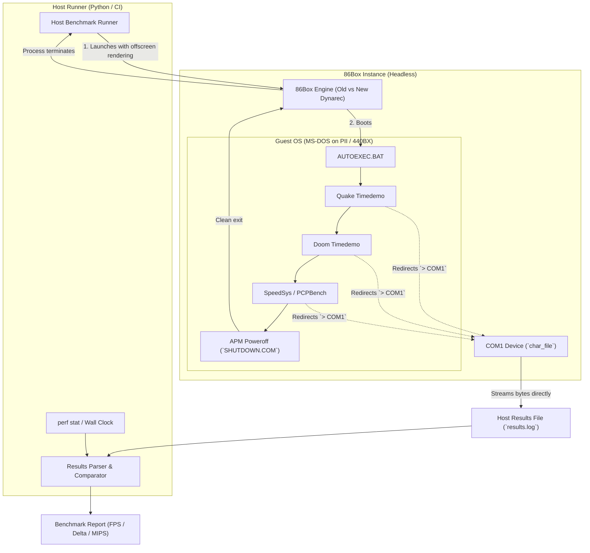

# Full-System Benchmarking Architecture: Old vs. New Dynarec

This document describes the automated, full-system benchmarking harness used to compare the legacy dynamic recompiler (`src/codegen/`) against the new dynamic recompiler (`src/codegen_new/`).



---

## 1. Output Redirection via Serial Port (COM1)

Output is streamed from the guest to the host via **Serial Port (COM1)** redirection using 86Box's `char_file` driver:

1. **Battle-Tested Chardev Integration**:
   - In 86Box, the serial subsystem (`src/device/serial.c`) manages character device initialization and control lines (`DTR`/`RTS`) with complete isolation. (Note: Parallel port file redirection currently has a timer initialization bug in 86Box that can trigger a crash on startup, making serial redirection the proven and stable choice).
2. **Direct Byte Streaming**:
   - When configured with `serial1_device = file`, 86Box writes incoming UART bytes directly to the host output file (`fwrite`) in real time.
3. **Native DOS Support**:
   - Initialized at startup with `MODE COM1:9600,N,8,1 > NUL`, standard DOS redirection (`> COM1`) transparently streams all command stdout into the host file.
4. **No Host Virtual Disk Mounting**:
   - Output lands directly in a host text file without having to mount, parse, or extract files from FAT partitions.

---

## 2. 86Box VM Configuration

### Machine Profile
- **Motherboard**: Intel SE440BX-2 (`se440bx2`) or ASUS P2B (`p2b`)
- **Chipset**: Intel 440BX (rock-solid Slot 1 platform with mature APM and PCI support)
- **CPU**: Intel Pentium II (Deschutes) 350 or 400 MHz (`cpu_multi = 4`)
- **RAM**: 64 MB or 128 MB (`mem_size = 131072`)
- **Video**: S3 Trio64V+ (`s3_trio64vplus`) or Tseng ET6000 PCI (low host rendering overhead so performance is CPU/memory bound)
- **Audio**: Disabled or Null sound driver

### `86box.cfg` Snippet
```ini
[General]
vid_renderer = qt_software

[Machine]
machine = se440bx2
cpu_family = i686_pentium2
cpu_speed = 400000000
cpu_multi = 4
fpu_type = internal
mem_size = 131072

[Video]
gfxcard = s3_trio64vplus

[Ports (COM & LPT)]
serial1_device = file

[File (COM 1)]
path = benchmark_results.log
append = 0

[Hard disks]
hdd_01_fn = dos_bench.img
hdd_01_parameters = 63, 16, 1024, 0, ide
hdd_01_ide_channel = 0:0
```

---

## 3. Guest Test Suite (`AUTOEXEC.BAT`)

The guest hard drive image contains MS-DOS 6.22 or Windows 98 SE DOS mode with an automated `AUTOEXEC.BAT`:

```bat
@ECHO OFF
PROMPT $P$G

REM Initialize Serial Port (COM1)
MODE COM1:9600,N,8,1 > NUL 2> NUL

ECHO ====================================================== > COM1
ECHO 86Box Automated Dynarec Benchmark Suite               > COM1
ECHO ====================================================== > COM1

REM --- 1. Doom Timedemo (32-bit Integer ALU & Register Pressure) ---
ECHO [BENCHMARK] DOOM demo3 starting... > COM1
C:\BENCH\DOOM\DOOM.EXE -timedemo demo3 -nosound -nodraw > COM1
ECHO [BENCHMARK] DOOM demo3 finished.   > COM1

REM --- 2. Quake Timedemo (32-bit x87 FPU & Texture Mapping) ---
ECHO [BENCHMARK] QUAKE demo1 starting... > COM1
C:\BENCH\QUAKE\QUAKE.EXE -timedemo demo1 -nosound -width 320 -height 200 > COM1
ECHO [BENCHMARK] QUAKE demo1 finished.   > COM1

REM --- 3. PCPBench (Mode 13h & VESA Software 3D) ---
ECHO [BENCHMARK] PCPBENCH starting... > COM1
C:\BENCH\PCPBENCH\PCPBENCH.EXE /vga > COM1
ECHO [BENCHMARK] PCPBENCH finished.   > COM1

REM --- Completion Marker & Clean Power-Off ---
ECHO === ALL BENCHMARKS COMPLETED === > COM1

REM Trigger APM 1.2 Power-Off
C:\UTILS\POWEROFF.COM
```

### Guest APM Power-Off (`POWEROFF.COM`)
To shut down the VM automatically, a minimal 10-byte assembly COM program calls APM BIOS power-off:
```nasm
; poweroff.asm (NASM)
org 0x100
mov ax, 0x5301    ; APM: Connect real-mode interface
xor bx, bx
int 0x15

mov ax, 0x5307    ; APM: Set power state
mov bx, 0x0001    ; All devices
mov cx, 0x0003    ; Power off (Shutdown)
int 0x15

ret
```
When this executes, 86Box receives the APM power-off command, terminates cleanly, and returns control to the host runner.

---

## 4. Host Benchmark Runner

A host Python runner automates execution across both dynarec builds and generates comparative metrics.

### Invocation Pattern
```bash
# Run headless (no GUI windows, no audio driver overhead)
QT_QPA_PLATFORM=offscreen ALSOFT_DRIVERS=null \
    perf stat -e instructions,cycles,L1-dcache-load-misses,branch-misses \
    ./build/new_dynarec_dev_debug/src/86Box -P /path/to/vm_dir -L /path/to/86box.log
```

### Metrics Collected

| Metric Category | Source | Metric | What It Reveals |
|---|---|---|---|
| **In-Guest Throughput** | `results.log` (via COM1) | Quake Timedemo FPS | FPU code generation, x87 translation efficiency |
| **In-Guest Throughput** | `results.log` (via COM1) | Doom Timedemo FPS | Register allocation pressure, integer ALU loops |
| **In-Guest Throughput** | `results.log` (via COM1) | PCPBench Score / FPS | Memory write throughput to video buffer |
| **Host Execution** | Host Wall Clock | Real Seconds Elapsed | Total end-to-end execution speedup |
| **Host Efficiency** | Host `perf stat` | Instructions Retired | Reduction in spills/reloads (Phase 1 register expansion) |
| **Host Branching** | Host `perf stat` | Branch Mispredictions | Better block dispatching and chaining (Phase 4) |

---

## 5. Sample Comparative Output

Upon completion of both runs, the test harness parses `benchmark_results.log` and outputs a comparison table:

```
========================================================================================
86Box Dynarec Comparison: Intel Pentium II 400 MHz (SE440BX-2)
========================================================================================
Benchmark              Old Dynarec (codegen)   New Dynarec (codegen_new)   Delta
----------------------------------------------------------------------------------------
Quake (demo1)          81.2 FPS                93.4 FPS                    +15.0%
Doom (demo3)           104.5 FPS               121.8 FPS                   +16.5%
PCPBench (Mode 13h)    58.3 FPS                66.1 FPS                    +13.4%

Host Wall-Clock Time   74.2 s                  63.1 s                      -14.9%
Host Retired Instrs    1.42e11                 1.18e11                     -16.9%
Host L1 Cache Misses   8.41e7                  6.12e7                      -27.2%
========================================================================================
```

---

## 6. Implementation Checklist for Setup

- [ ] Create a reusable raw DOS disk image (`dos_bench.img`) with DOS 6.22 or Win98 DOS.
- [ ] Place benchmark binaries (`DOOM.EXE`, `QUAKE.EXE`, `PCPBENCH.EXE`, `POWEROFF.COM`) on the image.
- [ ] Configure `86box.cfg` with `se440bx2`, `serial1_device = file`, and `path = results.log`.
- [ ] Implement the host runner script `tools/run_benchmarks.py` to invoke both `build/regular/src/86Box` and `build/new_dynarec_dev_debug/src/86Box`.
- [ ] Add a CMake preset or target (e.g. `ctest -R benchmark` or `make bench`) for 1-command verification.
