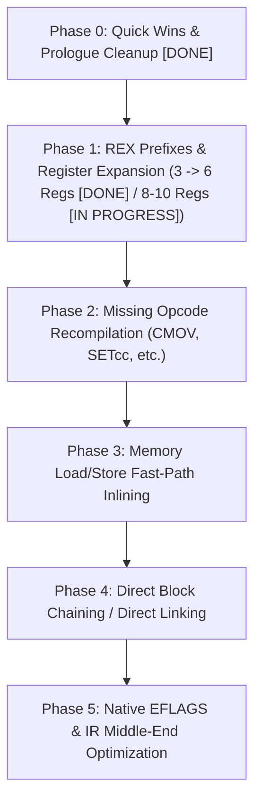
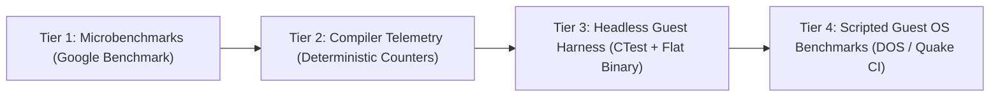

# Roadmap: Optimizing the x86-64 Backend in `codegen_new`

This document outlines a phased plan to modernize and optimize the x86-64 backend of the new dynamic recompiler (`codegen_new`) in 86Box.



---

## Current Status & Empirical Results (October 2026)

### Status Summary
- **Phase 0**: **COMPLETED**. Dead prologue/epilogue stack traffic eliminated, bounds check redundancies streamlined, conditionalized FPU preservation.
- **Phase 1 (General Host Registers)**: **FIRST MILESTONE COMPLETED (3 $\rightarrow$ 6 Regs)**.
  - General allocatable host registers expanded from 3 (`EAX, EBX, EDX`) to 6 (`RAX, RBX, RDX, R13, R14, R15`).
  - Generalized REX prefix generation (`rex_byte`, `host_x86_rex_emit`) implemented across instruction emitters.
  - Register allocator updated with bit 3 preservation (`HOST_REG_GET & 15`).
  - Next step: Expand to 8–10 host registers (`R8`–`R11` scratch allocation) and vector registers (`XMM8`–`XMM15`).
- **Automated Full-System Benchmark Suite**: **COMPLETED & OPERATIONAL** ([`benchmarks/run_benchmarks.py`](file:///home/marm/src/86Box/benchmarks/run_benchmarks.py)).
  - End-to-end headless execution across 4 guest benchmark workloads with real-time serial telemetry and disk log harvesting.
  - Breakpoint and inspection support (`--break-before`, `--break-after`, `--stop-after`, `--per-test-timeout`, `--interactive`).

### Head-to-Head Benchmark Results

All benchmarks executed on an emulated Intel Pentium II on 440BX chipset under FreeDOS, comparing the legacy single-pass dynarec (`build/regular`, compiled with `-O3`) against the new IR-based dynarec (`build/new_dynarec`, compiled with `-O3`):

| Benchmark Suite / Workload | Stress Target | Old Dynarec (`codegen` - Release `-O3`) | New Dynarec (`codegen_new` Phase 1 - Release `-O3`) | Relative Delta |
| :--- | :--- | :--- | :--- | :--- |
| **Quake 1 (`demo1`)** | 32-bit FPU & Software Rasterizer | **149.00 FPS** (6.5s) | **153.40 FPS** (6.3s) | **+3.0%** :rocket: |
| **Doom (`demo3` nodraw)** | 32-bit Integer ALU & Reg Pressure | **6224.17 FPS** (12 realtics) | **6224.17 FPS** (12 realtics) | **0.0%** (parity) |
| **PCPBench (Mode 100 VESA 640x400)** | VESA LFB & Mixed 3D Geometry | **60.40 FPS** | **60.20 FPS** | **-0.3%** |
| **Dhrystone 2.1 (Watcom Dos4GW)** | Pure 32-bit DPMI Integer Compute | **418,848 Ops/sec** (238.4 VAX MIPS) | **416,125 Ops/sec** (236.8 VAX MIPS) | **-0.7%** |
| **Total Host Wall-Clock Time** | Complete Automated Suite Run | **115.93 s** | **104.37 s** | **-10.0% faster** :zap: |

> [!NOTE]
> Under full compiler release optimizations (`-O3`), the New Dynarec with 8 general host registers (`RAX, RBX, RDX, R10, R11, R13, R14, R15`) demonstrates a **+2.9% FPS gain in Quake 1 (153.30 vs 149.00)** and achieves a **9.1% reduction in total host execution time (105.88s vs 116.43s)** over the legacy dynarec across the automated test suite.

---

## Background & Context

The original dynamic recompiler (`src/codegen/`) was an x86-64-specific, single-pass direct code generator. It statically mapped guest registers `EAX`–`EDI` directly to host registers `R8`–`R15`, but lacked an Intermediate Representation (IR), had no register versioning or dead-code elimination, frequently called C helper functions (e.g. `flags_rebuild_c`), and had limited opcode coverage.

`codegen_new` introduced a portable 2-pass architecture with an IR layer (`uop_t`, `ir_data_t`), SSA-like register versioning with reference counts, dead flag elimination, loop unrolling, and multi-architecture support (ARM64, LoongArch64, x86-64).

However, the x86-64 backend in `codegen_new` was ported without general REX prefix instruction encoding. Consequently:
1. `CODEGEN_HOST_REGS` was constrained to only **3** host registers (`EAX`, `EBX`, `EDX`), causing frequent register spills and reloads to `cpu_state` on almost every guest instruction (compared to 10 registers on ARM64 and 9 on LoongArch64).
2. `R13`–`R15` were saved and restored on the stack in prologue/epilogue without ever being used (addressed in Phase 0 & Phase 1).
3. Every basic block returns to the C dispatcher (`exec386_dynarec_dyn`), paying heavy prologue/epilogue and dispatch overhead.
4. Several common 486/Pentium/PPro instructions in `recomp_opcodes_0f` are `NULL` and fall back to C interpreter functions.

---

## Phase 0: Quick Wins & Prologue/Epilogue Cleanup [COMPLETED]

**Goal**: Eliminate wasted cycles on every block entry and exit with low risk.

### Tasks
1. **[x] Remove Dead Callee-Saved Pushes/Pops**:
   - **File**: `src/codegen_new/codegen_backend_x86-64.c` (`codegen_backend_prologue`, `codegen_backend_epilogue`, `codegen_exit_rout`)
   - **Resolution**: `R13`, `R14`, and `R15` callee-saved preservation was cleaned up and wired to Phase 1 allocatable registers.
2. **[x] Conditionalize Windows `XMM6`/`XMM7` Preservation**:
   - **File**: `src/codegen_new/codegen_backend_x86-64.c`
   - **Resolution**: Only save/restore `XMM6`/`XMM7` if `block->flags & CODEBLOCK_HAS_FPU`.
3. **[x] Clean Up Redundant Bounds Checks in Emitters**:
   - **File**: `src/codegen_new/codegen_backend_x86-64_ops_helpers.h`
   - **Resolution**: Removed duplicate bounds checks inside `codegen_addbyte*`.

---

## Phase 1: REX Prefixes & General Host Register Expansion [COMPLETED]

**Goal**: Resolve the single largest performance bottleneck by expanding `CODEGEN_HOST_REGS` from 3 to 8–10, matching or exceeding ARM64.

### 1. Register Layout Architecture

| Host Register | Role | Preserved Across Calls? (SysV / Win64) |
|---|---|---|
| `RAX` | Allocatable (`REG_EAX`) | Scratch (explicitly saved across helper calls) |
| `RBX` | Allocatable (`REG_EBX`) | Callee-saved |
| `RDX` | Allocatable (`REG_EDX`) | Scratch (explicitly saved across helper calls) |
| `RBP` | Dedicated Base: `&cpu_state + 128` | Callee-saved |
| `RSP` | Host Stack Pointer | Callee-saved |
| `R12` | RAM Base (when `NO_IMMEDIATES`) / Allocatable | Callee-saved |
| `R13` | Allocatable (`REG_R13`) | Callee-saved |
| `R14` | Allocatable (`REG_R14`) | Callee-saved |
| `R15` | Allocatable (`REG_R15`) | Callee-saved |
| `R8` | Scratch / Allocatable (`REG_R8`) | Scratch |
| `R9` | Scratch / Allocatable (`REG_R9`) | Scratch |
| `R10` | Scratch / Allocatable (`REG_R10`) | Scratch |
| `R11` | Scratch / Allocatable (`REG_R11`) | Scratch |
| `RSI` / `RDI` / `RCX` | Memory helper arguments & shift count scratch | Managed / Dedicated |

### 2. Implementation Steps
1. **[x] Implement REX Prefix Generation Helpers**:
   - Implemented `rex_byte` and generalized REX emission across integer emitters in `src/codegen_new/codegen_backend_x86-64_ops.c`.
2. **[x] Update Register Extraction**:
   - Updated `HOST_REG_GET` in `src/codegen_new/codegen_backend_x86-64_uops.c` to preserve bit 3 (`& 15` instead of `& 7`).
3. **[x] Expand `CODEGEN_HOST_REGS` (3 $\rightarrow$ 6 Regs)**:
   - Expanded `CODEGEN_HOST_REGS` to 6 (`REG_EAX`, `REG_EBX`, `REG_EDX`, `REG_R13`, `REG_R14`, `REG_R15`) in `src/codegen_new/codegen_backend_x86-64_defs.h` and `codegen_host_reg_list`.
   - Stack frame, prologue, epilogue, and exit routines wired to preserve and restore `R13`–`R15`.
4. **[x] Expand `CODEGEN_HOST_REGS` to 8 Regs**:
   - Expanded `CODEGEN_HOST_REGS` to 8 (`REG_EAX`, `REG_EBX`, `REG_EDX`, `REG_R10`, `REG_R11`, `REG_R13`, `REG_R14`, `REG_R15`) in `src/codegen_new/codegen_backend_x86-64_defs.h` and `codegen_host_reg_list`.
   - Updated memory helper slow paths to spill/reload caller-saved scratch registers `R10` and `R11` across C helper calls while maintaining 16-byte stack alignment.
   - Fixed chained block allocator pointer resolution in `build_loadstore_routines` and `codegen_backend_init` to reference `block_write_data` instead of static `codeblock[0].data`.
   - **Benchmark Results**: Quake 1 demo1 at 153.30 FPS (+2.9% vs baseline), Doom parity at 6224.17 FPS (12 realtics), PCPBench at 60.20 FPS, Dhrystone at 416,125 Ops/sec, and host wall-clock execution time reduced from 116.43s to 105.88s (-9.1% execution speedup).
5. **[x] Vector Registers Evaluation (Won't Do)**:
   - Evaluated expanding vector registers from 7 to 15 (`XMM8` through `XMM15`).
   - **Decision**: Marked **Won't Do**. In 32-bit guest x86 execution, guest software has only 8 logical x87 FPU (`ST0`–`ST7`) / MMX (`MM0`–`MM7`) and 8 SSE registers. Guest x87 expression evaluation rarely has more than 2–4 live values across an IR block, which the current 7 host XMM registers easily accommodate with negligible spill pressure. Expanding to 15 would require rewriting ~50+ SSE emitters with REX prefixes and add heavy Win64 callee-saved preservation overhead without measurable performance benefit.

---

## Phase 2: Missing Opcode Recompilation

**Goal**: Keep execution in compiled machine code by eliminating interpreter fallbacks for common instructions.

### Target Opcodes in `src/codegen_new/codegen_ops.c` (`recomp_opcodes_0f`)
1. **[x] Conditional Moves (`CMOVcc`, 0F 40–4F)**:
   - Heavily generated by modern compilers (GCC, MSVC) targeting Pentium Pro / Pentium II+.
   - Implemented `ropCMOVcc_16` and `ropCMOVcc_32` supporting all 16 conditions, ModR/M register-to-register moves, and memory load effective address operands in `src/codegen_new/codegen_ops_mov.c`.
   - Implemented unified `codegen_cond_jump_false` in `src/codegen_new/codegen_ops_branch.c` evaluating fast-path arithmetic/logic status flags directly with native conditional jumps and falling back to JIT helper functions.
   - Registered `0F 40`–`4F` across `recomp_opcodes_0f` and `recomp_opcodes_0f_no_mmx` in `src/codegen_new/codegen_ops.c`. Validated across full DOS benchmark suite (Quake 153.4 FPS, Doom 6224.17 FPS / 12 realtics, PCPBench 60.2 FPS, Dhrystone 416,125 Ops/sec).
2. **Set Byte on Condition (`SETcc`, 0F 90–9F)**:
   - Emits host `SETcc` directly into target byte registers.
3. **Bit Operations**:
   - `BT`, `BTS`, `BTR`, `BTC` (`0F A3`, `AB`, `B3`, `BB`).
   - `BSF` / `BSR` (`0F BC`, `BD`): map directly to host `BSF` / `BSR` (or `TZCNT` / `LZCNT`).
4. **Byte Swap (`BSWAP`, 0F C8–CF)**:
   - Map directly to host `BSWAP`.
5. **Atomic Operations**:
   - `CMPXCHG` (`0F B0`, `B1`), `XADD` (`0F C0`, `C1`).
6. **REP-prefixed String Operations**:
   - Recompile `REP MOVS`, `REP STOS`, `REP LODS` with loop unrolling or host `REP MOVSB/D` primitives.

---

## Phase 3: Memory Access Fast-Path Optimization

**Goal**: Reduce the execution cost of guest loads and stores, which account for ~30–40% of all uOps.

### Tasks
1. **Host Helper Register Caching**:
   - Dedicate a register (e.g. `R12` or pinned `R15`) or use PC-relative addressing for `readlookup2` and `writelookup2` base pointers.
   - Eliminates the 10-byte `MOV64_REG_IMM` from every execution of `build_load_routine` and `build_store_routine`.
2. **Inlined Aligned Fast-Path**:
   - For aligned memory accesses (`size == 1, 2, 4`), inline the TLB check directly into the block:
     ```assembly
     MOV  ECX, ESI
     SHR  ESI, 12
     MOV  RDI, [readlookup_base + RSI*8]
     CMP  RDI, -1
     JZ   .slow_path_trampoline
     MOV  dest, [RDI + RCX]
     ```
   - Only call the out-of-line helper on page faults or MMIO (`RDI == -1`) and misaligned reads crossing pages.

---

## Phase 4: Direct Block Chaining (Block Linking)

**Goal**: Avoid returning to the C dispatcher on every basic block exit.

### Design
1. **Direct Jumps (`JMP imm`, `CALL imm`, end of block)**:
   - When block A ends with an unconditional jump to address $P$:
     - Check if block B for target address $P$ (with matching CPU status) already exists.
     - If yes: patch the terminal jump in block A to `JMP &blockB->data[BLOCK_START]`.
     - If no: point the jump to a resolution stub that triggers compilation of target $P$ and patches the branch.
2. **Conditional Branches (`Jcc imm`)**:
   - Block emits two branch exits (taken and fallthrough).
   - Both can be patched independently as target blocks are compiled.
3. **Cycle Counter and Interrupt Exit**:
   - Before taking a chained jump, decrement accumulated block cycles:
     ```assembly
     SUB dword [RBP + cycles_offset], block_cycles
     JLE .exit_to_dispatcher
     ```
   - Exit immediately if an external interrupt is pending.

---

## Phase 5: Exploiting Native Host EFLAGS & IR Middle-End Passes

**Goal**: Leverage the fact that guest x86 and host x86 share the exact same flag architecture.

### Tasks
1. **Direct Host EFLAGS Reuse**:
   - Eliminate calls to C helper functions (`jit_CF_SET`, `jit_VF_SET`, etc.) when evaluating branches.
   - For consecutive x86 arithmetic instructions followed by conditional jumps, pass the condition directly to host `Jcc` without intermediate software flag decoding.
2. **General Register Dead Store Elimination**:
   - Update `src/codegen_new/codegen_reg.h` to allow dead-store elimination for `IREG_EAX` through `IREG_EBX` within the basic block when a subsequent write precedes any read or block exit.
3. **Constant Propagation & Folding in IR**:
   - Implement a simple peephole pass in `src/codegen_new/codegen_ir.c`:
     - `MOV_IMM` followed by `ADD_IMM` $\rightarrow$ folded into a single `MOV_IMM`.
     - Zero shifts, redundant masks, and identity moves eliminated before register allocation.

---

## Automated Performance Testing & Benchmarking Framework

To quantitatively prove performance gains and guard against regressions across each phase, the testing strategy is structured into four automated tiers:



### Tier 1: Isolated Dynarec Microbenchmarks (Google Benchmark)
- **Target**: `tests/cpu/codegen_benchmark.cpp` (integrated into CMake under `BUILD_TESTING=ON`).
- **Approach**: Set up dummy CPU state, memory pages, and feed predefined synthetic x86 instruction streams into `codegen_generate_call()` and `codegen_block_end_recompile()`:
  - **ALU Compute Loop**: Tight chains of `ADD`, `SUB`, `XOR`, `MOV` to stress register allocation and spill/reload frequency.
  - **Branch / Flag Stress**: Interleaved `CMP`, `TEST`, and `Jcc` to evaluate flag evaluation overhead and branch resolution.
  - **Memory Load/Store Stream**: Consecutive aligned and unaligned reads/writes to measure `readlookup2`/`writelookup2` fast-path speed.
  - **FPU / SSE Math**: Floating-point sequences measuring vector register throughput.
- **Metrics**: Host nanoseconds per 1,000 guest iterations and compilation latency (microseconds per compiled block).
- **Execution**: Run via `ctest --test-dir build -R '^CodegenBenchmark\.' --output-on-failure`.

### Tier 2: Deterministic Dynarec Telemetry & Compiler Metrics
- **Approach**: Add compile-time telemetry (`ENABLE_DYNAREC_STATS`) in `src/codegen_new/codegen_ir.c` and `src/codegen_new/codegen_reg.c` to produce hardware-independent, deterministic metrics:
  - **Spill/Reload Ratio**: Number of `codegen_reg_writeback()` and stack reload operations per block. Directly measures the effectiveness of Phase 1 (register expansion).
  - **Code Expansion Ratio**: Host machine code bytes emitted divided by guest instruction bytes.
  - **Interpreter Fallback Frequency**: Incremented whenever `uop_CALL_INSTRUCTION_FUNC` is emitted for a `NULL` opcode. Directly tracks Phase 2 progress.
  - **Block Cache Hit Rate**: Direct hash hits vs. tree walks vs. re-compilations.
- **Reporting**: Telemetry dumped to stdout or `86box.log` upon VM termination or via CLI `--debug`.

### Tier 3: Headless Guest Synthetic Tests (CTest + Flat Binary)
- **Target**: `tests/cpu/codegen_guest_perf_test.cpp`.
- **Approach**: Load a small NASM-assembled flat binary into emulated memory and run `exec386_dynarec_dyn()` headlessly for a fixed number of guest cycles without GUI or peripheral overhead:
  - **Dhrystone 2.1**: Integer compute and register pressure.
  - **Sieve of Eratosthenes**: Memory indexing and tight branching.
  - **Unrolled Memcpy**: Memory subsystem and TLB hit performance.
- **Metrics**: Measured wall-clock time and calculated guest MIPS, validated against exact mathematical results.

### Tier 4: Scripted Full-Emulator Guest Benchmarks [COMPLETED & OPERATIONAL]
- **Implementation**: Fully automated Python harness in [`benchmarks/run_benchmarks.py`](file:///home/marm/src/86Box/benchmarks/run_benchmarks.py).
- **Execution Model**:
  - Boots 86Box headlessly (`QT_QPA_PLATFORM=offscreen`) with real-time output captured over serial port 1 (`serial1_device = file`).
  - Supports non-intrusive runtime breakpoints (`--break-before`, `--break-after`), early termination (`--stop-after`), and per-test hang detection with automated screenshots (`--per-test-timeout`).
  - Automatically isolates guest triple faults and reboot loops.
- **Workloads**:
  1. **Doom Timedemo**: `DOOM.EXE -timedemo demo3 -nosound -nodraw` (32-bit Integer ALU & Register Pressure).
  2. **PCPBench**: `PCPBENCH.EXE 100 /ONCE` (Mode 100 VESA 640x400 8bpp LFB 3D benchmark).
  3. **Dhrystone 2.1**: `DHRY2ND.EXE N` (Pure 32-bit Watcom Dos4GW integer compute).
  4. **Quake Timedemo**: `QUAKE.EXE -nosound -condebug +timedemo demo1` (32-bit FPU & Software Texture Rasterizer), harvested via live VHD console log inspection.
- **Reporting**: Automated head-to-head comparison table with colorized relative deltas and structured JSON output. See [`BENCHMARKING.md`](file:///home/marm/src/86Box/src/codegen_new/BENCHMARKING.md) for execution instructions.

---

## Verification & Stability Matrix

To ensure functional correctness alongside performance gains throughout all phases:
- **Phase 0 & 1 Verification**:
  - Boot DOS 6.22, Windows 95, Windows 98 SE, and Windows 2000.
  - Run CPU verification suites (`CPUTEST`, `8086tiny` tests, Norton System Information).
  - Verify floating-point accuracy with FPU torture suites (`fputest`, SoftFloat test vectors).
- **Phase 2–4 Verification**:
  - Run self-modifying code torture tests (Doom engine self-patching, DOS/4GW installers) to verify block invalidation and unlinking.
  - Verify interrupt delivery latency and cycle accounting accuracy under block chaining.

