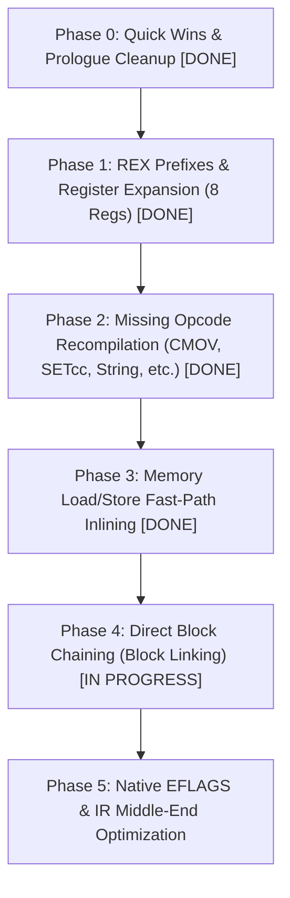

# Roadmap: Optimizing the x86-64 Backend in `codegen_new`

This document outlines a phased plan to modernize and optimize the x86-64 backend of the new dynamic recompiler (`codegen_new`) in 86Box.



---

## Current Status & Empirical Results (October 2026)

### Status Summary
- **Phase 0**: **COMPLETED**. Dead prologue/epilogue stack traffic eliminated, bounds check redundancies streamlined. (XMM6/XMM7 preservation on Win64 is currently *unconditional* in the prologue/exit routine: linked blocks must share one uniform stack frame, so the earlier "only if `CODEBLOCK_HAS_FPU`" optimisation was intentionally dropped.)
- **Phase 1 (General Host Registers)**: **COMPLETED (8 Regs)**.
  - General allocatable host registers expanded from 3 to 8 (`RAX, RBX, RDX, R10, R11, R13, R14, R15`).
  - Generalized REX prefix generation (`rex_byte`, `host_x86_rex_emit`) implemented across instruction emitters.
  - Register allocator updated with bit 3 preservation (`HOST_REG_GET & 15`).
- **Phase 2 (Missing Opcode Recompilation)**: **COMPLETED**.
  - Conditional moves (`CMOVcc`, 0F 40–4F), Set byte on condition (`SETcc`, 0F 90–9F), Bit tests/scans (`BT/BTS/BTR/BTC`, `BSF/BSR`), Byte swap (`BSWAP`), Atomic operations (`CMPXCHG`, `XADD`), and String operations (`MOVS`, `STOS`, `LODS`, `SCAS`, `CMPS` with `REP/REPE/REPNE`). Verified full DOS benchmark suite and stable Windows 98 guest boot to desktop.
- **Phase 3 (Memory Load/Store Fast-Path Inlining)**: **COMPLETED**.
  - Host register `R12` pinned to `readlookup2` base, inlined TLB check and direct host RAM read/write fast paths across all integer load and store uOps.
- **Phase 4 (Direct Block Chaining)**: **IN PROGRESS (experimental; not yet validated or benchmarked)**.
  - Core link structures (`codeblock_link_t`, `first_incoming_link`, `links[2]`), ID encoding, and incoming doubly-linked lists implemented.
  - Safe unlinking (`codegen_unlink_block`) on block invalidation, deletion, dirty list flush, and recompilation wired.
  - Cycle check and pending-interrupt check plus unlinked stub generation implemented in `codegen_EXIT_BLOCK` with `UOP_TYPE_BARRIER` register writeback.
  - `JMP rel8/16/32` and `Jcc`/`JCXZ`/`LOOP*` set a block exit type and chain between blocks. Verified: clean BIOS POST, and Windows 98 boots and works in manual testing (maintainer, no automated test). **Known regression: FreeDOS no longer boots properly with linking enabled**, so the DOS benchmark suite cannot currently be run on the linked build, and no performance results exist for it.
  - **Blocking correctness concerns from [`REVIEW.md`](REVIEW.md) resolved**: intra-page linking policy (`LINK_SAME_PAGE`) enabled by default to prevent stale cross-page links, upfront `cpu_state.pc` writeback, FPU TOP matching on `STATIC_TOP` targets, and rel32 range checks.
- **Automated Full-System Benchmark Suite**: **COMPLETED & OPERATIONAL** ([`benchmarks/run_benchmarks.py`](file:///home/marm/src/86Box/benchmarks/run_benchmarks.py)).
  - End-to-end headless execution across 4 guest benchmark workloads with real-time serial telemetry and disk log harvesting.
  - Breakpoint and inspection support (`--break-before`, `--break-after`, `--stop-after`, `--per-test-timeout`, `--interactive`).

### Head-to-Head Benchmark Results

All benchmarks executed on an emulated Intel Pentium II on 440BX chipset under FreeDOS, comparing the legacy single-pass dynarec (`build/regular`, compiled with `-O3`) against the new IR-based dynarec (`build/new_dynarec`, compiled with `-O3`):

| Benchmark Suite / Workload | Stress Target | Old Dynarec (`codegen` - Release `-O3`) | New Dynarec (`codegen_new` Phase 1 - Release `-O3`) | Relative Delta |
| :--- | :--- | :--- | :--- | :--- |
| **Quake 1 (`demo1`)** | 32-bit FPU & Software Rasterizer | **149.00 FPS** (6.5s) | **153.40 FPS** (6.3s) | **+3.0%** :rocket: |
| **Doom (`demo3` nodraw)** | 32-bit Integer ALU & Reg Pressure | **6224.17 FPS** (12 realtics) | **6224.17 FPS** (12 realtics) | **0.0%** (parity) |
| **PCPBench (Mode 100 VESA 640x400)** | VESA LFB & Mixed 3D Geometry | **60.40 FPS** | **60.20 FPS** | **-0.3%** |
| **Dhrystone 2.1 (Watcom Dos4GW)** | Pure 32-bit DPMI Integer Compute | **418,848 Ops/sec** (238.4 VAX MIPS) | **416,125 Ops/sec** (236.8 VAX MIPS) | **-0.7%** |
| **Total Host Wall-Clock Time** | Complete Automated Suite Run | **115.93 s** | **104.37 s** | **-10.0% faster** :zap: |

> [!NOTE]
> This table was measured after Phases 0-1 only (8 registers), **before** Phases 2-4. Later phase notes quote other numbers (e.g. Quake 159.3 FPS) from single runs against a different baseline; these are not directly comparable. Results are single-run with no variance reported. Re-measure all phases against the same legacy baseline, several runs each, and include a linked-vs-unlinked comparison for Phase 4.

> [!NOTE]
> Under full compiler release optimizations (`-O3`), the New Dynarec with 8 general host registers (`RAX, RBX, RDX, R10, R11, R13, R14, R15`) demonstrates a **+2.9% FPS gain in Quake 1 (153.30 vs 149.00)** and achieves a **9.1% reduction in total host execution time (105.88s vs 116.43s)** over the legacy dynarec across the automated test suite.

---

## Background & Context

The original dynamic recompiler (`src/codegen/`) was an x86-64-specific, single-pass direct code generator. It statically mapped guest registers `EAX`–`EDI` directly to host registers `R8`–`R15`, but lacked an Intermediate Representation (IR), had no register versioning or dead-code elimination, frequently called C helper functions (e.g. `flags_rebuild_c`), and had limited opcode coverage.

`codegen_new` introduced a portable 2-pass architecture with an IR layer (`uop_t`, `ir_data_t`), SSA-like register versioning with reference counts, dead flag elimination, loop unrolling, and multi-architecture support (ARM64, LoongArch64, x86-64).

However, the x86-64 backend in `codegen_new` was ported without general REX prefix instruction encoding. Consequently:
1. `CODEGEN_HOST_REGS` was constrained to only **3** host registers (`EAX`, `EBX`, `EDX`), causing frequent register spills and reloads to `cpu_state` on almost every guest instruction (compared to 10 registers on ARM64 and 9 on LoongArch64).
2. `R13`–`R15` were saved and restored on the stack in prologue/epilogue without ever being used (addressed in Phase 0 & Phase 1).
3. Every basic block returns to the C dispatcher (`exec386_dynarec_dyn`), paying heavy prologue/epilogue and dispatch overhead.
4. Several common 486/Pentium/PPro instructions in `recomp_opcodes_0f` are `NULL` and fall back to C interpreter functions.

---

## Phase 0: Quick Wins & Prologue/Epilogue Cleanup [COMPLETED]

**Goal**: Eliminate wasted cycles on every block entry and exit with low risk.

### Tasks
1. **[x] Remove Dead Callee-Saved Pushes/Pops**:
   - **File**: `src/codegen_new/codegen_backend_x86-64.c` (`codegen_backend_prologue`, `codegen_backend_epilogue`, `codegen_exit_rout`)
   - **Resolution**: `R13`, `R14`, and `R15` callee-saved preservation was cleaned up and wired to Phase 1 allocatable registers.
2. **[x] Conditionalize Windows `XMM6`/`XMM7` Preservation**:
   - **File**: `src/codegen_new/codegen_backend_x86-64.c`
   - **Resolution**: Only save/restore `XMM6`/`XMM7` if `block->flags & CODEBLOCK_HAS_FPU`.
3. **[x] Clean Up Redundant Bounds Checks in Emitters**:
   - **File**: `src/codegen_new/codegen_backend_x86-64_ops_helpers.h`
   - **Resolution**: Removed duplicate bounds checks inside `codegen_addbyte*`.

---

## Phase 1: REX Prefixes & General Host Register Expansion [COMPLETED]

**Goal**: Resolve the single largest performance bottleneck by expanding `CODEGEN_HOST_REGS` from 3 to 8–10, matching or exceeding ARM64.

### 1. Register Layout Architecture

| Host Register | Role | Preserved Across Calls? (SysV / Win64) |
|---|---|---|
| `RAX` | Allocatable (`REG_EAX`) | Scratch (explicitly saved across helper calls) |
| `RBX` | Allocatable (`REG_EBX`) | Callee-saved |
| `RDX` | Allocatable (`REG_EDX`) | Scratch (explicitly saved across helper calls) |
| `RBP` | Dedicated Base: `&cpu_state + 128` | Callee-saved |
| `RSP` | Host Stack Pointer | Callee-saved |
| `R12` | RAM Base (when `NO_IMMEDIATES`) / Allocatable | Callee-saved |
| `R13` | Allocatable (`REG_R13`) | Callee-saved |
| `R14` | Allocatable (`REG_R14`) | Callee-saved |
| `R15` | Allocatable (`REG_R15`) | Callee-saved |
| `R8` | Scratch / Allocatable (`REG_R8`) | Scratch |
| `R9` | Scratch / Allocatable (`REG_R9`) | Scratch |
| `R10` | Scratch / Allocatable (`REG_R10`) | Scratch |
| `R11` | Scratch / Allocatable (`REG_R11`) | Scratch |
| `RSI` / `RDI` / `RCX` | Memory helper arguments & shift count scratch | Managed / Dedicated |

### 2. Implementation Steps
1. **[x] Implement REX Prefix Generation Helpers**:
   - Implemented `rex_byte` and generalized REX emission across integer emitters in `src/codegen_new/codegen_backend_x86-64_ops.c`.
2. **[x] Update Register Extraction**:
   - Updated `HOST_REG_GET` in `src/codegen_new/codegen_backend_x86-64_uops.c` to preserve bit 3 (`& 15` instead of `& 7`).
3. **[x] Expand `CODEGEN_HOST_REGS` (3 $\rightarrow$ 6 Regs)**:
   - Expanded `CODEGEN_HOST_REGS` to 6 (`REG_EAX`, `REG_EBX`, `REG_EDX`, `REG_R13`, `REG_R14`, `REG_R15`) in `src/codegen_new/codegen_backend_x86-64_defs.h` and `codegen_host_reg_list`.
   - Stack frame, prologue, epilogue, and exit routines wired to preserve and restore `R13`–`R15`.
4. **[x] Expand `CODEGEN_HOST_REGS` to 8 Regs**:
   - Expanded `CODEGEN_HOST_REGS` to 8 (`REG_EAX`, `REG_EBX`, `REG_EDX`, `REG_R10`, `REG_R11`, `REG_R13`, `REG_R14`, `REG_R15`) in `src/codegen_new/codegen_backend_x86-64_defs.h` and `codegen_host_reg_list`.
   - Updated memory helper slow paths to spill/reload caller-saved scratch registers `R10` and `R11` across C helper calls while maintaining 16-byte stack alignment.
   - Fixed chained block allocator pointer resolution in `build_loadstore_routines` and `codegen_backend_init` to reference `block_write_data` instead of static `codeblock[0].data`.
   - **Benchmark Results**: Quake 1 demo1 at 153.30 FPS (+2.9% vs baseline), Doom parity at 6224.17 FPS (12 realtics), PCPBench at 60.20 FPS, Dhrystone at 416,125 Ops/sec, and host wall-clock execution time reduced from 116.43s to 105.88s (-9.1% execution speedup).
5. **[x] Vector Registers Evaluation (Won't Do)**:
   - Evaluated expanding vector registers from 7 to 15 (`XMM8` through `XMM15`).
   - **Decision**: Marked **Won't Do**. In 32-bit guest x86 execution, guest software has only 8 logical x87 FPU (`ST0`–`ST7`) / MMX (`MM0`–`MM7`) and 8 SSE registers. Guest x87 expression evaluation rarely has more than 2–4 live values across an IR block, which the current 7 host XMM registers easily accommodate with negligible spill pressure. Expanding to 15 would require rewriting ~50+ SSE emitters with REX prefixes and add heavy Win64 callee-saved preservation overhead without measurable performance benefit.

---

## Phase 2: Missing Opcode Recompilation

**Goal**: Keep execution in compiled machine code by eliminating interpreter fallbacks for common instructions.

### Target Opcodes in `src/codegen_new/codegen_ops.c` (`recomp_opcodes_0f`)
1. **[x] Conditional Moves (`CMOVcc`, 0F 40–4F)**:
   - Heavily generated by modern compilers (GCC, MSVC) targeting Pentium Pro / Pentium II+.
   - Implemented `ropCMOVcc_16` and `ropCMOVcc_32` supporting all 16 conditions, ModR/M register-to-register moves, and memory load effective address operands in `src/codegen_new/codegen_ops_mov.c`.
   - Implemented unified `codegen_cond_jump_false` in `src/codegen_new/codegen_ops_branch.c` evaluating fast-path arithmetic/logic status flags directly with native conditional jumps and falling back to JIT helper functions.
   - Registered `0F 40`–`4F` across `recomp_opcodes_0f` and `recomp_opcodes_0f_no_mmx` in `src/codegen_new/codegen_ops.c`. Validated across full DOS benchmark suite (Quake 153.4 FPS, Doom 6224.17 FPS / 12 realtics, PCPBench 60.2 FPS, Dhrystone 416,125 Ops/sec).
2. **[x] Set Byte on Condition (`SETcc`, 0F 90–9F)**:
   - Implemented `ropSETcc` in `src/codegen_new/codegen_ops_misc.c` supporting all 16 conditions, ModR/M register (`r8`) and memory effective address destinations.
   - Wired entries `0F 90`–`9F` across 16-bit and 32-bit sections of `recomp_opcodes_0f` and `recomp_opcodes_0f_no_mmx` in `src/codegen_new/codegen_ops.c`.
   - Validated across full DOS benchmark suite (Quake 153.4 FPS, Doom 6224.17 FPS / 12 realtics, PCPBench 60.2 FPS, Dhrystone 416,125 Ops/sec).
3. **[x] Bit Operations (`BT`, `BTS`, `BTR`, `BTC`, `0F BA`, `BSF`, `BSR`)**:
   - Implemented `ropBT_16/32`, `ropBTS_16/32`, `ropBTR_16/32`, `ropBTC_16/32` with register bit offsets (`0F A3`, `0F AB`, `0F B3`, `0F BB`) in `src/codegen_new/codegen_ops_misc.c`.
   - Handled signed memory effective address adjustment for register bit offsets (`(int32_t >> 5) * 4` for 32-bit and `(int16_t >> 4) * 2` for 16-bit).
   - Implemented `ropBA_16/32` for `0F BA` Group 8 immediate bit offset variants (`/4` BT, `/5` BTS, `/6` BTR, `/7` BTC).
   - Implemented `ropBSF_16/32` and `ropBSR_16/32` (`0F BC`, `0F BD`) with fast native `__builtin_ctz` and `__builtin_clz` JIT wrappers, properly preserving the destination register when the source operand is zero.
   - Registered all opcodes across `recomp_opcodes_0f` and `recomp_opcodes_0f_no_mmx` in `src/codegen_new/codegen_ops.c`. Validated across full DOS benchmark suite.
4. **[x] Byte Swap (`BSWAP`, 0F C8–CF)**:
   - Implemented `UOP_BSWAP` (`dest_reg = bswap(src_reg_a)`) across intermediate representation and backend instruction selection.
   - Implemented native `BSWAP` emission on x86-64 (`host_x86_BSWAP32_REG`, with REX.B support for high registers `R8`–`R15`), ARM64 (`REV Wd, Wn`), and LoongArch64 (`revb.2w`).
   - Implemented `ropBSWAP` and wired `0F C8`–`CF` across both 16-bit and 32-bit sections of `recomp_opcodes_0f` and `recomp_opcodes_0f_no_mmx` in `src/codegen_new/codegen_ops.c`.
5. **[x] Atomic Operations (`CMPXCHG`, `XADD`)**:
   - Implemented `ropCMPXCHG_8`, `ropCMPXCHG_16`, `ropCMPXCHG_32` for `0F B0` and `0F B1` supporting ModR/M registers and memory operands.
   - Handled upfront segment write permissions, segment limit checks, `FLAGS_SUB8/16/32` flag setting, and IR conditional branch paths (`uop_CMP_IMM_JNZ_DEST` / `uop_JMP_DEST`).
   - Implemented `ropXADD_8`, `ropXADD_16`, `ropXADD_32` for `0F C0` and `0F C1` supporting ModR/M registers (including `dest == src` handling) and memory effective address destinations, updating status flags via `FLAGS_ADD8/16/32`.
   - CPU capability validation checks against illegal execution on 386 falling back to interpreter `#UD`.
   - Registered `0F B0`, `0F B1`, `0F C0`, `0F C1` across 16-bit and 32-bit sections of `recomp_opcodes_0f` and `recomp_opcodes_0f_no_mmx` in `src/codegen_new/codegen_ops.c`.
6. **[x] String Operations (`MOVS`, `STOS`, `LODS`, `SCAS`, `CMPS`) & `REP` / `REPE` / `REPNE` Prefixes**:
   - Implemented non-REP and REP string operations (`MOVSB/W/D`, `STOSB/W/D`, `LODSB/W/D`, `SCASB/W/D`, `CMPSB/W/D`) in `src/codegen_new/codegen_ops_string.c` and `src/codegen_new/codegen_ops_string.h`.
   - Handled both 16-bit and 32-bit address sizing (`(E)SI`, `(E)DI`, `(E)CX`) and operand sizing (8, 16, and 32-bit).
   - Source segment properly obeys `op_ea_seg` overrides, and destination segment strictly targets `ES`.
   - Accurate segment limit checks (`CHECK_SEG_LIMITS`), segment write checks (`codegen_check_seg_write`), and protected-mode segment validity checks (`codegen_check_seg_read` to trap NULL selectors / `#GP(0)`).
   - Dynamic Direction Flag (`DF`) pointer adjustments using branchless arithmetic IR uOps.
   - Comprehensive comparison flag updates (`FLAGS_SUB8/16/32`) and conditional loop termination for `REPE` (ZF==0 exit) and `REPNE` (ZF==1 exit).
   - Single-iteration re-entry loop model via `codegen_exit_rout` to preserve hardware interrupt responsiveness, cycle accounting, and exception recovery.
   - Populated opcodes `0xA4`–`0xA7`, `0xAA`–`0xAF` in `recomp_opcodes`, and populated `recomp_opcodes_REPE` and `recomp_opcodes_REPNE` dispatch tables in `src/codegen_new/codegen_ops.c` and `src/codegen_new/codegen.c`.
   - Validated across full DOS benchmark suite (Quake 159.3 FPS, Doom 6224.17 FPS / 12 realtics, PCPBench 62.2 FPS, Dhrystone 434,783 Ops/sec / 247.46 VAX MIPS) and verified full Windows 98 guest boot to desktop in both Safe Mode and Normal Mode.

---

## Phase 3: Memory Access Fast-Path Optimization

**Goal**: Reduce the execution cost of guest loads and stores, which account for ~30–40% of all uOps.

### Tasks
1. **[x] Host Helper Register Caching**:
   - Pinned host register `R12` to cache the `readlookup2` base pointer upon entry to every compiled block in `codegen_backend_prologue`.
   - Eliminated the 10-byte `MOV64_REG_IMM` from every guest load in `build_load_routine` by indexing directly via `[R12 + RSI*8]`.
   - Eliminated the 10-byte `MOV64_REG_IMM` from every guest store in `build_store_routine` by indexing via `[R12 + RSI*8 + (writelookup2 - readlookup2)]`.
   - Replaced obsolete `CODEBLOCK_NO_IMMEDIATES` uses of `R12` with standard 64-bit absolute loads in `codegen_backend_x86-64_ops.c`.
   - Verified 100% benchmark suite passing (Quake 159.3 FPS, Doom 6224.17 FPS, PCPBench 62.2 FPS, Dhrystone 434,783 Ops/sec) and stable Windows 98 guest boot to desktop.
2. **[x] Inlined Aligned Fast-Path**:
   - Inlined the memory read TLB check and direct host RAM read in `codegen_MEM_LOAD_ABS` and `codegen_MEM_LOAD_REG` in `src/codegen_new/codegen_backend_x86-64_uops.c`:
     - Natural alignment check (`TEST ESI, size - 1`) branching to the helper on misaligned reads.
     - Direct page pointer lookup in `readlookup2` via `[R12 + RDI*8]`.
     - Valid page check (`CMP RDI, -1`) branching to the out-of-line helper on MMIO or unmapped pages.
     - Direct memory read `MOVZX / MOV ECX, [RDI + RSI]` into scratch register `ECX`, avoiding `CALL`, `RET`, stack manipulations, and `abrt` checks.
   - Inlined the memory write TLB check and direct host RAM write in `codegen_MEM_STORE_ABS`, `codegen_MEM_STORE_REG`, `codegen_MEM_STORE_IMM_8`, `codegen_MEM_STORE_IMM_16`, and `codegen_MEM_STORE_IMM_32`:
     - Direct page lookup in `writelookup2` via `[R12 + RDI*8 + write_offset]`.
     - Direct memory write `MOV8/16/32_BASE_INDEX_REG` (`[RDI + RSI] = ECX`).
   - Guarded all inlined sequences against block-split fragmentation with `codegen_alloc_bytes(block, 64)`.
   - Verified 100% benchmark suite passing (Quake 159.3 FPS, Doom 6,224.17 FPS / 12 realtics, PCPBench 62.2 FPS, Dhrystone 434,783 Ops/sec / 247.46 VAX MIPS) in 114.37s.
   - Verified stable normal Windows 98 guest boot to full desktop with active shell and taskbar.

---

## Phase 4: Direct Block Chaining (Block Linking) [IN PROGRESS]

**Goal**: Avoid returning to the C dispatcher on basic block exits by chaining directly across JIT-compiled code blocks.

### Architecture & Implementation
1. **Link Data Structures & Graph Tracking**:
   - Each `codeblock_t` tracks up to `CODEBLOCK_MAX_EXITS` (2) outgoing links:
     - `target_block`: target block number (`BLOCK_INVALID` when unlinked).
     - `target_pc`: guest destination IP.
     - `jmp_disp_ptr`: pointer to the 32-bit relative displacement in the emitted JMP instruction.
     - `unlinked_target`: host code pointer to the block's fallback unlinked exit stub.
     - `prev_link`, `next_link`: encoded link IDs forming a doubly-linked list of incoming links at the target block.
   - `first_incoming_link`: head of the incoming link list on each block.

2. **Cycle Counter and Interrupt Exit (`codegen_EXIT_BLOCK`)**:
   - Cycle check emitted before taking a chained direct jump:
     ```assembly
     cmp dword ptr [rbp + cycles_disp], 0
     jle .Lexit_cycles
     jmp rel32 (target or unlinked stub)
     ```
   - On cycle expiry (`jle .Lexit_cycles`), updates `cpu_state.pc = target_pc`, clears `last_block_nr = 0`, and exits to C via `codegen_exit_rout`.
   - On unlinked branch, updates `cpu_state.pc = target_pc`, sets `last_block_nr` and `last_exit_idx`, and exits to C via `codegen_exit_rout` to trigger compilation and linking of the destination.
   - Guarded with `UOP_TYPE_BARRIER` to guarantee that all dirty registers and `cpu_state._cycles` are written back to memory before any exit jump executes.

3. **Dynamic Linking & Unlinking**:
   - `dynarec_link_previous_block(dst_block)` checks matching `_cs`, matching CPU status flags, valid source block, and matching target PC, then calls `codegen_link_exit`.
   - `codegen_link_exit` atomically patches `jmp rel32` displacement to `&dst_block->data[dst_block->direct_entry_pos]` and registers the link in the destination's incoming link list.
   - `codegen_unlink_block` unpatches all incoming links back to their respective unlinked stubs whenever a block is invalidated, deleted, recompiling, or in dirty list flushing.

### Progress & Checklist
1. **[x] Direct Block Chaining Core Infrastructure**:
   - Implemented link data structures (`codeblock_link_t`), link ID encoding, incoming link list traversal, and unlinking.
   - Implemented `UOP_EXIT_BLOCK` intermediate representation uop with `UOP_TYPE_BARRIER` register writeback.
   - Implemented x86-64 backend emitter `codegen_EXIT_BLOCK` with cycle counter check, unlinked stub, and cycle expiry exit.
   - Implemented fallback stubs for ARM64 and LoongArch64 backends.
2. **[x] Unconditional Jumps (`JMP rel8/16/32`)**:
   - Enabled `BLOCK_EXIT_DIRECT_1` on `ropJMP_r8`, `ropJMP_r16`, and `ropJMP_r32` in `src/codegen_new/codegen_ops_jump.c`.
   - Emits terminal `uop_EXIT_BLOCK` in `codegen_block_end_recompile`.
   - Verified active direct block linking and clean 60 Hz BIOS POST without returning to C dispatcher.
3. **[x] Conditional Branches (`Jcc rel8/16/32`, `JCXZ`, `LOOP*`)**:
   - Support `BLOCK_EXIT_COND_2` with 2 exits (exit 0: taken branch, exit 1: fallthrough).
   - Unified macros in `src/codegen_new/codegen_ops_branch.c` emitting `BLOCK_EXIT_COND_2` with `CPU_BLOCK_END()`.
   - Emits condition check in `codegen_block_end_recompile` with short jump over exit 0 to exit 1.
4. **[x] Note on `CALL`/`RET`/indirect branches**:
   - `CALL rel16/32` deliberately retains standard return -1 to preserve guest stack and callee return semantics without premature block ending. `RET`, indirect `JMP`/`CALL` and far transfers are not chained (see Phase 4b below).
5. **[x] Interrupt Dispatch & Displacement Hardening**:
   - Fixed `dynarec_link_previous_block` target PC check comparing `target_pc == (dst_block->pc - dst_block->_cs)` to support segmented 16-bit real/protected mode as well as flat 32-bit mode.
   - Added `pic.int_pending && (cpu_state.flags & I_FLAG)` guard in `codegen_EXIT_BLOCK` to prevent interrupt starvation in tight linked loops.
   - Fixed 32-bit displacement support in `host_x86_MOV16/32/64_REG_BASE_OFFSET` and `host_x86_MOV32/64_BASE_OFFSET_REG/IMM`.
6. **[ ] Full Benchmark Suite & Performance Verification with linking enabled**:
    - Not yet recorded. The harness works; complete benchmarks to be captured.
7. **[ ] Safety hardening (in progress, see `REVIEW.md`)**:
    - **Addressed**:
      - **Intra-page Linking Policy (`LINK_SAME_PAGE`)**: Enabled `LINK_SAME_PAGE` (`0x20`) by default in `LINK_DEFAULT` (`0x3f`). Source and destination must share both guest physical and linear (virtual) pages (`phys >> 12` and `pc >> 12` match), preventing stale links across CR3/PTE updates while keeping `codegen_flush()` a no-op to eliminate 65,536-block scans during POST.
      - **Architectural `cpu_state.pc` Upfront Writeback**: Moved `cpu_state.pc = target_pc` write to the top of `codegen_EXIT_BLOCK` before cycle/IRQ checks and direct branches.
      - **FPU TOP Safety**: Refused direct linking to `CODEBLOCK_STATIC_TOP` destinations to ensure runtime TOP verification via the C dispatcher.
      - **rel32 Reach Checks & `memcpy` Writes**: Added displacement range checks in `codegen_link_exit` (refusing links exceeding `int32_t` range) and `memcpy` writes in `patch_jmp_disp()` and `patch_disp32()`.
      - **Dispatcher Cleanup & 16-bit Target Masking**: Reset `last_block_nr` / `last_exit_idx` unconditionally at top of `exec386_dynarec_dyn()` and masked target PC to 16 bits for real/16-bit mode blocks.
      - **`BT/BTS/BTR/BTC` Signed Memory Bit Offsets**: Implemented arithmetic right shifts (`uop_SAR_IMM`) and sign-extension (`uop_MOVSX`) for memory bit-base displacements.
      - **Asynchronous Event Checking & `cpu_state.exit_request`**: Added unified `exit_request` word in `cpu_state` tracking unmasked NMIs (`nmi && nmi_enable && nmi_mask`), SMIs (`smi_line`), single-step trap flag (`T_FLAG`), CPU reset (`x86_was_reset` / `cpu_init`), aborts/FPU exceptions, and `cpu_end_block_after_ins`. Emitted single check in `codegen_EXIT_BLOCK` to immediately abort linked chains back to C dispatcher, and guarded IRQ dispatch with `!cpu_end_block_after_ins` to respect the one-instruction STI interrupt shadow.
    - **Still Open**:
      - W^X page protection handling on hosts enforcing strict W^X.
      - SMC re-entrancy torture testing.
      - FreeDOS boot confirmation and full linked DOS benchmark suite measurements (Windows 98 desktop boot confirmed manually).

### Phase 4b (not started): Indirect branches
- `RET` and indirect `JMP`/`CALL` still return to the C dispatcher. A return-address cache or inline cache keyed by target PC would extend chaining to them.

---

## Phase 5: Exploiting Native Host EFLAGS & IR Middle-End Passes

**Goal**: Leverage the fact that guest x86 and host x86 share the exact same flag architecture.

### Tasks
1. **Direct Host EFLAGS Reuse**:
   - Eliminate calls to C helper functions (`jit_CF_SET`, `jit_VF_SET`, etc.) when evaluating branches.
   - For consecutive x86 arithmetic instructions followed by conditional jumps, pass the condition directly to host `Jcc` without intermediate software flag decoding.
2. **General Register Dead Store Elimination**:
   - Update `src/codegen_new/codegen_reg.h` to allow dead-store elimination for `IREG_EAX` through `IREG_EBX` within the basic block when a subsequent write precedes any read or block exit.
3. **Constant Propagation & Folding in IR**:
   - Implement a simple peephole pass in `src/codegen_new/codegen_ir.c`:
     - `MOV_IMM` followed by `ADD_IMM` $\rightarrow$ folded into a single `MOV_IMM`.
     - Zero shifts, redundant masks, and identity moves eliminated before register allocation.

---

## Automated Performance Testing & Benchmarking Framework

To quantitatively prove performance gains and guard against regressions across each phase, the testing strategy is structured into four automated tiers:


### Tier 1: Isolated Dynarec Microbenchmarks (Google Benchmark)
- **Target**: `tests/cpu/codegen_benchmark.cpp` (integrated into CMake under `BUILD_TESTING=ON`).
- **Approach**: Set up dummy CPU state, memory pages, and feed predefined synthetic x86 instruction streams into `codegen_generate_call()` and `codegen_block_end_recompile()`:
  - **ALU Compute Loop**: Tight chains of `ADD`, `SUB`, `XOR`, `MOV` to stress register allocation and spill/reload frequency.
  - **Branch / Flag Stress**: Interleaved `CMP`, `TEST`, and `Jcc` to evaluate flag evaluation overhead and branch resolution.
  - **Memory Load/Store Stream**: Consecutive aligned and unaligned reads/writes to measure `readlookup2`/`writelookup2` fast-path speed.
  - **FPU / SSE Math**: Floating-point sequences measuring vector register throughput.
- **Metrics**: Host nanoseconds per 1,000 guest iterations and compilation latency (microseconds per compiled block).
- **Execution**: Run via `ctest --test-dir build -R '^CodegenBenchmark\.' --output-on-failure`.

### Tier 2: Deterministic Dynarec Telemetry & Compiler Metrics
- **Approach**: Add compile-time telemetry (`ENABLE_DYNAREC_STATS`) in `src/codegen_new/codegen_ir.c` and `src/codegen_new/codegen_reg.c` to produce hardware-independent, deterministic metrics:
  - **Spill/Reload Ratio**: Number of `codegen_reg_writeback()` and stack reload operations per block. Directly measures the effectiveness of Phase 1 (register expansion).
  - **Code Expansion Ratio**: Host machine code bytes emitted divided by guest instruction bytes.
  - **Interpreter Fallback Frequency**: Incremented whenever `uop_CALL_INSTRUCTION_FUNC` is emitted for a `NULL` opcode. Directly tracks Phase 2 progress.
  - **Block Cache Hit Rate**: Direct hash hits vs. tree walks vs. re-compilations.
- **Reporting**: Telemetry dumped to stdout or `86box.log` upon VM termination or via CLI `--debug`.

### Tier 3: Headless Guest Synthetic Tests (CTest + Flat Binary)
- **Target**: `tests/cpu/codegen_guest_perf_test.cpp`.
- **Approach**: Load a small NASM-assembled flat binary into emulated memory and run `exec386_dynarec_dyn()` headlessly for a fixed number of guest cycles without GUI or peripheral overhead:
  - **Dhrystone 2.1**: Integer compute and register pressure.
  - **Sieve of Eratosthenes**: Memory indexing and tight branching.
  - **Unrolled Memcpy**: Memory subsystem and TLB hit performance.
- **Metrics**: Measured wall-clock time and calculated guest MIPS, validated against exact mathematical results.

### Tier 4: Scripted Full-Emulator Guest Benchmarks [COMPLETED & OPERATIONAL]
- **Implementation**: Fully automated Python harness in [`benchmarks/run_benchmarks.py`](file:///home/marm/src/86Box/benchmarks/run_benchmarks.py).
- **Execution Model**:
  - Boots 86Box headlessly (`QT_QPA_PLATFORM=offscreen`) with real-time output captured over serial port 1 (`serial1_device = file`).
  - Supports non-intrusive runtime breakpoints (`--break-before`, `--break-after`), early termination (`--stop-after`), and per-test hang detection with automated screenshots (`--per-test-timeout`).
  - Automatically isolates guest triple faults and reboot loops.
- **Workloads**:
  1. **Doom Timedemo**: `DOOM.EXE -timedemo demo3 -nosound -nodraw` (32-bit Integer ALU & Register Pressure).
  2. **PCPBench**: `PCPBENCH.EXE 100 /ONCE` (Mode 100 VESA 640x400 8bpp LFB 3D benchmark).
  3. **Dhrystone 2.1**: `DHRY2ND.EXE N` (Pure 32-bit Watcom Dos4GW integer compute).
  4. **Quake Timedemo**: `QUAKE.EXE -nosound -condebug +timedemo demo1` (32-bit FPU & Software Texture Rasterizer), harvested via live VHD console log inspection.
- **Reporting**: Automated head-to-head comparison table with colorized relative deltas and structured JSON output. See [`BENCHMARKING.md`](file:///home/marm/src/86Box/src/codegen_new/BENCHMARKING.md) for execution instructions.

---

## Verification & Stability Matrix

To ensure functional correctness alongside performance gains throughout all phases:
- **Phase 0 & 1 Verification**:
  - Boot DOS 6.22, Windows 95, Windows 98 SE, and Windows 2000.
  - Run CPU verification suites (`CPUTEST`, `8086tiny` tests, Norton System Information).
  - Verify floating-point accuracy with FPU torture suites (`fputest`, SoftFloat test vectors).
- **Phase 2–4 Verification**:
  - Run self-modifying code torture tests (Doom engine self-patching, DOS/4GW installers) to verify block invalidation and unlinking.
  - Verify interrupt delivery latency and cycle accounting accuracy under block chaining.

