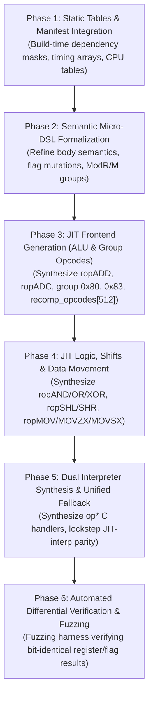

# Roadmap: Declarative CPU Architecture & Metacompiler Framework (`cpus/`)

This document outlines the architectural roadmap for migrating 86Box's CPU emulation—both the dynamic recompiler (`codegen_new`) frontend and the interpreter runtime (`src/cpu/`)—to a unified, declarative, specification-driven framework rooted in `src/codegen_new/cpus/`.



---

## 1. Architectural Vision & Mission

86Box currently maintains two parallel, handwritten implementations for x86 instruction execution:
1. **The Dynamic Recompiler Frontend (`src/codegen_new/codegen_ops_*.c`)**: ~25,000 lines of repetitive C translating x86 instructions into `uop_t` intermediate representation.
2. **The Software Interpreter (`src/cpu/x86_ops_*.h`, `386.c`, `cpu_table.c`)**: ~30,000 lines of C macros executing instructions directly on `cpu_state_t`.

### The Duplication Problem
- **Semantic Drift**: Bugfixes applied to JIT instruction handlers (e.g., ModR/M register decode quirks, lazy flag tags) are frequently omitted from the interpreter, and vice versa.
- **Copy-Paste Vulnerabilities**: Manual encoding of hundreds of instruction variants results in subtle errors: inverted `reg` vs `rm` fields, incorrect 8-bit high-byte register indexing (`AH/CH/DH/BH` vs `IREG_8`), or premature register mutation prior to faulting memory writes.
- **Maintenance Burden**: Adding support for new CPU models or coprocessors requires updating multiple disparate tables, CPUID masks, and timing arrays across `src/cpu/` and `src/codegen_new/`.

### The Solution: Declarative Single Source of Truth
The `cpus/` directory establishes declarative YAML manifests and specifications as the authoritative source of truth. The metacompiler (`x86gen.py`) compiles these specifications directly into:
- CPU model configuration tables and CPUID definitions.
- Microarchitectural pipeline, pairing, and execution timing tables.
- Instruction availability and `#UD` invalid-opcode dispatch tables.
- Dynamic recompiler instruction handlers emitting `uop_t` IR (`gen_recomp_ops.c`).
- Software interpreter instruction handlers (`gen_interp_ops.c`).

---

## 2. Current Status & Component Audit (October 2026)

| Component Subdirectory | Scope & Coverage | Maturity | Status / Readiness |
| :--- | :--- | :--- | :--- |
| **`timings/`** | 12 profiles (8086, 186, 286, 386, 486, Pentium, P6, P4, K6, K7, Cyrix 6x86, classes) | **High** | Accurately models unpipelined microcode, scalar 5-stage pipelines, U/V pairing rules, prefix stalls, and out-of-order execution ports. |
| **Vendor CPU Manifests** | 44 models across 10 vendors (Intel, AMD, Cyrix, VIA, Transmeta, NexGen, Rise, IBM, NEC, DM&P) | **High** | Covers 1978–2007 from 8088 to Pentium 4 / Athlon XP / Geode. Accurately declares ISA level, feature flags, stepping, and cache topology. |
| **`registers/`** | 7 files (GPR, Segments, Flags, Control/Debug, FPU/MMX, XMM/MXCSR, MSR) | **High** | Fully specifies bitfields, sub-register aliasing, and architectural reset states. |
| **`fpus/`** | 15 profiles (11 discrete, 4 integrated) | **High** | Specifies bus protocols, IEEE-754 precision, cycle timings, and coprocessor interface types (8087 through Weitek and K7 FPU). |
| **`isa/`** | 15 YAML specifications (164 families, 235 primary opcodes, 102 0F opcodes) | **Medium-High** | Covers arithmetic, logic, mov, branch, stack, string, SIMD (MMX, SSE, SSE2, 3DNow!, PadLock). |
| **Static Verification (`x86gen.py --verify`)** | 236 non-prefix opcodes checked against `src/cpu/codegen_timing_common.c` | **100% Match** | **236 / 236 opcodes identical** to handwritten runtime tables for both `opcode_deps` and `opcode_deps_mod3`. |
| **JIT / Interpreter Emitters (`x86gen.py`)** | Prototype generation for basic `ALU_BINARY` and `ALU_COMPARE` | **Proof of Concept** | Demonstrates feasibility; requires adaptation to real 86Box IR micro-operations and dispatch tables. |

---

## 3. Key Technical Challenges & Target Invariants

Before JIT and interpreter code generators can replace handwritten C files, the generator must enforce the core runtime invariants of 86Box:

### 3.1. Alignment with 86Box IR (`codegen_ir_defs.h`)
- **No Non-Existent UOPs**: The prototype generator previously referenced nonexistent uops (`uop_ADC`, `uop_SBB`). In 86Box:
  - `ADC` is lowered by fetching the carry flag (`get_cf(ir, temp)` calling `jit_CF_SET`) followed by `uop_ADD`.
  - `SBB` is lowered similarly using borrow evaluation.
- **Register Sizing & Aliasing**:
  - Byte registers must use `IREG_8(reg)`, mapping register numbers 4..7 to high-byte registers (`AH, CH, DH, BH`).
  - Word registers must use `IREG_16(reg)`, and dword registers use `IREG_32(reg)`.
  - Memory load/store sizes in `codegen_new` are determined by the destination/source register variant:
    - Byte: `uop_MEM_LOAD_REG(ir, IREG_temp0_B, seg, addr)`
    - Word: `uop_MEM_LOAD_REG(ir, IREG_temp0_W, seg, addr)`
    - Dword: `uop_MEM_LOAD_REG(ir, IREG_temp0, seg, addr)`

### 3.2. Fault Atomicity & Rollback
- In x86 protected mode, a memory write can trigger a Page Fault (`#PF`) or General Protection Fault (`#GP`).
- **Invariant**: Guest register state and lazy-flag variables must **never** be modified before all memory addresses and permissions have been checked:
  ```c
  uop_MOV_IMM(ir, IREG_oldpc, cpu_state.oldpc);
  target_seg = codegen_generate_ea(ir, op_ea_seg, fetchdat, op_ssegs, &op_pc, op_32, 0);
  codegen_check_seg_write(block, ir, target_seg);
  ```

### 3.3. Dispatch Table Architecture
- Handlers must fit the 512-entry indexing scheme used by `src/codegen_new/codegen.c`:
  - `recomp_opcodes[512]`: Primary opcodes (0x00..0xFF for 16-bit operand size, 0x100..0x1FF for 32-bit).
  - `recomp_opcodes_0f[512]`: 0F-escaped two-byte opcodes.
  - Group dispatch tables: `rop80`, `rop81_w`, `rop81_l`, `rop83_w`, `rop83_l`, `ropC0`, `ropC1_w`, `ropC1_l`, `ropD0..D3`, `ropF6..F7`, `ropFF`.

---

## 4. Phased Implementation Roadmap

### Phase 1: Static Tables & Manifest Integration (Build-Time Synthesis)
**Goal**: Integrate `x86gen.py` into the CMake build pipeline to synthesize static tables, eliminating handwritten duplications with zero risk to CPU core execution.

- [ ] **1.1. CMake Build Step for Dependency Tables**:
  - Add a custom build target executing `python3 src/codegen_new/cpus/x86gen.py --emit-deps-c ${CMAKE_CURRENT_BINARY_DIR}/codegen_timing_generated.c`.
  - Replace handwritten `opcode_deps` and `opcode_deps_mod3` in `src/cpu/codegen_timing_common.c` with the generated source.
- [ ] **1.2. Microarchitecture Timing Arrays**:
  - Extend `x86gen.py` to synthesize `pair_timings` for Pentium (P54C/P55C), 486 pipeline tables, and P6 port dispatch from `timings/*.yaml`.
  - Validate output against `src/cpu/codegen_timing_pentium.c` and `codegen_timing_486.c`.
- [ ] **1.3. CPU & FPU Manifest Table Refactoring**:
  - Synthesize C struct arrays for `cpu_table.c` (CPU model names, default internal names, CPUID, voltage, packages, and coprocessor support lists) directly from `cpus/*/*.yaml` and `cpus/fpus/*/*.yaml`.
  - Shrink the 8,460-line handwritten `src/cpu/cpu_table.c`.

### Phase 2: Formal Semantic Micro-DSL [COMPLETED]
**Goal**: Upgrade the `semantics:` blocks in `isa/*.yaml` from ad-hoc strings to a formal, structured micro-operation grammar.

- [x] **2.1. Standardize Instruction Semantics Schema**:
  - Defined explicit primitive semantic nodes across `types_and_operands.yaml`, `arithmetic.yaml`, `logic_and_bit.yaml`, `shift_rotate.yaml`, and `mov_and_transfer.yaml`:
    - `op: ADD | SUB | AND | OR | XOR | SHL | SHR | SAR | ROL | ROR | NOT | NEG | MOV | MOVZX | MOVSX | BSWAP`
    - `carry: none | in | out | in_out`
    - `inputs: [dst, src]` / `output: dst | none`
    - `fault_policy: FAULT_ATOMIC | READ_ONLY | NONE`
    - `flags: { tag: FLAGS_ADD, update: [CF, OF, SF, ZF, AF, PF], preserve: [CF], forced_clear: [CF, OF], undefined: [AF] }`
- [x] **2.2. ModR/M Group Definition Structure**:
  - Formalized all 7 core group tables (`group_1`, `group_2`, `group_3`, `group_4`, `group_5`, `group_8`, `group_11`) in `types_and_operands.yaml`.
  - Added group and sub-code tags (`group: group_1, group_ext: 0..7`) in instruction maps.
  - Implemented `x86gen.py --groups` CLI command to display and inspect group tables.
- [x] **2.3. Immediate and Operand Width Representation**:
  - Specified fetching and sign-extension rules for `Ib`, `Iv`, `Ib_sext`, `Iw`, `Id`, `Jb`, `Jv` in `immediate_encodings`.
  - Implemented `x86gen.py --semantics <mnemonic>` CLI tool to inspect the formal micro-semantics of any instruction family.
  - Upgraded `emit_jit_ops` to generate real `uop_t` lowerings for `ADC`, `SBB` (via `get_cf`), `NOT` (via `uop_XOR_IMM`), and `NEG` (via `uop_SUB 0 - reg`).

### Phase 3: JIT Frontend Generation (ALU & Group Opcodes)
**Goal**: Auto-generate complete, production-ready JIT handlers and group decoders for all integer arithmetic operations, replacing `codegen_ops_arith.c`.

- [ ] **3.1. Recompiler Emitter Engine**:
  - Refactor `x86gen.py:emit_jit_ops` to generate:
    - Register-to-register, memory-to-register, and register-to-memory variants.
    - Full operand sizing (8-bit, 16-bit, 32-bit with proper `IREG_8/16/32` selectors).
    - Accurate `get_cf()` lowering for `ADC` and `SBB`.
- [ ] **3.2. Synthesize Group Dispatchers**:
  - Auto-generate `rop80`, `rop81_w`, `rop81_l`, `rop83_w`, `rop83_l`.
- [ ] **3.3. Table Slice Synthesis**:
  - Generate the primary arithmetic slice (0x00..0x3F, 0x80..0x83) for `recomp_opcodes[512]`.
- [ ] **3.4. Verification against Existing Handlers**:
  - Run side-by-side assembly/IR comparison between handwritten `codegen_ops_arith.c` and generated output on identical test blocks.

### Phase 4: JIT Logic, Shifts & Data Movement
**Goal**: Extend the generator across logic, bit test/scan, shift/rotate, and move instructions.

- [ ] **4.1. Logic & Bit Operations**:
  - Synthesize `AND, OR, XOR, TEST, NOT, NEG`.
  - Synthesize `BT, BTS, BTR, BTC, BSF, BSR`.
- [ ] **4.2. Shifts and Rotates**:
  - Generate `SHL, SHR, SAR, ROL, ROR, RCL, RCR` (constant 1, immediate count, and `%cl` register variants).
  - Generate double-precision shifts (`SHLD`, `SHRD`).
- [ ] **4.3. Data Movement & Extensions**:
  - Synthesize `MOV` (reg/mem, immediate, segment register loads).
  - Synthesize `MOVZX` and `MOVSX` (byte-to-word, byte-to-dword, word-to-dword).
  - Synthesize `XCHG` (handling implicit `LOCK` prefix on memory operands).

### Phase 5: Dual Interpreter Synthesis & Unified Fallback
**Goal**: Synthesize interpreter opcode handlers from the identical declarative specifications, achieving guaranteed lockstep parity.

- [ ] **5.1. Interpreter Opcode Emitter**:
  - Generate C interpreter functions adhering to `int (*)(uint32_t fetchdat)`:
    - Register reads/writes (`getr8/16/32`, `setr8/16/32`).
    - ModR/M EA decoding (`fetch_ea_16`, `fetch_ea_32`, `geteab/w/l`, `seteab/w/l`).
    - Cycle timing and prefetch tracking (`CLOCK_CYCLES`, `PREFETCH_RUN`).
- [ ] **5.2. Unified Fallback Execution**:
  - Wire uncompiled or self-modifying code fallback (`uop_CALL_INSTRUCTION_FUNC`) directly to synthesized interpreter functions.

### Phase 6: Automated Differential Verification & Fuzzing
**Goal**: Build a formal verification pipeline ensuring 100% architectural compliance and zero regression.

- [ ] **6.1. Unit Test Harness (`tests/test_cpus_synth.c`)**:
  - Harness executing instructions across all addressing modes and register combinations.
- [ ] **6.2. Differential Fuzzing**:
  - Compare execution results of:
    1. Generated JIT (`gen_recomp_ops.c`)
    2. Generated Interpreter (`gen_interp_ops.c`)
    3. Handwritten reference core
  - Check identical post-instruction GPRs, EFLAGS, and memory modifications.
- [ ] **6.3. Guest OS Boot Validation**:
  - Validate clean boot and benchmark execution on MS-DOS 6.22, Windows 95 OSR2, and Windows 98 SE.

---

## 5. Success Metrics

1. **Code Reduction**: Eliminate >20,000 lines of duplicated handwritten C across `src/codegen_new/` and `src/cpu/`.
2. **Timing Accuracy**: 100% verified match across all CPU timing tables and dependency masks.
3. **Parity**: 0 discrepancies in register or flag state between JIT and interpreter execution paths during full-system OS boot tests.
4. **Maintenance Velocity**: Adding a new x86 CPU or custom opcode extension (e.g. VIA PadLock, AMD Geode instructions) requires only adding a YAML manifest, with zero manual C recompiler boilerplate.

