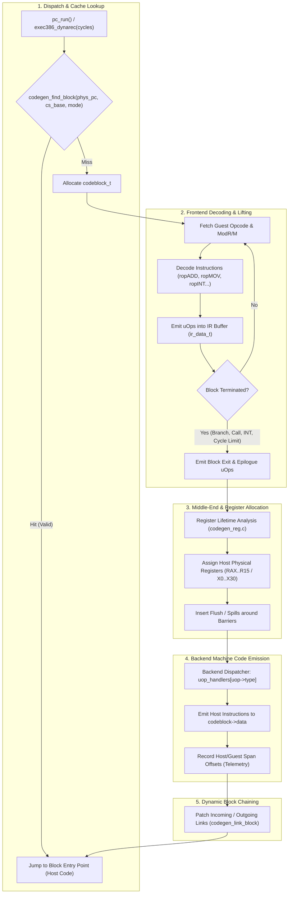
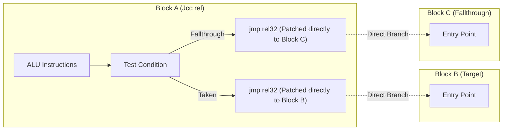

# Architecture of the 86Box Dynamic Recompiler (`codegen_new`)

## 1. Executive Summary & Core Invariants

`codegen_new` is a high-performance, cycle-accurate, multi-host dynamic binary translator (JIT compiler) designed specifically for 16-bit and 32-bit x86 PC system emulation. It translates guest x86 machine code (spanning 8086 Real Mode, Virtual 8086 Mode, 286/386/486/Pentium Protected Mode, and x87/MMX/3DNow!/SSE extensions) into native machine code for modern host processors (**x86-64**, **ARM64**, and **LoongArch64**).

Unlike userspace binary translators (e.g., Box64, FEX-Emu, Rosetta 2) which rely on host operating system syscalls and flat virtual address spaces, `codegen_new` operates in a **full-system, cycle-stepped emulation environment**. It strictly enforces the following core architectural invariants:

1. **Cycle-Stepped Execution**: Guest code does not run unthrottled. Every basic block and I/O access accounts for cycle costs and wait states by decrementing `cpu_state._cycles`. A block must cleanly terminate when `_cycles <= 0` or when a hardware interrupt is pending (`pic.int_pending && IF`).
2. **Segmented Memory & Paging Support**: Addresses are computed with dynamic segment bases (`CS`, `DS`, `ES`, `SS`, `FS`, `GS`), segment limit checks, and two-tier physical memory dispatch (`readlookup2` / `writelookup2` for 4KB RAM pages; slow-path C callouts for MMIO and unmapped space).
3. **Hardware-Accurate Self-Modifying Code (SMC)**: Real-world PC software (e.g., DOS loaders, copy protection, Win9x VxDs, demo-scene effects) constantly writes to memory containing active execution code. The dynarec detects writes via per-page dirty masks, unlinks callers, and invalidates or re-translates affected blocks on the fly.
4. **Hardware Interrupt & Exception Atomicity**: CPU exceptions (`#PF`, `#GP`, `#UD`, `#SS`, `#NP`) and external hardware interrupts (PIT timer, PIC, DMA) must be serviced with exact architectural register state and instruction pointers (`pc` and `oldpc`).

---

## 2. Comparative Analysis: Old Dynarec (`src/codegen/`) vs. New Dynarec (`src/codegen_new/`)

The legacy dynarec (`src/codegen/`, originating in PCem) served as 86Box's initial recompiler. `codegen_new` was designed to overcome fundamental architectural dead-ends in the legacy design.

### Comparison Matrix

| Architectural Dimension | Legacy Dynarec (`src/codegen/`) | New Dynarec (`src/codegen_new/`) |
| :--- | :--- | :--- |
| **Pipeline Paradigm** | **1-Pass Macro Assembler**: Decodes guest bytes and immediately emits host x86-64 machine code bytes into a memory buffer. | **Multi-Tier Compiler Pipeline**: Frontend Decoder $\to$ Micro-Op Intermediate Representation (IR) $\to$ Register Allocation $\to$ Backend Machine Code Emission $\to$ Dynamic Block Linking. |
| **Host Portability** | **x86-64 Only**: `#error Dynamic recompiler not implemented on your platform`. Deeply intertwined with host x86 opcode tables and ModR/M layouts. | **Multi-Architecture**: Abstract IR retargetable to **x86-64**, **ARM64** (Apple Silicon, Raspberry Pi, Linux ARM), and **LoongArch64**. |
| **Intermediate Representation (IR)** | **None**: No intermediate data structure. Instructions cannot be analyzed, reordered, optimized, or inspected before emission. | **Linear Micro-Op IR (`ir_data_t`)**: Clean stream of micro-operations (`uop_t`) with explicit virtual registers (`IREG_*`), operand sizes, side-effects, and order barriers. |
| **Register Allocation** | **Hardcoded Mapping**: Fixed 1:1 assignment of guest registers to host registers; manual spill/reload macros scattered across opcode handlers. | **Dynamic Linear Scan Allocator (`codegen_reg.c`)**: Dynamic interval analysis mapping virtual registers (`IREG_*`) to available host registers, with automatic spilling, dirty writeback, and REX prefix constraint handling. |
| **Block Chaining & Linking** | **Brittle Single-Exit Linking**: Basic patching of jump offsets in host code; difficult to track multi-branch blocks or safely unlink when code is invalidated. | **Graph-Aware Multi-Exit Chaining (`codeblock_link_t`)**: Supports `LINK_JMP`, `LINK_JCC` (fallthrough + branch), `LINK_LOOP`, and `LINK_RET` with bidirectional incoming/outgoing link lists. |
| **Self-Modifying Code (SMC)** | **Coarse Invalidation**: Whole-block or page invalidation; prone to catastrophic recompilation thrashing in tight SMC loops. | **Dual-Mask Tracking + Dirty-List Epochs**: Fine-grained 64-byte chunk masks (`code_present_mask` + `dirty_mask`) and adaptive fallback to `CODEBLOCK_NO_IMMEDIATES` mode during high churn. |
| **Telemetry & Observability** | **Minimal / Ad-Hoc**: Printfs and gdbstub breakpoints. | **Integrated Telemetry (`codegen_dump.c`)**: Binary block dump format (`.86bdump`), runtime IPC socket triggers, Capstone host/guest disassembler integration, and automated linter. |
| **Subsystem Coupling** | **Sprawling**: Monolithic functions directly coupled to `386.c`, `cpu.h`, and interpreter internals. | **Modular Subsystems**: Clear boundaries between decoder (`codegen_ops*.c`), IR engine (`codegen_ir.c`), allocator (`codegen_reg.c`), and target backends (`codegen_backend_*_uops.c`). |

---

## 3. High-Level Pipeline Architecture

The compilation and execution lifecycle in `codegen_new` proceeds through five distinct stages:



---

## 4. Subsystem Deep-Dive

### 4.1 Frontend Decoder & Instruction Lifting (`src/codegen_new/codegen_ops*.c`)

The frontend translates x86 instruction streams into micro-operations. Instruction decoding is modularized across domain-specific source files:

- `codegen_ops_arith.c`: ALU integer arithmetic (`ADD`, `SUB`, `ADC`, `SBB`, `CMP`, `NEG`, `INC`, `DEC`, `MUL`, `IMUL`, `DIV`, `IDIV`).
- `codegen_ops_logic.c`: Bitwise operations (`AND`, `OR`, `XOR`, `NOT`, `TEST`).
- `codegen_ops_shift.c`: Shifts and rotates (`SHL`, `SHR`, `SAR`, `ROL`, `ROR`, `RCL`, `RCR`, `SHLD`, `SHRD`).
- `codegen_ops_mov.c`: Register/memory data transfer (`MOV`, `MOVZX`, `MOVSX`, segment register loads).
- `codegen_ops_stack.c`: Stack operations (`PUSH`, `POP`, `PUSHA`, `POPA`, `ENTER`, `LEAVE`).
- `codegen_ops_branch.c`: Conditional loops (`LOOP`, `LOOPE`, `LOOPNE`, `JCXZ`).
- `codegen_ops_jump.c`: Control flow (`JMP`, `Jcc`, `CALL`, `RET`, `IRET`, `INT`, `INT3`, `INTO`).
- `codegen_ops_string.c`: String primitives (`MOVS`, `STOS`, `LODS`, `CMPS`, `SCAS`) with `REP` prefix handling.
- `codegen_ops_misc.c`: Processor control (`NOP`, `HLT`, `CPUID`, `RDTSC`, `IN`, `OUT`, `LEA`, `BOUND`).
- `codegen_ops_fpu_*.c`: x87 Floating-Point unit instructions.
- `codegen_ops_mmx_*.c` / `codegen_ops_3dnow.c`: SIMD extensions.

#### Effective Address (EA) Generation
Address calculation handles both 16-bit addressing modes (e.g., `[BX + SI + disp]`) and 32-bit SIB addressing modes (e.g., `[EAX + ECX*4 + disp32]`):
- `codegen_generate_ea_16_long()` in `codegen.c`
- `codegen_generate_ea_32_long()` in `codegen.c`

The computed linear address is placed into `IREG_eaaddr`. Segment base registers (`IREG_CS_base`, `IREG_DS_base`, etc.) are added either at compile-time (if segment is known to be flat 0) or dynamically via native `uop_ADD`.

---

### 4.2 Intermediate Representation (IR) Architecture (`codegen_ir.c`, `codegen_ir_defs.h`)

The dynarec compiles code through a linearized micro-operation IR. The IR buffer is stored in `ir_data_t`:

```c
typedef struct uop_t {
    uint32_t type;            /* UOP_ADD, UOP_MOV, UOP_MEM_LOAD_32, etc. | Flags */
    ireg_t   dest_reg_a;      /* Destination virtual register */
    ireg_t   src_reg_a;       /* Source operand A */
    ireg_t   src_reg_b;       /* Source operand B */
    ireg_t   src_reg_c;       /* Source operand C / Index */
    int      dest_reg_a_real; /* Assigned host physical register */
    int      src_reg_a_real;  /* Assigned host physical register */
    int      src_reg_b_real;  /* Assigned host physical register */
    int      src_reg_c_real;  /* Assigned host physical register */
    uint32_t imm;             /* Immediate value 1 */
    uint32_t imm2;            /* Immediate value 2 */
    void    *ptr;             /* Pointer parameter (function target, host buffer) */
    int      jump_dest_uop;   /* Target uOp index for intra-block branches */
} uop_t;
```

#### Virtual Registers (`IREG_*`)
The dynarec defines virtual register IDs covering:
- **Guest General-Purpose Registers**: `IREG_EAX`, `IREG_ECX`, `IREG_EDX`, `IREG_EBX`, `IREG_ESP`, `IREG_EBP`, `IREG_ESI`, `IREG_EDI`.
- **Sub-Register Width Specifiers**: `IREG_SIZE_B` (8-bit low), `IREG_SIZE_BH` (8-bit high: `AH`, `CH`, `DH`, `BH`), `IREG_SIZE_W` (16-bit), `IREG_SIZE_L` (32-bit), `IREG_SIZE_Q` (64-bit).
- **Segment State**: Segment bases (`IREG_CS_base`..`IREG_GS_base`) and segment selectors (`IREG_CS_seg`..`IREG_GS_seg`).
- **Execution & CPU Control**: `IREG_pc`, `IREG_oldpc`, `IREG_cycles`, `IREG_exit_request`, `IREG_eaaddr`.
- **Lazy Flags Registers**: `IREG_flags_op`, `IREG_flags_res`, `IREG_flags_op1`, `IREG_flags_op2`.

#### Barrier Semantics
1. `UOP_TYPE_BARRIER`: Full barrier. All virtual registers currently held in host registers must be flushed back to `cpu_state` in memory, and the register allocator cache is purged. Used when invoking C helpers that can arbitrarily mutate CPU state or throw longjmp exceptions.
2. `UOP_TYPE_ORDER_BARRIER`: Order barrier. Dirty host registers are written back to memory to ensure coherent state if an exit occurs, but values are preserved in host registers for subsequent read reuse. Used around memory loads and stores.

---

### 4.3 Lazy Flags Architecture

Calculating exact x86 arithmetic flags (`CF`, `PF`, `AF`, `ZF`, `SF`, `OF`) after every single instruction is one of the largest potential performance sinks in x86 emulation. `codegen_new` utilizes a **lazy flag evaluation model**:

Instead of computing condition codes immediately, an ALU operation stores:
- `cpu_state.flags_op`: The operation type (e.g., `FLAGS_ADD32`, `FLAGS_SUB16`, `FLAGS_LOGIC8`).
- `cpu_state.flags_res`: The operation result.
- `cpu_state.flags_op1`: The first input operand.
- `cpu_state.flags_op2`: The second input operand.

#### Compile-Time vs. Runtime State
> [!IMPORTANT]
> `cpu_state.flags_op` is **runtime guest state**. It must never be inspected via a C `switch` at JIT compile time. 
> Compile-time flag optimizations rely exclusively on `codegen_last_flags_op`, which tracks the known static flag operation in the active block and is automatically invalidated to `FLAGS_UNKNOWN` across callouts or unknown branches.

When a branch (`Jcc`), conditional move (`CMOVcc`), byte-set (`SETcc`), or push (`PUSHF`) requires flags:
- If `codegen_last_flags_op` is known, the backend emits optimized host instructions directly testing the ALU result or host condition codes without calling the C helper.
- If flags are unknown or across a barrier, the backend invokes optimized lookup helpers (`flags_eval()`).

---

### 4.4 Register Allocator (`src/codegen_new/codegen_reg.c`)

The register allocator maps the infinite virtual `IREG_*` space down to the host machine's physical register set.

- **x86-64 Host Registers**: Up to 15 GPRs (`RAX`, `RCX`, `RDX`, `RBX`, `RSI`, `RDI`, `RBP`, `R8`–`R15`). `RSP` is reserved for the host stack.
- **ARM64 Host Registers**: Up to 28 GPRs (`X0`–`X27`). `X28`–`X31` reserved for platform/stack.

#### Allocation & Spilling Mechanics
1. **Read Allocation (`codegen_reg_alloc_read_reg`)**: Checks if the requested virtual register is already resident in a host register. If resident, reuses it. If not, claims an available host register (or evicts the oldest unmodified/least-recently-used register) and emits a load from `cpu_state`.
2. **Write Allocation (`codegen_reg_alloc_write_reg`)**: Allocates a host register for the destination, marking the host register descriptor as **dirty**.
3. **Register Flushing (`codegen_reg_flush`)**: Traverses the register table; any register marked dirty emits a host store back into `cpu_state` and clears the dirty bit.

#### Host Architecture Constraints: REX vs. High-Byte Registers
On x86-64, ModR/M byte instructions cannot mix a REX prefix with legacy high-byte registers (`AH`, `CH`, `DH`, `BH`). If an instruction uses `R8`–`R15`, references to `AH`..`BH` produce illegal encodings.
`codegen_reg.c` handles this via `HOST_REG_FLAG_NO_BH`: when an operand requires a high-byte sub-register, host registers `R10`–`R15` are strictly masked out of the allocation candidates.

---

### 4.5 Backend Machine Code Generators

Backends implement the architecture-specific lowering interface declared in `codegen_backend.h`:

- `codegen_backend_x86-64_uops.c`
- `codegen_backend_arm64_uops.c`
- `codegen_backend_loongarch64_uops.c`

Each backend defines the function table:
```c
const uOpFn uop_handlers[UOP_MAX] = { ... };
```
where each entry lowers a specific `uop_t` to native bytes in `codeblock->data`.

#### Memory Dispatch: Fast-Path vs. Slow-Path
For every memory read/write, the backend emits an inlined fast-path check against the 4KB page lookup tables:

```
Guest Linear Address
       │
       ├───► [addr >> 12] ───► readlookup2[page]
                                    │
               ┌────────────────────┴────────────────────┐
               ▼                                         ▼
       Valid Host Offset                         Invalid / MMIO ((uintptr_t)-1)
               │                                         │
       Inlined Direct Host Memory Pointer        Callout to C Helper (readmem_slow)
       (host_ptr = (uint8_t*)lookup + addr)      Preserve Cycles & Restore State
```

If `readlookup2[addr >> 12]` is valid, the read executes in a single native host memory instruction (e.g. `mov eax, [r11 + rax]`). If invalid, execution branches out-of-line to the C memory subsystem.

---

### 4.6 Direct Block Chaining (`src/codegen_new/codegen_block.c`)

When a block finishes execution, returning control to the central C dispatcher loop (`exec386_dynarec`) incurs significant overhead (stack frame tearing, function calls, hash table lookups).

`codegen_new` eliminates this via **Direct Block Chaining**:



#### Link Structure (`codeblock_link_t`)
Each `codeblock_t` contains up to `CODEBLOCK_MAX_EXITS` links (typically 2 for `Jcc` or `LOOP`):
- `jmp_disp_ptr`: Host address pointing to the 32-bit displacement inside the host jump instruction.
- `target_pc`: Guest PC target.
- `unlinked_target`: Pointer to a tiny stub that returns to the dispatcher if the target block is not currently compiled.
- `prev_link` / `next_link`: Encoded doubly-linked incoming link list, allowing a target block to immediately find and patch/unpatch all callers when it is moved or invalidated.

Chaining policy is governed at runtime by `BOX86_LINK_MASK` (`LINK_JMP`, `LINK_JCC`, `LINK_LOOP`, `LINK_REAL`, `LINK_PMODE`, `LINK_RET`).

---

### 4.7 Self-Modifying Code (SMC) & Invalidation

x86 software frequently modifies code in RAM. `codegen_new` coordinates with `src/mem/mem.c` to maintain code cache coherence without destroying performance:

1. **Page Marking (`code_present_mask`)**: When a block is compiled, the physical 4KB pages containing its code are marked in `page->code_present_mask` using 64-byte chunks.
2. **Write Interception**: Any store into a RAM page with `code_present_mask != 0` immediately triggers:
   - Setting `page->dirty_mask` for the modified 64-byte chunk.
   - Setting `cpu_state.exit_request |= EXIT_STATUS_BLOCK_END`.
3. **Dispatcher Re-entry & Unlinking**: On block boundary exit, the dispatcher inspects `dirty_mask`. Any compiled blocks overlapping the modified 64-byte slice are evicted via `codegen_unlink_block()`:
   - Callers branching to the invalidated block have their host jump displacements re-pointed back to the unlinked stub.
   - The block is freed or placed on the dirty list for recompilation.

---

## 5. Telemetry, Debugging & Profiling Architecture

`codegen_new` includes a high-resolution telemetry subsystem:

- **Block Dumper (`codegen_dump.c`)**: Can stream all compiled blocks, guest disassembly, host machine code, register allocation decisions, and performance counters to a `.86bdump` file via environment variables (`BOX86_DUMP_BLOCKS=1`) or IPC commands.
- **Dynamic IPC Control (`scripts/86box-ipc.py`)**: Interacts headlessly with a running 86Box instance over local UNIX domain sockets to take screenshots, trigger block dumps, arm breakpoints, or inspect guest CPU registers without stopping the VM.
- **Analysis Suite (`scripts/analyze_blocks.py`)**: Parses block dumps to compute:
  - Hotspot attribution (top blocks by host execution time and cycles).
  - Code quality linting (detecting redundant PC writes, dead flag materialization, register spilling thrash).
  - Block disassembly with aligned guest-to-host instruction spans.

---

## 6. Architectural Limitations of `codegen_new`

Despite its vast improvements over the legacy macro-based dynarec, empirical profiling across DOS benchmarks and Windows 98 guest workloads has revealed several fundamental architectural bottlenecks in `codegen_new`:

### 6.1 Basic-Block Scope & Lack of Inter-Block SSA / Global CFG
* **The Limitation**: `codegen_new` is strictly a **single basic-block JIT**. Compilation begins at a block entry point and terminates at the first control-flow transfer (`JMP`, `Jcc`, `LOOP`, `CALL`, `RET`, `INT`).
* **Consequences**:
  * The IR has no Control Flow Graph (CFG) across blocks, no $\phi$ (phi) functions, and no Static Single Assignment (SSA) form.
  * Classical compiler optimizations—such as Loop-Invariant Code Motion (LICM), Common Subexpression Elimination (CSE), global dead code elimination, and cross-block register allocation—are structurally impossible.
  * Loops as small as 2 or 3 instructions (e.g. `rep stosb`, polling loops, string scanning) generate independent blocks that must continually transition across block boundary stubs.

### 6.2 Per-Block C Function Boundary & Dispatcher Overhead
* **The Limitation**: Every compiled block is modeled as a standalone C function pointer (`void (*code)(void)`).
* **Consequences**:
  * Even with direct block chaining (`codeblock_link_t`), whenever chaining cannot occur (cross-page boundaries, cache misses, cycle exhaustion, hardware interrupts), the host CPU must tear down the block's stack frame, return to the C dispatcher in `pc_run()`, perform hash lookups, and enter the next block.
  * Telemetry from Windows 98 boot profiling (`PROFILE-WIN98-v3.md`) demonstrates that **22.17% of all host instructions** executed by the dynarec are function prologue/epilogue/spill/reload glue, and **6.58% of total host execution time** is burned inside the C dispatcher loop across 199+ million C returns.

### 6.3 Eager Exception State Synchronization (Hot Memory Path PC Stores)
* **The Limitation**: Before every memory load or store (`uop_MEM_LOAD_*`, `uop_MEM_STORE_*`), the frontend emits:
  ```c
  uop_MOV_IMM(ir, IREG_pc, current_pc);
  uop_MOV_IMM(ir, IREG_oldpc, current_oldpc);
  ```
* **Consequences**:
  * This is done so that if a memory access triggers a CPU fault (`#PF` page fault or `#GP` general protection fault), `cpu_state.pc` accurately reflects the faulting guest instruction.
  * However, >99.9% of memory accesses are fast-path RAM hits that never fault (and in real mode, page faults are impossible). Eagerly storing `pc` and `oldpc` into host memory on every load/store wastes tens of millions of host writes (e.g., **30.7M writes in ScanDisk**, **137.7M writes in Windows 98**).
  * The architecture currently lacks an out-of-line **cold exception materialization** table (safepoints or unwind metadata) to reconstruct `pc`/`oldpc` only when a fault actually occurs.

### 6.4 Coarse Barrier Granularity & Dead Flag Materialization
* **The Limitation**: Barriers (`UOP_TYPE_BARRIER` and `UOP_TYPE_ORDER_BARRIER`) are all-or-nothing.
* **Consequences**:
  * When a barrier is encountered (I/O instructions `IN`/`OUT`, C helper callouts, block termination), the engine flushes all dirty host registers and eagerly computes `cpu_state.flags_*` from lazy flags.
  * In guest software, code following a barrier often immediately overwrites flags (e.g. `TEST`, `CMP`, `OR`) without ever reading the committed values.
  * In Windows 98 boot traces, eager flag materialization before barriers wastes **961 million host cycles** across 115,176 static sites.

### 6.5 Sub-Register Representation & High-Byte REX Conflicts
* **The Limitation**: On x86-64 hosts, ModR/M cannot encode legacy high-byte registers (`AH`, `BH`, `CH`, `DH`) alongside REX prefixes (which are required to access registers `R8`–`R15`).
* **Consequences**:
  * `codegen_reg.c` handles this by applying `HOST_REG_FLAG_NO_BH`, completely masking out `R10`–`R15` whenever an operand touches `AH`..`DH`.
  * When combined with instructions requiring fixed registers (e.g. variable shifts requiring `CL`, or multiplication requiring `EAX`/`EDX`), the allocator is starved down to just 3–4 legacy host registers.
  * This triggers severe intra-block spill/reload thrashing (e.g. 148,000+ spills in ScanDisk FAT cluster calculations). Sub-registers are not canonicalized into explicit bitfield operations (`BFX`/`BFI`) on 32/64-bit host containers.

### 6.6 Heavy C Callout Fallbacks for Protected-Mode Control Flow
* **The Limitation**: Complex x86 architectural operations—such as selector loading (`loadseg()`), task switching, far calls (`LCALL`), far jumps (`LJMP`), and protected-mode `IRET`—are not lowered to native uOps.
* **Consequences**:
  * These operations drop entirely out of JIT execution into heavy C runtime helpers in `src/cpu/x86seg.c` and `src/cpu/x86_ops_pmode.h`.
  * Every callout destroys host register cache residency, flushes lazy flags, and incurs >1,100 host cycles per invocation (e.g. `loadseg` in the top Windows 98 hot blocks `blk#55748` and `blk#58507`).
  * The dynarec lacks an inlined fast-path cache for validated protected-mode segment descriptors.

### 6.7 Global State Coupling (No SMP / Multi-Core Emulation)
* **The Limitation**: `codegen_new` directly references global C symbols (`cpu_state`, `readlookup2`, `writelookup2`, `pic`, `devices`).
* **Consequences**:
  * The JIT cannot be instantiated multiple times concurrently, making Symmetric Multiprocessing (SMP) or multi-threaded CPU emulation impossible without a major architectural refactor.
  * It prevents `codegen_new` from being cleanly embedded as an independent library (`lib86dynarec`) in other emulation projects without dragging in 86Box's entire global header tree.

### 6.8 Combinatorial Frontend Repetition
* **The Limitation**: Decoding and lowering guest opcodes into uOps requires ~25,000 lines of handwritten C across `codegen_ops_*.c`.
* **Consequences**:
  * Every instruction requires manual permutations for 8-bit, 16-bit, and 32-bit operand sizes, ModR/M register-to-register, register-to-memory, memory-to-register, and SIB addressing forms.
  * This manual explosion creates maintenance friction, subtle desync bugs with the C interpreter, and duplicate effort across frontend files.

---

## 7. Structural Summary

```
src/codegen_new/
├── codegen.c                   # Top-level driver, EA calculation, timing sync
├── codegen.h                   # Core struct declarations (codeblock_t, codeblock_link_t)
├── codegen_block.c             # Code cache, block hash table, direct chaining, SMC unlinking
├── codegen_ir.c                # Micro-operation IR stream manager, uop dispatcher
├── codegen_ir_defs.h           # uOp definitions, IREG register IDs, barrier masks
├── codegen_reg.c               # Dynamic linear-scan register allocator
├── codegen_reg.h               # Register descriptor layouts and helper macros
├── codegen_dump.c              # Telemetry, .86bdump binary format emitter
├── codegen_dump.h              # Telemetry headers and IPC profiling interfaces
├── codegen_ops.c               # Primary opcode dispatch table (rop table)
├── codegen_ops_*.c             # Frontend instruction lifters by category
├── codegen_backend_x86-64*.c   # x86-64 backend emitters and uOp handlers
├── codegen_backend_arm64*.c    # ARM64 backend emitters and uOp handlers
└── codegen_backend_loongarch64*.c # LoongArch64 backend emitters and uOp handlers
```

