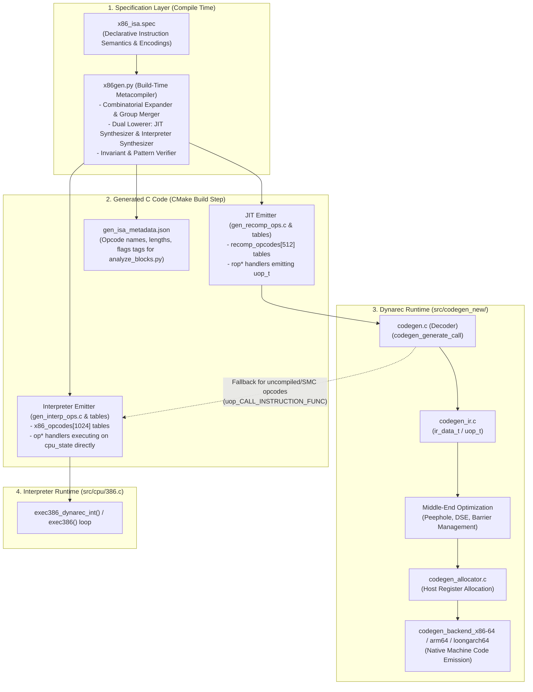
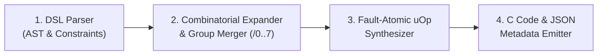
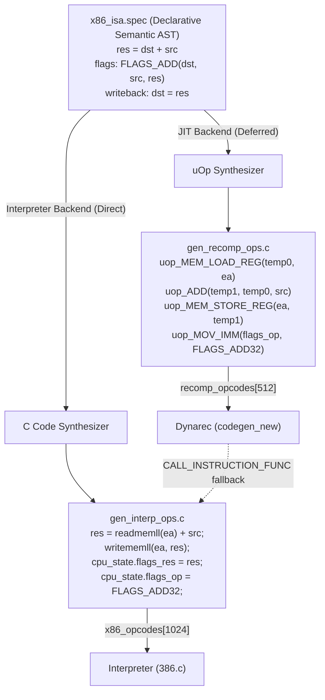
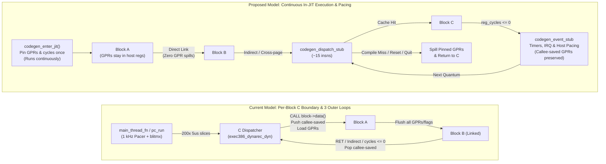
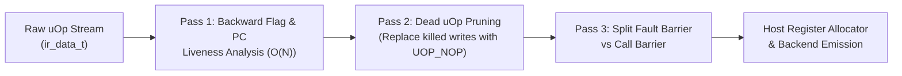
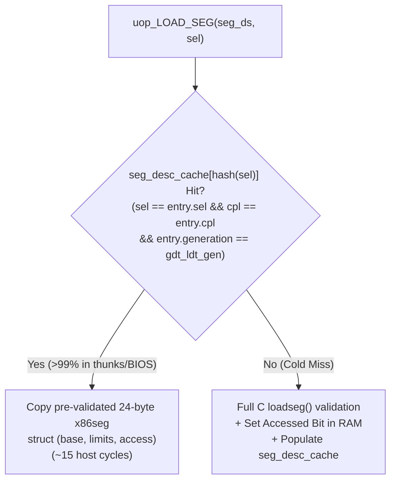

# Future Architecture Proposals & Explorations (`CODEGEN_FUTURE`)

This document collects long-term architectural proposals, middle-end/backend design studies, and next-generation explorations for the 86Box dynamic recompiler (`codegen_new`), grounded in empirical telemetry from [`PROFILE-WIN98-v3.md`](file:///home/marm/src/86Box/src/codegen_new/docs/PROFILE-WIN98-v3.md) and [`ROADMAP.md`](file:///home/marm/src/86Box/src/codegen_new/docs/ROADMAP.md).

### Overview of Proposals

| Proposal | Target Layer | Primary Goal | Empirical Motivation (`PROFILE-WIN98-v3`) |
| :--- | :--- | :--- | :--- |
| **Proposal 1: Specification-Driven JIT & Interpreter Generation (`x86gen`)** | Frontend Decoder & Emitters (`codegen_ops_*.c`, `src/cpu/x86_ops_*.h`) | Replace ~55,000 lines of dual handwritten C (dynarec + interpreter) with a declarative ISA specification that synthesizes both engines from a single source of truth. | Eliminates JIT-vs-interpreter desync bugs, copy-paste ModR/M and sub-register errors, and fault-atomicity bugs; auto-generates disassembler metadata. |
| **Proposal 2: Persistent JIT Execution Region & Pinned State** | Execution Model, Allocator & Backend (`codegen_block.c`, `codegen_backend_*`) | Replace per-block C function boundaries (`void (*)(void)`) with a persistent JIT region, pinned guest GPRs, and an in-JIT assembly dispatch stub. | **22.17%** of all JIT instructions are currently prologue/spill/reload glue; **6.58%** of host CPU time is C dispatcher overhead (**199M** C returns). |
| **Proposal 3: Middle-End IR Liveness & Barrier Refinement** | IR Optimizer (`codegen_ir.c`, `codegen_reg.c`) | Decouple fault barriers from full register flushes; eliminate dead lazy-flag writes and redundant `pc`/`oldpc` stores via an $O(N)$ backward pass. | **961M host cycles** (**115,176** static sites) wasted on dead flag materialization; **137.7M** redundant `pc`/`oldpc` writes. |
| **Proposal 4: Protected-Mode Segment Descriptor Caching** | Segment & Control-Flow Helpers (`x86seg.c`, `codegen_ops_mov.c`, `codegen_ops_jump.c`) | Cache validated GDT/LDT entries and inline fast-path selector reloads (`MOV seg, r/m`, `IRET`/`LCALL`/`LJMP`). | Top #1 and #2 hottest blocks in Windows 98 (`blk#55748`, `blk#58507`) spend **>1,100 host cycles/exec** in C `loadseg()` / `op_pmodeiret()`. |

---

# Proposal 1: Specification-Driven JIT Generation (`x86gen`)

## 1. Motivation & The Problem of Combinatorial Explosion

Writing an x86-to-host dynamic recompiler by hand is an exercise in managing extreme combinatorial complexity:

```
[Opcode] × [Operand Size: 8, 16, 32-bit] × [ModR/M Location: Reg-Reg, Reg-Mem, Mem-Reg, Imm-Reg, Imm-Mem] × [Addressing: 16-bit EA vs 32-bit SIB] × [Segment Overrides: CS, DS, ES, SS, FS, GS] × [Block Flags: Normal vs CODEBLOCK_NO_IMMEDIATES]
```

In the current `codegen_new` codebase:
- Translating even basic instructions across their valid encodings requires ~25,000 lines of handwritten, repetitive C across [`src/codegen_new/codegen_ops.c`](file:///home/marm/src/86Box/src/codegen_new/codegen_ops.c), [`codegen_ops_arith.c`](file:///home/marm/src/86Box/src/codegen_new/codegen_ops_arith.c), [`codegen_ops_logic.c`](file:///home/marm/src/86Box/src/codegen_new/codegen_ops_logic.c), [`codegen_ops_mov.c`](file:///home/marm/src/86Box/src/codegen_new/codegen_ops_mov.c), [`codegen_ops_shift.c`](file:///home/marm/src/86Box/src/codegen_new/codegen_ops_shift.c), and [`codegen_ops_misc.c`](file:///home/marm/src/86Box/src/codegen_new/codegen_ops_misc.c).
- A single instruction family like `ADD` requires a dozen distinct functions (`ropADD_b_rmw`, `ropADD_w_rmw`, `ropADD_l_rmw`, `ropADD_b_rm`, `ropADD_w_rm`, `ropADD_l_rm`, `ropADD_AL_imm`, `ropADD_AX_imm`, `ropADD_EAX_imm`, plus group handlers in `rop80`, `rop81_w`, `rop81_l`, `rop83_w`, `rop83_l`).
- **Human Error & Subtle Invariant Violations**: Manual duplication invites copy-paste bugs:
  - Inverted ModR/M `reg` vs `rm` fields.
  - Using `IREG_EAX + r` for 8-bit registers instead of `IREG_8(r)` (which maps indices `4..7` to high-byte registers `AH`, `CH`, `DH`, `BH`).
  - Using `uop_MOV` instead of `uop_MOVZX` when populating 32-bit `IREG_flags_op1` / `IREG_flags_op2` / `IREG_flags_res` from 8-bit or 16-bit operands.
  - Clobbering the destination register *before* saving the pre-operation value into `IREG_flags_op1`.
  - Mutating guest registers or lazy-flag state *before* a potentially faulting `uop_MEM_STORE_REG` (corrupting the `#PF` exception state).
  - Forgetting `codegen_mark_code_present()`, `codegen_flags_changed = 1`, or `CODEBLOCK_NO_IMMEDIATES` checks.

**Proposal 1** replaces handwritten frontend handlers with a **Specification-Driven JIT Generator (`x86gen`)**: instruction encodings and semantics are declared in a domain-specific specification (`.spec`), from which all frontend decoding, invariant enforcement, and `uop_t` emission code is automatically synthesized at build time.

---

## 2. Prior Art in Industry & Academic Research

Specification-driven binary translation is a proven methodology in modern compilers and emulators:

1. **Ghidra's SLEIGH & P-Code (NSA)**:
   - Ghidra supports 50+ architectures by defining target ISAs in `.slaspec` files using **SLEIGH**, which specifies bit encodings and lifts machine code into **P-Code** (closely analogous to 86Box's `uop_t` IR).
2. **Sail & Pydrofoil (University of Cambridge)**:
   - **Sail** is the formal ISA specification language used by ARM and RISC-V International.
   - **Pydrofoil** automatically synthesizes a tracing/method JIT compiler directly from Sail specifications of RISC-V and ARM.
3. **ISLE (Bytecode Alliance / Cranelift / Wasmtime)**:
   - Cranelift uses **ISLE** (Instruction Selection Lowering Engine), a declarative term-rewriting DSL that compiles high-level semantic rules into verified C++/Rust emitters.
4. **QEMU `decodetree.py`**:
   - QEMU uses a Python-based pattern-matching DSL (`decodetree.py`) to generate instruction decoders and dispatchers from compact bit-pattern tables.

---

## 3. End-to-End System Architecture



### Key Architectural Boundaries
The metacompiler targets **both execution engines simultaneously**:
- **JIT Frontend Target**: Outputs functions matching the `RecompOpFn` signature (`uint32_t (*)(codeblock_t *block, ir_data_t *ir, uint8_t opcode, uint32_t fetchdat, uint32_t op_32, uint32_t op_pc)`). The JIT middle-end (`codegen_ir.c`), register allocator (`codegen_allocator.c`), and host machine code backends remain untouched.
- **Interpreter Target**: Outputs functions matching the `OpFn` signature (`int (*)(uint32_t fetchdat)`), operating directly on `cpu_state`, memory (`readmem*` / `writemem*`), and cycle counting.
- **Unified Fallback Path**: When `codegen_new` encounters an opcode declining compilation (or during SMC fallback), `uop_CALL_INSTRUCTION_FUNC` calls directly into the autogenerated interpreter function. Because both came from the same spec, **behavior is guaranteed to be 100% identical**.

---

## 4. The Instruction DSL Specification

The DSL expresses instructions in terms of **typed abstract operands** (`Eb`, `Ev`, `Gb`, `Gv`, `Ib`, `Iv`, `Ib_sext`), CPU feature requirements, and pure value-numbered semantics.

### 4.1 Arithmetic Family Example (`ADD`, `ADC`, `SUB`, `CMP`)

```yaml
# x86_arith.spec

family: ADD
  opcode_map:
    0x00:    { dst: Eb,  src: Gb }          # r/m8     += r8      (ropADD_b_rmw)
    0x01:    { dst: Ev,  src: Gv }          # r/m16/32 += r16/32  (ropADD_w/l_rmw)
    0x02:    { dst: Gb,  src: Eb }          # r8       += r/m8    (ropADD_b_rm)
    0x03:    { dst: Gv,  src: Ev }          # r16/32   += r/m16/32(ropADD_w/l_rm)
    0x04:    { dst: AL,  src: Ib }          # AL       += imm8    (ropADD_AL_imm)
    0x05:    { dst: eAX, src: Iv }          # AX/EAX   += imm16/32(ropADD_AX/EAX_imm)
    0x80 /0: { dst: Eb,  src: Ib }          # r/m8     += imm8    (merged into rop80)
    0x81 /0: { dst: Ev,  src: Iv }          # r/m16/32 += imm16/32(merged into rop81_w/l)
    0x83 /0: { dst: Ev,  src: Ib_sext }     # r/m16/32 += sext(imm8) (merged into rop83_w/l)

  semantics(dst, src):
    old_dst = read(dst)
    val_src = read(src)
    res     = old_dst + val_src
    write(dst, res)
    flags:
      tag: FLAGS_ADD        # Expands to FLAGS_ADD8 / FLAGS_ADD16 / FLAGS_ADD32
      op1: old_dst
      op2: val_src
      res: res

family: SUB
  opcode_map:
    0x28:    { dst: Eb,  src: Gb }
    0x29:    { dst: Ev,  src: Gv }
    0x2A:    { dst: Gb,  src: Eb }
    0x2B:    { dst: Gv,  src: Ev }
    0x2C:    { dst: AL,  src: Ib }
    0x2D:    { dst: eAX, src: Iv }
    0x80 /5: { dst: Eb,  src: Ib }
    0x81 /5: { dst: Ev,  src: Iv }
    0x83 /5: { dst: Ev,  src: Ib_sext }

  semantics(dst, src):
    old_dst = read(dst)
    val_src = read(src)
    res     = old_dst - val_src
    write(dst, res)
    flags:
      tag: FLAGS_SUB
      op1: old_dst
      op2: val_src
      res: res

family: CMP
  inherit: SUB
  opcode_map:
    0x38:    { dst: Eb,  src: Gb }
    0x39:    { dst: Ev,  src: Gv }
    0x3A:    { dst: Gb,  src: Eb }
    0x3B:    { dst: Gv,  src: Ev }
    0x3C:    { dst: AL,  src: Ib }
    0x3D:    { dst: eAX, src: Iv }
    0x80 /7: { dst: Eb,  src: Ib }
    0x81 /7: { dst: Ev,  src: Iv }
    0x83 /7: { dst: Ev,  src: Ib_sext }
  writeback: none           # Suppresses write(dst, res) and uses read-only segment check!
```

### 4.2 Control Flow & CPU-Gated Instructions (`Jcc`, `CMPXCHG`)

```yaml
# x86_branch.spec
family: Jcc
  opcode_map:
    0x70..0x7F:      { cond: opcode & 0x0F, disp: Rel8 }
    0x0F 0x80..0x8F: { cond: opcode & 0x0F, disp: Rel16_32 }

  semantics(cond, disp):
    target = next_pc + disp
    exit: COND_2(cond, target_taken=target, target_not_taken=next_pc)

# x86_misc.spec
family: CMPXCHG
  requires: opcode_0f_supported   # Emits check against x86_dynarec_opcodes_0f[0x0b] (#UD on 386)
  opcode_map:
    0x0F 0xB0: { dst: Eb, src: Gb, acc: AL }
    0x0F 0xB1: { dst: Ev, src: Gv, acc: eAX }
```

---

## 5. The Metacompiler Pipeline (`x86gen.py`)



### 5.1 Stage 1 & 2: Parsing, Combinatorial Expansion & Group Merging
- `recomp_opcodes[512]` is indexed by `(opcode | (op_32 & 0x100))`, splitting 16-bit (`0x000..0x0FF`) and 32-bit (`0x100..0x1FF`) operand sizes into distinct functions while passing address size (`op_32 & 0x200`) dynamically to `codegen_generate_ea()`.
- **ModR/M Group Merging**: Opcodes that share a primary byte and dispatch on ModR/M `/reg` (`0x80`, `0x81`, `0x83`, `0xC0`, `0xC1`, `0xD0`–`0xD3`, `0xF6`, `0xF7`, `0xFE`, `0xFF`, `0x0F 0x00`, `0x0F 0x01`, `0x0F 0xBA`) are automatically grouped into a single generated handler (`gen_rop80`, `gen_rop81_w`, `gen_rop81_l`, etc.) that decodes the ModR/M EA once and switches on `(fetchdat >> 3) & 7`.

### 5.2 Stage 3: Fault-Atomic Micro-Semantics Synthesis
To prevent subtle state corruption on `#GP` / `#SS` / `#PF` exceptions, `x86gen` enforces a strict **5-phase emission order** inside every generated handler:
1. **CPU Support & Decode Phase**: Check `requires:` guards (returning `0` if unsupported so the interpreter raises `#UD`) and mark instruction bytes present via `codegen_mark_code_present(block, cs + op_pc, len)`.
2. **EA & Segment Validation Phase (Memory Path)**:
   - Emit `uop_MOV_IMM(ir, IREG_oldpc, cpu_state.oldpc)`.
   - Call `target_seg = codegen_generate_ea(ir, op_ea_seg, fetchdat, op_ssegs, &op_pc, op_32, 0)`.
   - Call `codegen_check_seg_write(block, ir, target_seg)` (if `writeback` is active) or `codegen_check_seg_read(block, ir, target_seg)`.
3. **Memory Load & Computation into Temporaries**:
   - Load memory operand into `IREG_temp0` (`_B` / `_W` / 32-bit) via `uop_MEM_LOAD_REG(ir, IREG_temp0, ireg_seg_base(target_seg), IREG_eaaddr)`.
   - Compute the result into `IREG_temp1` without modifying any architectural guest register or `IREG_flags_*` state yet.
4. **Memory Store Phase (Before Architectural / Flag Mutation)**:
   - Emit `uop_MEM_STORE_REG(ir, ireg_seg_base(target_seg), IREG_eaaddr, IREG_temp1)`.
   - If `uop_MEM_STORE_REG` triggers a page fault (`#PF`), execution exits cleanly to `codegen_exit_rout` with all guest registers and `IREG_flags_*` still holding their pre-instruction values!
5. **Architectural Register & Lazy-Flag Commit Phase**:
   - Commit `IREG_flags_op1` (using `old_dst`), `IREG_flags_op2`, `IREG_flags_res` (using `uop_MOVZX` for 8/16-bit operands and `uop_MOV` for 32-bit operands), and `IREG_flags_op`.
   - Set `codegen_flags_changed = 1;`.
   - Return the updated `op_pc`.

### 5.3 Stage 4: Output C Code Generation (Verified Example)
For `0x01` (`ADD r/m32, r32`), `x86gen` emits code that strictly satisfies all `codegen_new` invariants:

```c
/* Autogenerated by x86gen from x86_arith.spec — DO NOT EDIT */
uint32_t
gen_ropADD_l_rmw(codeblock_t *block, ir_data_t *ir, UNUSED(uint8_t opcode),
                 uint32_t fetchdat, uint32_t op_32, uint32_t op_pc)
{
    int src_reg = (fetchdat >> 3) & 7;

    codegen_mark_code_present(block, cs + op_pc, 1);
    if ((fetchdat & 0xc0) == 0xc0) {
        int dest_reg = fetchdat & 7;

        /* Save pre-operation dst into flags_op1 BEFORE mutating dest_reg */
        uop_MOV(ir, IREG_flags_op1, IREG_32(dest_reg));
        uop_MOV(ir, IREG_flags_op2, IREG_32(src_reg));
        uop_ADD(ir, IREG_32(dest_reg), IREG_32(dest_reg), IREG_32(src_reg));
        uop_MOV(ir, IREG_flags_res, IREG_32(dest_reg));
    } else {
        x86seg *target_seg;

        uop_MOV_IMM(ir, IREG_oldpc, cpu_state.oldpc);
        target_seg = codegen_generate_ea(ir, op_ea_seg, fetchdat, op_ssegs, &op_pc, op_32, 0);
        codegen_check_seg_write(block, ir, target_seg);

        /* Load and compute into temporaries; complete MEM_STORE_REG before mutating flags */
        uop_MEM_LOAD_REG(ir, IREG_temp0, ireg_seg_base(target_seg), IREG_eaaddr);
        uop_ADD(ir, IREG_temp1, IREG_temp0, IREG_32(src_reg));
        uop_MEM_STORE_REG(ir, ireg_seg_base(target_seg), IREG_eaaddr, IREG_temp1);

        uop_MOV(ir, IREG_flags_op1, IREG_temp0);
        uop_MOV(ir, IREG_flags_op2, IREG_32(src_reg));
        uop_MOV(ir, IREG_flags_res, IREG_temp1);
    }
    uop_MOV_IMM(ir, IREG_flags_op, FLAGS_ADD32);

    codegen_flags_changed = 1;
    return op_pc + 1;
}
```

---

## 6. Addressing PC Emulation Nuances in the DSL

### 6.1 Lazy Flags & Partial Flag Updates (`INC`, `DEC`, Shifts)
- **Problem**: `INC` and `DEC` update `ZF, SF, OF, AF, PF`, but **must preserve `CF`**.
- **DSL Solution**: When a family declares `preserve_flags: [CF]`, `x86gen` automatically emits `rebuild_c(ir)` prior to overwriting `IREG_flags_op` with `FLAGS_INC*` / `FLAGS_DEC*`.

### 6.2 Self-Modifying Code & `CODEBLOCK_NO_IMMEDIATES`
- **Problem**: When a guest page undergoes frequent self-modifying code writes, 86Box promotes its blocks to `CODEBLOCK_BYTE_MASK | CODEBLOCK_NO_IMMEDIATES`. If a 32-bit immediate is baked into the JIT block via `fastreadl()`, self-modifying patches to that immediate will execute stale constants.
- **DSL Solution**: The `Iv` operand expander automatically emits:
  ```c
  if (block->flags & CODEBLOCK_NO_IMMEDIATES) {
      LOAD_IMMEDIATE_FROM_RAM_32(block, ir, IREG_temp0, cs + op_pc);
      ...
  } else {
      uint32_t imm = fastreadl(cs + op_pc);
      codegen_mark_code_present(block, cs + op_pc, 4);
      ...
  }
  ```
  guaranteeing 100% `CODEBLOCK_NO_IMMEDIATES` compliance across every instruction in the ISA.

### 6.3 Integration with Central CPU Timing (`codegen_timing_*`)
- Unlike naive JITs that hardcode fixed cycle counts in each opcode handler, 86Box models family-specific instruction timing and superscalar pairing (486, Pentium U/V pipes, P6, K6, WinChip) centrally via [`codegen_timing_opcode()`](file:///home/marm/src/86Box/src/codegen_new/codegen.c#L633-L636) before invoking `recomp_op_table[...]`.
- `x86gen` preserves this separation of concerns: standard instructions rely on `codegen_timing_opcode()`, while repeating string instructions (`REP`) or conditional helper paths can declare explicit `extra_cycles` hooks.

---

## 7. Dual-Target Code Generation: Synthesizing Both Interpreter and JIT from a Single Arch Spec

### 7.1 The Desynchronization Problem in Dual-Engine Emulators
In production x86 emulators, maintaining two completely separate handwritten implementations of the ISA—one for the **C Interpreter** ([`src/cpu/x86_ops_*.h`](file:///home/marm/src/86Box/src/cpu/386.c), ~30,000 lines) and one for the **Dynamic Recompiler** ([`src/codegen_new/codegen_ops_*.c`](file:///home/marm/src/86Box/src/codegen_new/codegen_ops.c), ~25,000 lines)—is the single greatest source of obscure emulation bugs:

1. **Semantic Divergence**: Subtle behavioral discrepancies inevitably creep in:
   - Difference in undefined flag bits (e.g. `AF` or `OF` status after 16-bit shifts by >16 bits).
   - Inconsistent segment limit checks or BCD arithmetic quirks (`DAA`/`DAS`/`AAM`/`AAD`).
   - Different ModR/M decoding corner cases or fault-restart EIP calculations.
2. **State Corruption on Engine Transitions**:
   Whenever execution transitions between dynarec and interpreter (such as when hitting uncompiled opcodes via `uop_CALL_INSTRUCTION_FUNC`, falling back on heavy self-modifying code pages, or handling cross-page execution), any semantic divergence causes state corruption that can take weeks of debugging to isolate.
3. **Double Maintenance Tax**:
   Every new instruction, bug fix, or hardware erratum patch must be written, reviewed, and tested twice.

### 7.2 Lowering Strategies: Deferred (JIT) vs. Direct (Interpreter) Execution
Because the DSL specification describes pure value-numbered micro-semantics (`res = dst + src; flags: ...; writeback: ...`), the metacompiler can target two completely different operational paradigms from the same AST:



| Pipeline Step | JIT Recompiler Target (`x86gen-jit`) | C Interpreter Target (`x86gen-interp`) |
| :--- | :--- | :--- |
| **Input Signature** | `uint32_t (*)(codeblock_t *, ir_data_t *, ...)` | `int (*)(uint32_t fetchdat)` |
| **Execution Timing** | **Deferred**: records uOps for offline compilation | **Direct**: executes immediately in C |
| **Register Access** | Emits `ireg_t` mappings into `uop_t` | Reads/writes `cpu_state.regs[i].l` directly |
| **Memory Access** | Emits `uop_MEM_LOAD_REG` / `uop_MEM_STORE_REG` | Calls `readmemll(ea)` / `writememll(ea, val)` |
| **Lazy Flags** | Emits `uop_MOV` to `IREG_flags_*` | Writes to `cpu_state.flags_*` directly in C |
| **Cycle Accounting** | Emits `codegen_accumulate(ir, ACCREG_cycles, -c)` | Calls `CLOCK_CYCLES(c)` macro |

### 7.3 Verified Example: Dual Emission of `ADD r/m32, r32` (`0x01`)
From a single 6-line entry in `x86_arith.spec`, `x86gen` automatically generates **both** implementations:

#### 1. Generated JIT Handler (`gen_recomp_ops.c`):
```c
/* Emits uOps for native host compilation */
uint32_t gen_ropADD_l_rmw(codeblock_t *block, ir_data_t *ir, UNUSED(uint8_t opcode),
                          uint32_t fetchdat, uint32_t op_32, uint32_t op_pc)
{
    int src_reg = (fetchdat >> 3) & 7;
    codegen_mark_code_present(block, cs + op_pc, 1);

    if ((fetchdat & 0xc0) == 0xc0) {
        int dest_reg = fetchdat & 7;
        uop_MOV(ir, IREG_flags_op1, IREG_32(dest_reg));
        uop_MOV(ir, IREG_flags_op2, IREG_32(src_reg));
        uop_ADD(ir, IREG_32(dest_reg), IREG_32(dest_reg), IREG_32(src_reg));
        uop_MOV(ir, IREG_flags_res, IREG_32(dest_reg));
    } else {
        x86seg *target_seg;
        uop_MOV_IMM(ir, IREG_oldpc, cpu_state.oldpc);
        target_seg = codegen_generate_ea(ir, op_ea_seg, fetchdat, op_ssegs, &op_pc, op_32, 0);
        codegen_check_seg_write(block, ir, target_seg);

        uop_MEM_LOAD_REG(ir, IREG_temp0, ireg_seg_base(target_seg), IREG_eaaddr);
        uop_ADD(ir, IREG_temp1, IREG_temp0, IREG_32(src_reg));
        uop_MEM_STORE_REG(ir, ireg_seg_base(target_seg), IREG_eaaddr, IREG_temp1);

        uop_MOV(ir, IREG_flags_op1, IREG_temp0);
        uop_MOV(ir, IREG_flags_op2, IREG_32(src_reg));
        uop_MOV(ir, IREG_flags_res, IREG_temp1);
    }
    uop_MOV_IMM(ir, IREG_flags_op, FLAGS_ADD32);
    codegen_flags_changed = 1;
    return op_pc + 1;
}
```

#### 2. Generated Interpreter Handler (`gen_interp_ops.c`):
```c
/* Directly executes on cpu_state in C */
int gen_opADD_l_a32(uint32_t fetchdat)
{
    int src_reg = (fetchdat >> 3) & 7;
    uint32_t src = cpu_state.regs[src_reg].l;

    if ((fetchdat & 0xc0) == 0xc0) {
        int dest_reg = fetchdat & 7;
        uint32_t dst = cpu_state.regs[dest_reg].l;
        uint32_t res = dst + src;

        cpu_state.flags_op1 = dst;
        cpu_state.flags_op2 = src;
        cpu_state.flags_res = res;
        cpu_state.flags_op  = FLAGS_ADD32;
        cpu_state.regs[dest_reg].l = res;
        CLOCK_CYCLES(1);
    } else {
        uint32_t ea = get_ea_32(fetchdat);
        uint32_t dst = readmemll(ea);
        if (cpu_state.abrt) return 1;

        uint32_t res = dst + src;
        writememll(ea, res);
        if (cpu_state.abrt) return 1;

        cpu_state.flags_op1 = dst;
        cpu_state.flags_op2 = src;
        cpu_state.flags_res = res;
        cpu_state.flags_op  = FLAGS_ADD32;
        CLOCK_CYCLES(3);
    }
    return 0;
}
```

### 7.4 Architectural Synergies of Dual Generation

1. **Zero Behavioral Divergence by Construction**:
   Because both handlers are synthesized from the identical semantic AST, edge cases (flags updates, register mappings, overflow traps) are mathematically guaranteed to behave identically in both engines.
2. **Built-In Differential Fuzzing ("Golden Model" Parity)**:
   In test builds, a single compiler flag can run an instruction through the autogenerated JIT block, run the identical instruction through the autogenerated interpreter function, and verify bit-for-bit identity across `cpu_state.regs`, `cpu_state.flags_*`, and guest RAM before committing.
3. **Seamless Interpreter Fallbacks**:
   When `codegen_new` cannot compile an instruction, it emits `uop_CALL_INSTRUCTION_FUNC` to call the interpreter's `op*` function directly. Generating both from the same spec ensures every single JIT opcode has a perfectly matching C fallback immediately available.
4. **Collapsing ~55,000 Lines of C into ~2,000 Lines of DSL**:
   Instead of maintaining ~30,000 lines of `src/cpu/x86_ops_*.h` for the interpreter and ~25,000 lines of `src/codegen_new/codegen_ops_*.c` for the dynarec, the entire PC instruction set is maintained in a single, human-readable specification.

---

## 8. Incremental Adoption Strategy for `x86gen`

1. **Step 1 — Prototype Metacompiler**: Implement `x86gen.py` in `src/codegen_new/tools/` targeting the core ALU families (`ADD`, `OR`, `ADC`, `SBB`, `AND`, `SUB`, `XOR`, `CMP` — opcodes `0x00`–`0x3F` and groups `0x80`–`0x83`).
2. **Step 2 — Table Coexistence**: Generate `gen_recomp_ops.c` and wire verified entries into `recomp_opcodes[]` alongside legacy handwritten handlers.
3. **Step 3 — Differential IR Verification**: Use the binary block dumper (`BOX86_DUMP_BLOCKS` + [`scripts/analyze_blocks.py`](file:///home/marm/src/86Box/scripts/analyze_blocks.py)) to verify that autogenerated handlers emit identical or cleaner uOp sequences and pass all linter checks (`0` stale cycle hazards, `0` disassembly failures).
4. **Step 4 — Progressive Migration**: Expand `.spec` coverage to `MOV`, shifts (`0xC0`/`0xC1`/`0xD0`–`0xD3`), bit operations (`BT`/`BTS`/`BTR`/`BTC`/`BSF`/`BSR`), branches, and MMX/3DNow!.

---

# Proposal 2: Persistent JIT Execution Region & Pinned State (Phase 8 Architecture)

## 1. Diagnosis: Why the Per-Block C-Function Boundary Is a Bottleneck

Even with 100% direct block linking ([`PROFILE-WIN98-v3.md` Section 5.3](file:///home/marm/src/86Box/src/codegen_new/docs/PROFILE-WIN98-v3.md#L163-L169)), every `codeblock_t` in `codegen_new` is still compiled as an standalone C function (`void (*code)(void)`) that assumes it is called from C and returns to C:

1. **22.17% of All Emitted Host Instructions Are Prologue/Spill/Reload Glue**:
   - In [`PROFILE-WIN98-v3.md` Section 5.2](file:///home/marm/src/86Box/src/codegen_new/docs/PROFILE-WIN98-v3.md#L155-L162), **12.19%** of dynamic host instructions are register-allocator spill/reload operations and **9.98%** are block prologue/frame setup instructions.
   - Every block begins with an empty register allocator (`codegen_reg_reset()`), loads guest GPRs from `cpu_state.regs[]` on first use, and flushes all dirty GPRs, `pc`, and lazy flag fields back to `cpu_state` before **every** block exit—even when jumping directly to a linked block that immediately reloads the exact same registers from `cpu_state`!
2. **Per-Block C ABI Frame Setup & Teardown**:
   - Every compiled block emits a full C ABI prologue and epilogue saving and restoring host callee-saved registers (`RBX`, `RBP`, `R12`–`R15` on x86-64; `X19`–`X28`, `FP`, `LR` on ARM64; `S0`–`S8`, `FP`, `RA` on LoongArch64).
3. **199 Million C Dispatcher Returns (6.58% of Total Host CPU Time)**:
   - Every indirect jump (`JMP reg`, `JMP [mem]`, `CALL [mem]`), `RET` inline-cache miss, cross-page jump, or `CODEBLOCK_STATIC_TOP` FPU block tears down the host stack frame, returns to `exec386_dynarec_dyn()`, re-runs the outer C loop, re-hashes `phys_addr`, and invokes the next `block->data()` from scratch.
4. **Three Concentric Outer C/C++ Loops Exiting the JIT 200,000 Times/Sec**:
   - **5 µs Inner Slice (`while (cycles > 0)` in [`exec386_dynarec`](file:///home/marm/src/86Box/src/cpu/386_dynarec.c#L1021-L1179))**: Slices each 1 ms frame into 200 fixed 5 µs chunks (`cyc_period = cycs / 200`), forcing a JIT exit 200,000 times per emulated second just to advance `tsc` and test `timer_target`.
   - **1 ms Emulation Frame ([`pc_run`](file:///home/marm/src/86Box/src/86box.c#L2054-L2127))**: Exits [`exec386_dynarec`](file:///home/marm/src/86Box/src/cpu/386_dynarec.c#L1011) 1,000 times per second to run `endblit()`/`startblit()`, `mouse_process()`, `joystick_process()`, `rivatimer_update_all()`, `ack_pause()`, and `framecount++`.
   - **1 ms Host Wall-Clock Pacer ([`main_thread_fn`](file:///home/marm/src/86Box/src/qt/qt_main.cpp#L471-L528))**: Reads `elapsed_timer.nsecsElapsed()`, tracks `debt_ns`, and calls `plat_delay_ms(1)` when the guest is ahead of real time.



---

## 2. Core Workstreams

### 2.1 Persistent JIT Entry Trampoline & Pinned Guest GPRs (`codegen_enter_jit`)
- Replace per-block C calls (`block->data()`) and the 200 Hz / 1 kHz outer loops with a single native assembly entry/exit trampoline `codegen_enter_jit()` that runs **continuously** until a block needs compilation, the CPU falls back to the interpreter (`!CACHE_ON()`), or the VM pauses/stops.
- **Host Register Pinning Across Blocks**:
  - **x86-64 (16 GPRs)**:
    - `RBP` = `&cpu_state + 128`
    - `R12` = `readlookup2` base pointer
    - `RBX` = pinned `cycles` counter (`reg_cycles`)
    - `R13`, `R14`, `R15`, `RSI`, `RDI` = pinned to the 5 hottest guest GPRs (`EAX`, `ECX`, `EDX`, `EBX`, `ESP`), leaving `RAX`, `RCX`, `RDX`, `R8`–`R11` as scratch registers for `IREG_EBP`, `IREG_ESI`, `IREG_EDI`, `IREG_temp*`, and memory helpers.
  - **ARM64 (31 GPRs)** & **LoongArch64 (32 GPRs)**:
    - Pin `&cpu_state`, `cycles`, `readlookup2`, and **all 8 guest GPRs (`EAX`–`EDI`)** permanently in callee-saved registers (`W19`–`W28` on ARM64; `S0`–`S8` on LoongArch64), completely eliminating guest GPR load/store traffic across basic blocks.
- **Why Callee-Saved Pinning Eliminates JIT Exits on Timer/IO/Pacing Calls**:
  - Because pinned guest GPRs reside in **host callee-saved registers** (`RBX`, `RBP`, `R12`–`R15` onSysV/Win64 x86-64; `X19`–`X28` on AAPCS64; `S0`–`S8` on LoongArch64), any C function called from an assembly stub (`timer_process()`, `mouse_process()`, or an OS sleep helper) **automatically preserves and restores those registers** by ABI contract.
  - Only helpers that inspect or mutate `cpu_state.regs[]` directly (such as `x86_int()` during hardware interrupt delivery or slow-path MMIO/port I/O handlers that read guest registers) require syncing the relevant registers around the call.

### 2.2 In-JIT Native Assembly Dispatch Stub (`codegen_dispatch_stub`)
- Emit a shared ~20-instruction native routine at startup for all indirect branches (`RET` miss, `JMP reg/[mem]`, `CALL [mem]`) and unlinked cross-page transitions.
- Without spilling pinned guest GPRs or returning to C, `codegen_dispatch_stub`:
  1. Tests `reg_cycles <= 0` $\rightarrow$ branches to `codegen_event_stub` if the quantum expired or an asynchronous exit was requested via cycle-counter stealing.
  2. Translates `cs + pc` via `readlookup2[(cs + pc) >> 12]` (exiting to C only on TLB miss `-1` or page-straddling block).
  3. Verifies clean page masks and probes `codeblock_hash_ptr[HASH(phys)]`.
  4. Matches `block->pc == cs + pc && block->_cs == cs && block->phys == phys && block->status == cpu_cur_status`.
  5. Jumps directly to `block->entry_checked` with all pinned guest GPRs live in host registers.

### 2.3 Event-Driven Cycle Accounting, Exact Inline `RDTSC` & Cycle-Counter Stealing
1. **Unified Event Quantum (`min(timer_target, next_pacing_tsc) - tsc`)**:
   - Eliminate the fixed 5 µs `cyc_period` slicing (`cycs / 200`) and `cycles_main` accounting.
   - Instead, `reg_cycles` is loaded with the exact number of cycles until the next scheduled deadline:
     $$\text{reg\_cycles} = \min(\text{timer\_target}, \text{next\_pacing\_tsc}) - \text{tsc}$$
   - Store `cpu_state.tsc_sync_base = tsc + reg_cycles` whenever `reg_cycles` is loaded or modified.
   - **2-Instruction Exact Inline `RDTSC`**: Because $\text{current\_tsc} = \text{tsc\_sync\_base} - \text{reg\_cycles}$ holds at every instruction boundary, guest `RDTSC` inside any JIT block compiles to two inline instructions (`mov rax, [rbp + tsc_sync_base]; sub rax, rbx`) with exact cycle accuracy and zero C helper overhead.
2. **Pinned `cycles` Synchronized in Slow-Path Thunks**:
   - Fast-path RAM accesses (`readlookup2` / `writelookup2` hits) never touch `reg_cycles`.
   - Cold slow-path memory/IO thunks spill `reg_cycles` to `cpu_state._cycles` before calling C handlers (`readmembl`, `writemembl`, SVGA MMIO, port I/O) and reload `reg_cycles` from `cpu_state._cycles` afterward—preserving exact video/bus wait-state deductions and handling mid-block `timer_target` updates seamlessly.
3. **Cycle-Counter Stealing (Single-Instruction Block Exit Check)**:
   - When an asynchronous event or exit condition occurs (`pic.int_pending`, `nmi`, `smi_line`, `cpu_state.abrt`, SMC write), steal the remaining cycle budget (`cpu_state.tsc_sync_base -= cpu_state._cycles; cpu_state._cycles = 0;`).
   - Every block exit then reduces to a single subtract-and-branch on `reg_cycles`:
     ```x86asm
     sub ebx, #block_cycles
     jle codegen_event_stub
     ```

### 2.4 Continuous In-JIT Event Loop, Interrupt Injection & Real-Time Host Pacing (`codegen_event_stub`)

When `reg_cycles <= 0`, execution branches to `codegen_event_stub` **inside the JIT frame** rather than returning to [`exec386_dynarec()`](file:///home/marm/src/86Box/src/cpu/386_dynarec.c#L1011) or [`pc_run()`](file:///home/marm/src/86Box/src/86box.c#L2054):

1. **Commit `tsc` in Assembly**:
   - Computes `tsc = cpu_state.tsc_sync_base - reg_cycles` and stores it to `tsc`.
2. **In-JIT Device Timer Processing (`tsc >= timer_target`)**:
   - When `tsc >= timer_target`, `codegen_event_stub` calls [`timer_process()`](file:///home/marm/src/86Box/src/timer.c#L115) directly from assembly (callee-saved guest GPRs remain untouched in host registers).
3. **In-JIT Hardware Interrupt Injection (`pic.int_pending`, `nmi`, `smi_line`)**:
   - After timer processing (or when woken by cycle-counter stealing), `codegen_event_stub` tests `cpu_state.exit_request`:
     - **Hardware IRQ (`(eflags & I_FLAG) && pic.int_pending`)**: Calls a dedicated helper `codegen_inject_interrupt()` after spilling only `ESP`/`EIP`/flags. The helper invokes `picinterrupt()` and `x86_int(vector)`, updates `CS:pc` and `ESP` to point to the guest ISR entry point, reloads `ESP` into its pinned register, and jumps directly to `codegen_dispatch_stub` to execute the ISR in JIT.
     - **Compile Miss / Fault / Reset / Quit**: Exits `codegen_enter_jit` to C only when a block is not yet compiled, an unhandled fault/reset requires interpreter intervention, or `is_quit` / `dopause` / `hard_reset_pending` is set.
4. **In-JIT Real-Time Host Pacing (`tsc >= next_pacing_tsc`)**:
   - Instead of exiting `exec386_dynarec` $\rightarrow$ `pc_run` $\rightarrow$ `main_thread_fn` every 1 ms (`rspeed / 1000` guest cycles), `next_pacing_tsc` triggers directly inside `codegen_event_stub`:
   - **Direct Hardware Clock Read (`rdtsc` / `cntvct_el0`)**:
     On x86-64 (`rdtsc`) and ARM64 (`mrs cntvct_el0`), reading the host monotonic clock takes ~20 host cycles and zero syscalls. The stub advances `host_target_ticks += host_ticks_per_ms` and compares `host_now` against `host_target_ticks`:
     - **Fast Path (On-Time, Catching Up, or `fast_forward`)**: If `host_now >= host_target_ticks`, clamp maximum lag to `max_debt_ticks` (50 ms), invoke the lightweight 1 kHz housekeeping helper (`rivatimer_update_all()`, `mouse_process()`, `joystick_process()`, `framecount++`), reload `reg_cycles`, and jump straight back to the guest block with **zero sleep and zero JIT exit**.
     - **Sub-Millisecond Spin-Wait Path (`0 < host_target_ticks - host_now < spin_threshold_ticks`, e.g., `< 100 µs`)**: Execute a short in-stub `pause` (x86-64) / `yield` (ARM64) loop polling the hardware counter until `host_now >= host_target_ticks`. This eliminates OS scheduler sleep overshoot (1–2 ms jitter) and prevents `<100% / >100%` speed oscillation.
     - **OS Sleep Path (`host_target_ticks - host_now >= spin_threshold_ticks`)**: Call the C pacing sleep helper (`plat_delay_ns` / `plat_delay_ms`) directly from `codegen_event_stub` while guest GPRs remain preserved in callee-saved registers, then resume JIT execution immediately upon wakeup.
5. **Contention-Gated `blitmx` Handoff**:
   - Currently [`pc_run()`](file:///home/marm/src/86Box/src/86box.c#L2068-L2080) unlocks and relocks `blitmx` (`endblit()` / `startblit()`) every 1 ms even when no UI thread wants the lock.
   - Because [`qt_platform.cpp`](file:///home/marm/src/86Box/src/qt/qt_platform.cpp#L872-L895) already maintains the atomic `blitmx_contention` counter, the CPU thread holds `blitmx` continuously inside `codegen_enter_jit` and only pulses `endblit(); startblit();` during the 1 ms pacing tick when `ATOMIC_LOAD(blitmx_contention) > 0` or `ATOMIC_LOAD(do_pause_ack) != 0`.
6. **Fused Idle (`HLT` / ACPI `P_LVL2`/`P_LVL3`) + In-JIT Pacing**:
   - When the guest executes `HLT` or reads `P_LVL2`/`P_LVL3`, the idle fast path advances `tsc` directly to `min(timer_target, next_pacing_tsc)` (`reg_cycles = 0`) and branches to `codegen_event_stub`.
   - Whenever an idle skip reaches `next_pacing_tsc`, `codegen_event_stub` immediately sleeps the host thread for the remaining wall-clock millisecond—converting guest CPU idle directly into host OS sleep without ever leaving the JIT frame.

### 2.5 Dual Block Entry Points & `CODEBLOCK_STATIC_TOP` FPU Chaining
- **Dual Entry Offsets**:
  - `entry_checked`: Verifies `status` and page cleanliness (used by `codegen_dispatch_stub` and cross-page jumps).
  - `entry_chained_same_page`: Used by intra-page linked branches where `cs`, `status`, and physical page validity are invariant.
- **Chained FPU Loops (`CODEBLOCK_STATIC_TOP`)**:
  - Record `block->entry_top` (`block->TOP` at block start) and `block->exit_top` (`(block->TOP + net_top_delta) & 7` at block end).
  - Permit direct block linking into `CODEBLOCK_STATIC_TOP` targets whenever `src_block->exit_top == dst_block->entry_top`, eliminating C dispatcher round-trips in FPU-intensive loops (such as Quake's perspective texture rasterizer).

### 2.6 Implementation Sketch: `codegen_event_stub` & In-JIT Pacing

```c
/* Called from codegen_event_stub (x86-64 / ARM64 / LoongArch64) when reg_cycles <= 0.
 * All pinned guest GPRs live in host callee-saved registers and are preserved
 * automatically across this function by the C compiler ABI!
 * Returns:
 *   > 0 : New reg_cycles quantum (>0) -> stay in JIT and jump to codegen_dispatch_stub
 *  <= 0 : Exit codegen_enter_jit to C (compile needed, interpreter fallback, reset, or pause)
 */
int32_t
codegen_handle_jit_event(int32_t rem_cycles)
{
    /* 1. Commit elapsed cycles to guest TSC */
    tsc = cpu_state.tsc_sync_base - rem_cycles;

    /* 2. Run expired hardware timers */
    if (TIMER_VAL_LESS_THAN_VAL(timer_target, tsc))
        timer_process();

    /* 3. Real-time host pacing (every 1 ms of guest TSC) */
    if (TIMER_VAL_LESS_THAN_VAL(cpu_state.next_pacing_tsc, tsc)) {
        cpu_state.next_pacing_tsc += cpu_state.pacing_quantum_cycles;
        codegen_pace_tick_in_jit(); /* Host clock check, micro-spin or sleep, mouse/joystick, contention-gated blitmx */
    }

    /* 4. Check asynchronous events & interrupts */
    if (UNLIKELY(cpu_init || cpu_state.abrt || new_ne || smi_line ||
                 (nmi && nmi_enable && nmi_mask) || !CACHE_ON() ||
                 is_quit || !cpu_thread_run || dopause || hard_reset_pending)) {
        return 0; /* Cold exit from codegen_enter_jit to handle reset/fault/pause in C */
    }

    if ((cpu_state.flags & I_FLAG) && pic.int_pending && !cpu_end_block_after_ins) {
        /* Deliver hardware IRQ directly and resume guest ISR in JIT */
        int vec = picinterrupt();
        if (vec != -1) {
            cpu_is_halted   = 0;
            oldcs           = CS;
            cpu_state.oldpc = cpu_state.pc;
            x86_int(vec);
            if (cpu_state.abrt)
                return 0;
        }
    }

    /* 5. Compute next event-driven cycle quantum */
    uint64_t next_deadline = TIMER_VAL_LESS_THAN_VAL(timer_target, cpu_state.next_pacing_tsc)
                             ? timer_target
                             : cpu_state.next_pacing_tsc;
    int64_t delta = (int64_t)(next_deadline - tsc);
    if (delta <= 0)
        delta = 1;
    else if (delta > 0x7fffffffLL)
        delta = 0x7fffffffLL;

    cpu_state.tsc_sync_base = tsc + (uint64_t)delta;
    cpu_state._cycles       = (int32_t)delta;
    return (int32_t)delta;
}
```

---

# Proposal 3: Middle-End IR Liveness, Dead-Flag Elimination & Barrier Refinement

## 1. Empirical Motivation (`PROFILE-WIN98-v3`)

The automated block audit across **130,147 compiled blocks** ([`PROFILE-WIN98-v3.md` Section 8](file:///home/marm/src/86Box/src/codegen_new/docs/PROFILE-WIN98-v3.md#L243-L263)) identified two massive sources of wasted work inside compiled blocks:

1. **Dead Lazy-Flag Materialization (115,176 static sites / 961,267,544 dynamic host cycles)**:
   - Sequential ALU instructions (`ADD`, `SUB`, `AND`, `OR`, `XOR`, `INC`, `DEC`, `CMP`) each emit 3–4 uOps writing `IREG_flags_op1`, `IREG_flags_op2`, `IREG_flags_res`, and `IREG_flags_op`.
   - Because `UOP_MEM_LOAD_REG` and `UOP_MEM_STORE_REG` carry `UOP_TYPE_ORDER_BARRIER`, [`codegen_ir_compile()`](file:///home/marm/src/86Box/src/codegen_new/codegen_ir.c) marks all IR registers dirty (`dirty_ir_regs[0] = ~0ULL`), forcing the register allocator to flush all 4 lazy-flag registers to `cpu_state` memory before every memory access—even when the next guest instruction after the memory access immediately overwrites the flags!
2. **Redundant `IREG_pc` / `IREG_oldpc` Stores (137,737,526 dynamic writes)**:
   - [`codegen.c`](file:///home/marm/src/86Box/src/codegen_new/codegen.c#L731) emits `uop_MOV_IMM(ir, IREG_pc, new_pc)` after every guest instruction and `uop_MOV_IMM(ir, IREG_oldpc, cpu_state.oldpc)` before every memory access. Whenever multiple memory accesses or instructions occur in a block, `UOP_TYPE_ORDER_BARRIER` flushes every intermediate `IREG_pc` store to `cpu_state.pc` on the fast path, even though `cpu_state.pc` is only needed if a slow-path memory access faults or when the block exits.

---

## 2. Design of the Middle-End Optimization Pass

Crucially, **Proposal 3 can be implemented independently of Proposal 2** as a pure middle-end pass in [`src/codegen_new/codegen_ir.c`](file:///home/marm/src/86Box/src/codegen_new/codegen_ir.c) prior to host register allocation:



### 2.1 Backward Liveness Pass for `IREG_flags_*` and `IREG_oldpc` (`codegen_ir_optimize`)
Walk `ir->uops[wr_pos - 1 .. 0]` backward maintaining a liveness bitmask for `{OP, RES, OP1, OP2, OLDPC, PC}`:
- **At block exit**:
  - If the exit is `BLOCK_EXIT_COND_2` with a fast-path condition that only inspects `IREG_flags_res` (e.g. `JZ`/`JNZ` after a `Z_FLAG` operation), only `RES` (and `OP`/`OP1`/`OP2` if `flags_rebuild` could be called in a subsequent block) is live.
- **When encountering a flag-overwriting instruction (`uop_MOV_IMM(IREG_flags_op, ...)`):**
  - If the subsequent instruction unconditionally defines `{OP, RES, OP1, OP2}` and no flag consumer (`jit_flags_rebuild`, `jit_CF_SET`, `UOP_SETCC`, `UOP_CMOV`, `UOP_CALL_FUNC`, or potentially faulting `UOP_MEM_*` barrier) intervened, the earlier writes to `IREG_flags_op`, `IREG_flags_res`, `IREG_flags_op1`, and `IREG_flags_op2` are **dead** and converted to `UOP_NOP`.
- **When encountering consecutive `uop_MOV_IMM(IREG_pc, ...)` with no intervening barrier**:
  - All but the last `IREG_pc` write before a barrier or exit are converted to `UOP_NOP`.

### 2.2 Cold Exception Materialization for `IREG_oldpc` / `IREG_pc`
- Instead of flushing `IREG_oldpc` and `IREG_pc` to `cpu_state` memory on every fast-path TLB hit (`UOP_MEM_LOAD_REG` / `UOP_MEM_STORE_REG`), attach the guest instruction's `oldpc` to the memory uOp metadata and materialize `cpu_state.oldpc = oldpc` **only** inside the cold slow-path fallback branch (when `readlookup2` / `writelookup2` misses or faults).
- This removes `IREG_oldpc` and `IREG_pc` from the fast-path `UOP_TYPE_ORDER_BARRIER` flush set entirely, eliminating ~137M memory stores in the Windows 98 boot trace.

---

# Proposal 4: Protected-Mode Segment Descriptor Caching (`loadseg` / `IRET` Fast-Path)

## 1. Empirical Motivation (`PROFILE-WIN98-v3`)

With `HLT`, `DIV`, `RDTSC`, `CLI`/`STI`, `POPF`, `VERR`/`VERW`, `IRET`, `LCALL`, and `SMSW` lowered into the JIT, the #1 and #2 hottest basic blocks in the entire 90-second Windows 98 trace ([`PROFILE-WIN98-v3.md` Section 6 & 11.5](file:///home/marm/src/86Box/src/codegen_new/docs/PROFILE-WIN98-v3.md#L176-L208)) are protected-mode segment descriptor reloads:

| Rank | Block | Executions | Avg Host Cycles / Exec | Bottleneck Instruction |
| :--- | :--- | ---: | ---: | :--- |
| **#1** | `blk#55748` (`14840:0000315c`) | 994,056 | **1,164.9 cyc** | 16-bit protected-mode `IRETD` (`op_pmodeiret`) |
| **#2** | `blk#58507` (`14840:000005eb`) | 696,576 | **1,436.5 cyc** | Protected-mode `MOV DS, BX` (`uop_LOAD_SEG` $\rightarrow$ C `loadseg()`) |
| **#3** | `blk#55771` (`fff8:0000d492`) | 987,955 | **869.8 cyc** | Protected-mode segment reload & far return |

In 16-bit/32-bit mixed protected mode (Windows 98 GDI/USER 16-to-32 thunks, `HIMEM.SYS` `INT 15h AH=87h` extended memory moves, and VMM VxD calls), every data segment reload (`MOV DS/ES/FS/GS, r/m16`) calls C `loadseg()`, which:
1. Checks `(cr0 & 1) && !(cpu_state.eflags & VM_FLAG)`.
2. Computes the GDT or LDT physical/linear address (`gdt.base + (seg & ~7)`).
3. Performs two 32-bit memory reads (`readmeml`) to fetch the 8-byte descriptor.
4. Validates descriptor type, privilege levels (`DPL >= CPL && DPL >= RPL`), present bit, and limit.
5. Sets the accessed bit (`access |= 1`) via `writememb` back to the GDT/LDT in RAM.
6. Populates `x86seg->base`, `limit_low`, `limit_high`, `access`, `ar_high`, and `checked`.

---

## 2. Design: Per-CPU Validated Selector Cache (`seg_desc_cache`)



### 2.1 Cache Structure & Invariants
Maintain a small direct-mapped cache (e.g., 16 or 32 entries indexed by `(selector >> 3) & 0x1F`) in `cpu_state`:
```c
typedef struct seg_cache_entry_t {
    uint32_t generation;   /* Matches cpu_state.seg_cache_gen */
    uint16_t selector;     /* Exact 16-bit selector (including TI and RPL bits) */
    uint8_t  cpl;          /* CPL at which DPL/RPL check succeeded */
    uint8_t  is_writeable; /* Validated for SS (stack) vs DS/ES/FS/GS (data read) */
    uint32_t base;
    uint32_t limit;
    uint32_t limit_low;
    uint32_t limit_high;
    uint8_t  access;
    uint8_t  ar_high;
} seg_cache_entry_t;
```
- **Why Accessed-Bit Writes Can Be Skipped on Cache Hits**:
  - An entry is only inserted into `seg_desc_cache` *after* `loadseg()` has already verified the descriptor and set the Accessed bit (`bit 0` of the access byte) in the GDT/LDT in guest RAM.
  - As long as the GDT/LDT page in guest RAM is not modified, the Accessed bit in guest RAM is already `1`, so subsequent reloads of the same selector do not need to re-issue `writememb`!

### 2.2 Cache Invalidation Rules (100% Architectural Fidelity)
Increment `cpu_state.seg_cache_gen++` (O(1) invalidation) whenever:
1. `LGDT`, `LLDT`, `LTR`, or task switch modifies `gdt.base`, `gdt.limit`, `ldt.base`, or `ldt.limit`.
2. `CR0` or `EFLAGS.VM` changes mode (`CPL` transitions are already keyed in `entry.cpl`).
3. Any guest memory write hits the physical page(s) containing the active GDT or LDT (tracked via a 2-page physical address check in `writemembl` / `dma_bm_write` or by marking the GDT/LDT physical pages in `pages[].code_present_mask` so writes trap into invalidation).

### 2.3 Expected Impact
- Reduces protected-mode `MOV DS/ES/FS/GS/SS, sel` from ~200+ host cycles (two `readmeml` calls + `writememb` + complex branching) to **~12–15 host cycles** (a single cache tag comparison and three 64-bit struct copies).
- Directly accelerates Windows 98 16/32-bit GDI/USER thunking, `HIMEM.SYS` extended memory block moves, and protected-mode BIOS/VxD dispatch (`blk#58507`, `blk#55748`, `blk#55771`).


