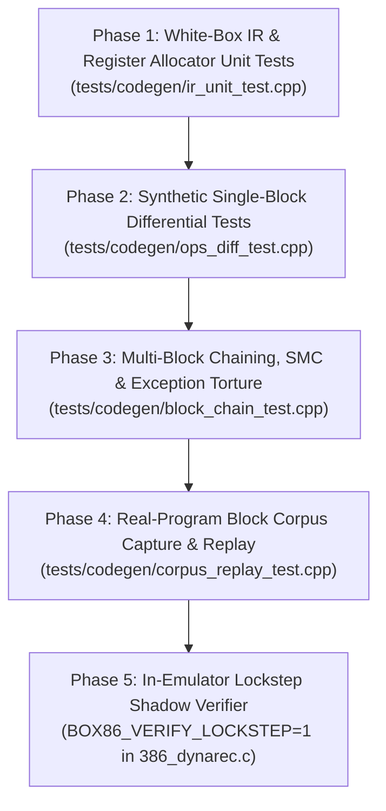

# Implementation Plan: Unit & Differential Testing Suite for `codegen_new`

**Scope**: End-to-end verification architecture for 86Box's dynamic recompiler (`src/codegen_new/`), covering the IR middle-end, register allocator, x86-64/ARM64/LoongArch64 backends, block chaining, self-modifying code (SMC), and real-world guest instruction streams.  
**Target Location**: `tests/codegen/` (integrated with CMake `BUILD_TESTING=ON` and GoogleTest).

---

## 1. Design Philosophy & Why Naive Trace Comparison Fails

Testing a full-system emulator's JIT by booting an OS or game and comparing a full execution trace against the interpreter fails in practice due to **timer and interrupt drift**:
- If the JIT and interpreter differ by even a single emulated CPU cycle—or check pending interrupts at slightly different block boundaries—hardware timers (PIT, APIC), VGA VSync status bits (`0x3DA`), or mouse/disk IRQs will fire one instruction earlier or later.
- Once an asynchronous interrupt is delivered at a different guest `CS:EIP`, the guest control flow diverges permanently, producing millions of false-positive diffs even if every instruction was compiled 100% correctly.

To achieve **zero false positives** while testing both synthetic edge cases and real-world software (FreeDOS, Doom, Quake, PCPBench, Windows 98 SE), the test architecture is divided into **five layers**:



1. **White-Box IR & Allocator Unit Tests**: Construct `uop_t` sequences directly in `ir_data_t` to test constant folding, dead store elimination (DSE), `HOST_REG_FLAG_NO_BH` constraints, and intra-block jump barriers in isolation.
2. **Synthetic Single-Block Differential Tests**: Assemble targeted x86 instruction streams into a flat 4 MB test RAM buffer, execute the block once under the reference interpreter (`exec386_dynarec_int`) and once under `codegen_new`, and assert bit-for-bit equality of architectural registers, rebuilt `EFLAGS`, FPU state, `pc`, `cycles`, and RAM writes.
3. **Multi-Block Chaining, SMC & Exception Torture**: Execute controlled multi-block graphs testing direct block linking (`jmp rel32`), cross-alias self-modifying code invalidation (`writelookup2`), cross-page blocks (`phys_2`), FPU `TOP` rotation, and precise exception state when a memory access faults between dead-store-eliminated register writes.
4. **Real-Program Block Corpus Capture & Replay**: Dump and deduplicate real basic blocks + entry state snapshots from live runs of FreeDOS, Doom, Quake, PCPBench, and Windows 98 SE into a compact binary corpus, then replay all ~20,000+ blocks headlessly inside a fast (<1s) GoogleTest binary against the interpreter.
5. **In-Emulator Lockstep Shadow Verifier**: An opt-in runtime mode (`BOX86_VERIFY_LOCKSTEP=1`) in `exec386_dynarec_dyn()` that snapshots `cpu_state` and RAM writes before each compiled block, runs `code()`, rolls back, runs `exec386_dynarec_int()`, and immediately catches the first diverging block in any live VM with zero timer drift.

---

## 2. Build System & Test Fixture Architecture (`tests/codegen/`)

### 2.1 CMake Integration
86Box already supports GoogleTest unit tests under [`tests/CMakeLists.txt`](file:///home/marm/src/86Box/tests/CMakeLists.txt) using `-ffunction-sections -fdata-sections` and `-Wl,--gc-sections` so test executables only pull in referenced symbols from `src/cpu/`, `src/mem/`, and `src/codegen_new/` without linking UI, sound, or storage devices.

Add `add_subdirectory(codegen)` to [`tests/CMakeLists.txt`](file:///home/marm/src/86Box/tests/CMakeLists.txt) and create `tests/codegen/CMakeLists.txt`:

```cmake
if(BUILD_TESTING AND DYNAREC AND NEW_DYNAREC)
    add_executable(codegen_tests
        codegen_test_fixture.cpp
        ir_unit_test.cpp
        ops_diff_test.cpp
        block_chain_test.cpp
        corpus_replay_test.cpp
        $<TARGET_OBJECTS:dynarec>
        $<TARGET_OBJECTS:cgt>
        $<TARGET_OBJECTS:cpu>
        $<TARGET_OBJECTS:softfloat3e>
        ../../src/mem/mem.c
    )
    target_compile_definitions(codegen_tests PRIVATE USE_DYNAREC USE_NEW_DYNAREC)
    target_include_directories(codegen_tests PRIVATE
        ${PROJECT_SOURCE_DIR}/src/include
        ${PROJECT_SOURCE_DIR}/src/cpu
        ${PROJECT_SOURCE_DIR}/src/codegen_new
        ${PROJECT_BINARY_DIR}/src/include
    )
    target_compile_options(codegen_tests PRIVATE
        $<$<COMPILE_LANG_AND_ID:C,GNU,Clang,AppleClang>:-ffunction-sections;-fdata-sections>
        $<$<COMPILE_LANG_AND_ID:CXX,GNU,Clang,AppleClang>:-ffunction-sections;-fdata-sections>
    )
    target_link_options(codegen_tests PRIVATE
        $<$<PLATFORM_ID:Darwin>:-Wl,-dead_strip>
        $<$<AND:$<NOT:$<PLATFORM_ID:Darwin>>,$<CXX_COMPILER_ID:GNU,Clang>>:-Wl,--gc-sections>
    )
    target_link_libraries(codegen_tests PRIVATE GTest::gtest_main)
    include(GoogleTest)
    gtest_discover_tests(codegen_tests)
endif()
```

### 2.2 The Differential Test Fixture (`tests/codegen/codegen_test_fixture.h`)

A shared GoogleTest base class (`CodegenTestFixture`) sets up an isolated 4 MB guest RAM environment, initializes the MMU lookup tables (`readlookup2`, `writelookup2`, `_mem_exec`, `pages`), and initializes `codegen_new`:

```cpp
struct ArchitecturalSnapshot {
    uint32_t regs[8];          // EAX..EDI
    uint32_t pc;
    uint32_t oldpc;
    uint16_t flags;            // Rebuilt via flags_rebuild()
    uint16_t eflags;
    x86seg   seg_cs, seg_ds, seg_es, seg_ss, seg_fs, seg_gs;
    int      TOP;
    uint16_t npxs, npxc;
    double   ST[8];
    uint8_t  tag[8];
    uint64_t MM[8];
    int32_t  cycles;
    uint8_t  abrt;
};

struct MemWriteRecord {
    uint32_t phys_addr;
    uint8_t  old_val;
    uint8_t  new_val;
};
```

#### Core Fixture Operations:
1. **`ResetGuestState(bool pmode32 = true)`**:
   - Zeroes `cpu_state`, sets `ram` to a 4 MB aligned buffer, calls `mem_reset_page_blocks()`, `flushmmucache()`, and `codegen_reset()`.
   - Configures flat 32-bit protected mode (`CR0 = 1`, `use32 = 0x300`, `stack32 = 1`, `CS/DS/ES/SS` base `0`, limit `0xFFFFFFFF`) or 16-bit real/protected mode as requested by the test.
   - Sets `cycles = 10000` and selects a deterministic CPU timing profile (`codegen_timing_set(&timing_p6)`).
2. **`LoadCode(uint32_t linear_pc, const std::vector<uint8_t>& bytes)`**:
   - Writes instruction bytes into `ram[linear_pc]` and populates `_mem_exec[linear_pc >> 12]`.
3. **`StepBlockInterpreter(const ArchitecturalSnapshot& initial)`**:
   - Restores `initial` state and RAM, runs `exec386_dynarec_int()` (or the recompilation interpreter loop for exactly `N` instructions), calls `flags_rebuild()`, and returns `{PostSnapshot, MemWriteLog}`.
4. **`StepBlockJit(const ArchitecturalSnapshot& initial)`**:
   - Restores `initial` state and RAM.
   - Pass 1 (Compile): Calls `exec386_dynarec_dyn()` to compile the block into `codeblock[hash]`.
   - Pass 2 (Execute Compiled Host Code): Restores `initial` state and RAM again, clears `dirty_mask`, and calls `exec386_dynarec_dyn()` so it takes the `valid_block && (block->flags & CODEBLOCK_WAS_RECOMPILED)` path and executes `code()` directly.
   - Calls `flags_rebuild()` and returns `{PostSnapshot, MemWriteLog}`.
5. **`AssertStatesMatch(const ArchitecturalSnapshot& interp, const ArchitecturalSnapshot& jit)`**:
   - Compares general registers, segment descriptors, `pc`, `abrt`, FPU stack/tags, and RAM writes.
   - Compares architectural `EFLAGS` masked by the defined flag mask of the tested instruction (e.g., masking out undefined `AF`/`OF` bits on shifts or `BSF`/`BSR` while strictly checking defined `CF`/`ZF`/`SF`/`OF`/`PF` bits).

---

## 3. Phase 1: White-Box IR, Peephole, DSE & Allocator Unit Tests

**File**: `tests/codegen/ir_unit_test.cpp`  
**Purpose**: Test `codegen_ir.c` and `codegen_reg.c` directly by constructing `ir_data_t` blocks, running `codegen_ir_compile()`, and executing or inspecting the resulting `uop_t` stream.

### Test Cases
1. **Constant Folding & Peephole Pass (`codegen_ir_peephole`)**:
   - **Self-Cancelling Ops**: Emit `uop_XOR(ir, IREG_EAX, IREG_EAX, IREG_EAX)` and `uop_SUB(ir, IREG_EBX, IREG_EBX, IREG_EBX)`; assert they fold to `UOP_MOV_IMM(..., 0)`.
   - **Linear Constant Propagation**: Emit `uop_MOV_IMM(ir, IREG_EAX, 0x1000)` followed by `uop_ADD_IMM(ir, IREG_EAX, IREG_EAX, 0x234)` and `uop_SHL_IMM(ir, IREG_EAX, IREG_EAX, 2)`; assert the final uOp folds to `UOP_MOV_IMM(ir, IREG_EAX, 0x48d0)`.
   - **Shift Count Masking**: Emit `uop_SHL_IMM` / `uop_SHR_IMM` / `uop_SAR_IMM` with shift counts `0`, `31`, `32`, and `63`; verify x86 5-bit shift count semantics (`count & 0x1f`).
   - **Barrier & Jump Target Invalidation**: Emit `uop_MOV_IMM(ir, IREG_EAX, 42)`, then a `UOP_TYPE_JUMP_DEST` or `UOP_TYPE_BARRIER`, then `uop_ADD_IMM(ir, IREG_EAX, IREG_EAX, 1)`. Assert that constant folding does **not** fold across the jump destination or barrier.

2. **Dead Store Elimination (DSE) vs. Precise Exceptions**:
   - Construct an IR sequence:
     ```c
     uop_MOV_IMM(ir, IREG_EAX, 0x11111111);
     uop_MEM_LOAD_ABS(ir, IREG_EBX, IREG_DS_base, 0xdeadbeef); // Faulting address
     uop_MOV_IMM(ir, IREG_EAX, 0x22222222);
     ```
   - Configure `0xdeadbeef` to set `cpu_state.abrt = ABRT_PF` in `readmemll`.
   - Compile and run the block. Assert that when the block exits early on the memory fault, `cpu_state.regs[0].l` (`EAX`) equals **`0x11111111`** (proving DSE did not mark version 1 of `IREG_EAX` dead across `UOP_MEM_LOAD_ABS`, or that the order barrier flushed it before faulting).

3. **Sub-Register Aliasing & `HOST_REG_FLAG_NO_BH` Pressure**:
   - Construct an IR block that keeps 7–8 values live across `IREG_EAX`..`IREG_EDI` and `IREG_temp0`..`IREG_temp3` (forcing allocation into `R10`, `R11`, `R13`, `R14`, `R15`), then interleaves reads and writes to `IREG_AL`, `IREG_AH`, `IREG_AX`, and `IREG_EAX` ( plus `BL`/`BH`, `CL`/`CH`, `DL`/`DH`).
   - Assert that:
     - No `IREG_SIZE_BH` operand is ever assigned to a `HOST_REG_FLAG_NO_BH` register (`R10`–`R15`), and no REX-prefixed register is paired with `AH`–`DH` in the same instruction.
     - Modifying `IREG_AH` after `IREG_EAX` is cached in `R10` flushes/invalidates the stale 32-bit copy in `R10` so a subsequent read of `IREG_EAX` sees the updated `AH` byte.

4. **Intra-Block Jump Liveness Barrier Verification**:
   - Construct an IR sequence with a conditional forward jump (`uop_CMP_IMM_JZ_DEST`) where the fallthrough path modifies `IREG_AH` (or `IREG_ECX`) before `uop_set_jump_dest`.
   - Verify that `uop_NOP_BARRIER` before the jump target prevents the register allocator from writing back an uninitialized host register on the taken branch (direct regression test for the FreeDOS `ropSETcc` crash).

---

## 4. Phase 2: Synthetic Single-Block Differential Tests

**File**: `tests/codegen/ops_diff_test.cpp`  
**Purpose**: Systematic opcode-by-opcode differential testing comparing `StepBlockInterpreter()` against `StepBlockJit()` across boundary inputs.

### Test Suites

1. **P0 Sentinel & Branch Target Boundary Suite (`BranchSentinelDiffTest`)**:
   - Tests `JMP rel8`, `JMP rel16`, `JMP rel32`, `CALL rel16`, `CALL rel32`, `Jcc rel8/16/32` (taken and not-taken), `JCXZ`, `LOOP`, `LOOPE`, `LOOPNE`, `RET`, `RET imm16`:
     - Target offset `0x00000000` (regression test for `BUGS.md` Bug 1 and unfixed `ropJMP_r8/16/32` sentinel collisions).
     - Target offset `0x0000FFFF` and wrap-around from `0xFFFE` $\rightarrow$ `0x0000` in 16-bit code segments (`use32 = 0`).
     - Target offset `0xFFFFFFFF` (`-1` sentinel collision in 32-bit flat segments).
   - Verifies that `ESP`/`SP`, pushed return addresses on the stack, `cpu_state.pc`, and `block->exit_type` match the interpreter and never double-execute via `codegen_skip`.

2. **Phase 5 Flag Fast-Path & Condition Evaluation Suite (`FlagsFastPathDiffTest`)**:
   - Parameterized test over:
     - **Flag Producers**: `ADD`, `ADC`, `SUB`, `SBB`, `CMP`, `INC`, `DEC`, `AND`, `OR`, `XOR`, `TEST`, `NEG`, `SHL`, `SHR`, `SAR`, `SHLD`, `SHRD`, `CLC`, `STC`, `CMC`, `SAHF`, `POPF`.
     - **Flag Consumers**: All 16 condition codes (`O, NO, B, NB, E, NE, BE, NBE, S, NS, P, NP, L, NL, LE, NLE`) consumed by `Jcc`, `SETcc`, and `CMOVcc`.
     - **Edge-Case Operands**: `(0, 0)`, `(0, 1)`, `(1, 0)`, `(0x7FFFFFFF, 1)` (signed overflow), `(0x80000000, 1)` (signed underflow), `(0xFFFFFFFF, 1)` (unsigned carry), in 8-bit, 16-bit, and 32-bit operand sizes.
   - Also tests sequences where an intervening instruction modifies only *part* of the flags (e.g., `CMP` sets `CF=1`, followed by `INC` or `DEC` which preserves `CF`, followed by `JB` or `JBE`), verifying `rebuild_c()` and `codegen_last_flags_op` never read a stale `CF`.

3. **16/32-Bit Mixed Addressing & Far Pointer Suite (`MixedAddressingDiffTest`)**:
   - Tests `LES`, `LDS`, `LFS`, `LGS`, `LSS`, `LEA`, and ModR/M SIB addressing across all 4 combinations of `(op_32 & 0x100)` (16/32-bit operand size) and `(op_32 & 0x200)` (16/32-bit address size):
     - Specifically tests `66 C4 BE F6 FE` (`les edi, dword [bp - 0x10a]`) with `SS.base = 0x81cf0000` and `BP = 0x0050` so `(BP - 0x10a)` wraps 16-bit (`0xff46`) without truncating the upper 16 bits of `SS.base` (regression test for `BUGS.md` Bug 3).

4. **Bit Manipulation & Atomic Operations Suite (`BitAndAtomicDiffTest`)**:
   - `BSF` / `BSR` (16-bit and 32-bit, register and memory): source `= 0` (asserting `ZF = 1` and destination register remains untouched) and every single-bit power of two `1ULL << k`.
   - `BT`, `BTS`, `BTR`, `BTC` (immediate and register bit offsets):
     - Register bit offsets with memory targets using negative bit offsets (e.g., `-1`, `-16`, `-32`, `-65`) and large positive offsets (`+32`, `+100`), verifying signed dword/word effective address displacement `(bit_offset >> 5) * 4` and 16-bit EA wrap.
   - `CMPXCHG` (8/16/32-bit, reg and mem, matching and non-matching `AL`/`AX`/`EAX`) and `XADD` (including `xadd eax, eax` where `src == dst`).

5. **String `REP` Operations & Cycle Accounting Suite (`StringRepDiffTest`)**:
   - Tests `MOVS`, `STOS`, `LODS`, `SCAS`, `CMPS` (8/16/32-bit, single and `REP`/`REPE`/`REPNE`):
     - `ECX = 0` (must perform 0 memory accesses, preserve flags, and not fault on invalid `ESI`/`EDI`).
     - `DF = 0` (forward) and `DF = 1` (backward).
     - 16-bit address size (`0x67` prefix or `use32 = 0`) where `SI`/`DI`/`CX` wrap at `0xFFFF` $\leftrightarrow$ `0x0000` mid-loop without corrupting the upper 16 bits of `ESI`/`EDI`/`ECX`.
     - **MMIO / Video Wait-State Cycle Preservation Test (P0 PCPBench Regression Test)**:
       - Map a test page at `0xA0000` with a custom write callback (`wb`/`ww`/`wl`, `writelookup2 = LOOKUP_INV`) that decrements `cycles -= 10` on each write (simulating `svga_writel_linear` LFB wait states).
       - Run `rep stosd` / `rep movsd` with `ECX = 50` into `0xA0000`.
       - Assert that post-execution `cycles` reflects **both** the per-iteration CPU cycles (`50 * 3`) **and** the 500 wait-state cycles deducted by the write handler (catching the `IREG_cycles` clobber across `UOP_MEM_STORE_REG`).

---

## 5. Phase 3: Multi-Block Chaining, SMC & FPU Torture Tests

**File**: `tests/codegen/block_chain_test.cpp`  
**Purpose**: Test interactions across multiple compiled blocks where `codegen_link_exit()` patches live host jumps.

### Test Cases
1. **Cross-Alias Self-Modifying Code (Win98 `DIBENG.DLL` Regression Test)**:
   - Configure paging (`CR0 |= 0x80000001`) so virtual page `0x00401000` (`CS`) and virtual page `0x80901000` (`DS`) both map to physical page `0x00100000`.
   - Compile and link a 3-block loop (`Block A -> Block B -> Block C -> Block A`) where:
     - `Block C` executes `add eax, 0x11111111` (immediate at physical `0x00100084`).
     - On iteration 5, `Block A` writes `0x22222222` to `DS:[0x80901084]` (modifying `Block C` via the data alias).
   - Run for 10 iterations with full block linking enabled (`LINK_DEFAULT`).
   - Assert `EAX == 5 * 0x11111111 + 5 * 0x22222222`, proving `mem_flush_write_page()` invalidated `writelookup2[0x80901]`, `codegen_notify_code_write()` asserted `EXIT_STATUS_BLOCK_END`, and `codegen_flush_code_writes()` unlinked `Block C` before iteration 6.

2. **Cross-Page Block Linking & Page Remap (`phys_2`)**:
   - Place a 2-page block (`Block B`) straddling `0x00401FF8`..`0x00402008`, linked from `Block A` (`0x00401000`).
   - Remap the PTE for page `0x00402000` to a new physical page and flush the TLB (`writecr3` or `invlpg`).
   - Assert that `Block A` does not jump into the stale `Block B` compiled with the old `phys_2`.

3. **Asynchronous Exit Request Preemption inside Linked Loops**:
   - Compile a tight 2-block infinite loop (`Block A <-> Block B`) with `cycles = 100000`.
   - From a memory read hook triggered on iteration 3, assert each async event source one at a time:
     1. `nmi = 1` (via `nmi_raise()`)
     2. `smi_line = 1`
     3. `pic.int_pending = 1` (with `I_FLAG` set)
     4. `EXIT_STATUS_BLOCK_END`
   - Assert that the linked loop exits back to `exec386_dynarec_dyn()` at the end of iteration 3 instead of spinning until all 100,000 cycles expire.

4. **FPU `CODEBLOCK_STATIC_TOP` Rotation Across Linked Blocks**:
   - Compile `Block A` (`fld1` — decrements `TOP`) linking into `Block B` (`fadd st(0), st(1)` — compiled initially with `CODEBLOCK_STATIC_TOP` at `TOP = 0`, then entered with `TOP = 7`, `6`, `5`...).
   - Assert that `ST(0)`..`ST(7)` and `TOP` match the interpreter across 8 rotations.

---

## 6. Phase 4: Real-Program Block Corpus Capture & Standalone Replay

**Files**:
- Capture hook: `src/codegen_new/codegen_corpus.c` (enabled via `BOX86_DUMP_CORPUS=/path/to/corpus.bin`)
- Replay runner: `tests/codegen/corpus_replay_test.cpp`

### 6.1 Why Block-Level Corpus Capture Works Best
Instead of recording gigabytes of continuous instruction traces, we hook block compilation/execution in `386_dynarec.c` to record **deduplicated basic-block fixtures** from real guest workloads:
- FreeDOS boot + `JemmEx` initialization
- Doom (`demo3`)
- Quake 1 (`demo1` — heavy x87 FPU and span rasterizer loops)
- PCPBench (VESA Mode 100)
- Dhrystone 2.1
- Windows 98 SE boot, Explorer desktop, Control Panel, and Device Manager

Across all six workloads, the CPU executes roughly **20,000–35,000 unique basic blocks** (keyed by `FNV1a(cpu_cur_status, use32, instruction_bytes)`).

### 6.2 Corpus Record Format (`codegen_corpus_entry_t`)
When a previously unseen block is about to execute (or up to `K = 2` distinct entry states per unique block to capture both branch directions), the capture hook records:
1. **Header**:
   - `uint64_t block_hash`
   - `uint32_t cpu_cur_status`, `uint32_t use32`, `uint32_t cr0`, `uint16_t ins_count`
2. **Pre-Execution `ArchitecturalSnapshot`**:
   - Full `cpu_state` registers, segments (`CS, DS, ES, SS, FS, GS` bases/limits/access), `flags`/`eflags`, `npxc`/`npxs`, `TOP`, `ST[0..7]`, `MM[0..7]`.
3. **Code Slice**:
   - Linear start address `cs + pc`, byte length (`<= 1000` bytes), and raw instruction bytes.
4. **Touched Memory Lines (Read Set)**:
   - During a single reference pass of the block, a lightweight hook in `readmemb/w/l/q` records every 64-byte cacheline read by the block (`{linear_addr & ~63, uint8_t data[64]}`). Typically a basic block reads only 1–4 cachelines (stack frame + EA target).
   - If the block accesses an I/O port (`inb/w/l`, `outb/w/l`) or unmapped MMIO (`_mem_exec == NULL` and non-RAM), it is flagged `CORPUS_FLAG_HAS_IO` and skipped by the pure-RAM corpus dumper.

### 6.3 Standalone Replay Execution (`corpus_replay_test.cpp`)
1. `corpus_replay_test` loads `corpus.bin` (or a checked-in seed corpus under `tests/codegen/corpus/`).
2. For each `codegen_corpus_entry_t`:
   - Restores the 64-byte memory cachelines and code bytes into the fixture's 4 MB scratch RAM and sets up virtual-to-physical identity mapping in `readlookup2`/`writelookup2` for those pages.
   - Runs `StepBlockInterpreter(entry.pre_state)` to compute the ground-truth post-state and memory writes.
   - Runs `StepBlockJit(entry.pre_state)` to compile and execute the block under `codegen_new`.
   - Calls `AssertStatesMatch(interp_post, jit_post)`.
3. **Performance**: Replaying 25,000 basic blocks takes **~0.4–0.8 seconds** on a single core, giving instant regression feedback on every IR, register allocator, or backend change.

---

## 7. Phase 5: In-Emulator Lockstep Shadow Verifier (`BOX86_VERIFY_LOCKSTEP=1`)

**Location**: `src/cpu/386_dynarec.c` (compiled in when `RECOMPILER_DEBUG` or `ENABLE_LOCKSTEP_VERIFY` is defined).

### How It Works in a Live VM
When `BOX86_VERIFY_LOCKSTEP=1` is set in the environment:
1. Block linking is automatically disabled (`codegen_link_set_policy(0, 0)`) so every block exits back to `exec386_dynarec_dyn()`.
2. Before calling `code()` on a compiled block (`valid_block && (block->flags & CODEBLOCK_WAS_RECOMPILED)`):
   - If the block contains `IN`/`OUT` instructions or hits device MMIO (tracked by a flag set in `codegen_generate_call` / `readmem*`), it executes normally without shadow replay (since hardware I/O reads are non-idempotent).
   - Otherwise:
     1. Save `pre_state = cpu_state` and enable a 64-entry RAM write undo log in `writemem*` (and temporarily set `writelookup2` to trap stores or snapshot modified stack/EA pages).
     2. Run `code()` (the JIT block).
     3. Call `flags_rebuild()`, save `jit_post_state = cpu_state` and `jit_writes`, then restore `cpu_state = pre_state` and revert the RAM writes.
     4. Run the reference interpreter (`exec386_dynarec_int()`) for `block->ins` instructions.
     5. Call `flags_rebuild()` and compare `cpu_state` and RAM writes against `jit_post_state`.
3. **On Mismatch**:
   - Prints a complete diagnostic report and calls `fatal()`:
     - Guest `CS:EIP`, `cpu_cur_status`, and raw hex instruction bytes of the block
     - Full IR dump (`codegen_ir_dump`)
     - Register, `EFLAGS`, FPU, and memory write diff (`Expected (Interpreter)` vs. `Actual (JIT)`)
   - Optionally writes the failing block directly as a standalone `codegen_corpus_entry_t` file (`crash_block.bin`) so it can be replayed and debugged in `gdb ./codegen_tests` in milliseconds.

---

## 8. Recommended Implementation Order

| Step | Deliverable | Est. Effort | Immediate Value |
| :--- | :--- | :--- | :--- |
| **Step 1** | `tests/codegen/CMakeLists.txt` + `codegen_test_fixture.{h,cpp}` | Small | Boots `codegen_new` + `exec386_dynarec_int` inside `ctest` with a 4 MB RAM buffer. |
| **Step 2** | `ops_diff_test.cpp` (P0 Sentinel + `REP` Cycle Clobber + Flag Fast-Paths) | Medium | Reproduces and guards the `new_pc == 0/-1` sentinel bugs, `LES` `is_a16` wrap, and `REP` LFB cycle clobber in <50ms. |
| **Step 3** | `ir_unit_test.cpp` (DSE + Peephole + `HOST_REG_FLAG_NO_BH` + Intra-Block Jumps) | Medium | Proves DSE precise-exception safety and `R8`–`R15` vs. `AH`–`DH` register allocation invariants. |
| **Step 4** | `block_chain_test.cpp` (SMC Alias + `phys_2` + `exit_request` + FPU `TOP`) | Medium | Torture-tests Phase 4 direct block linking without needing to boot Windows 98. |
| **Step 5** | Lockstep Verifier (`BOX86_VERIFY_LOCKSTEP=1`) + Corpus Dumper (`corpus_replay_test.cpp`) | Medium | Harvests 20,000+ real basic blocks from FreeDOS/Doom/Quake/PCPBench/Win98 into a sub-second CI regression suite. |
