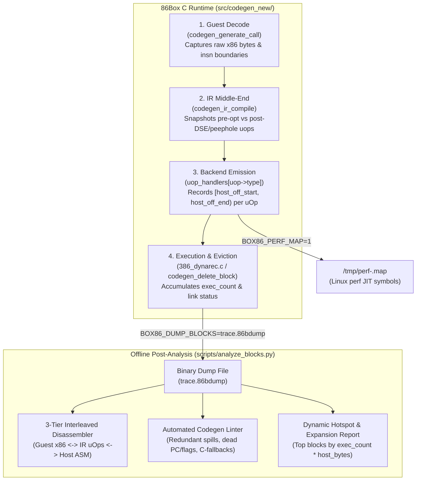

# Design Document: Dynarec Block Dumper & Post-Analysis Pipeline (`DEBUG-BLOCK-DUMPER`)

## 1. Overview & Motivation

When optimizing or debugging `src/codegen_new/`, the translation from **Guest x86 bytes** $\rightarrow$ **Intermediate Representation (`uop_t`)** $\rightarrow$ **Host Machine Code (x86-64 / ARM64 / LoongArch64)** happens entirely in memory inside `codeblock_t` buffers. Currently, inspecting what the JIT actually emits requires attaching GDB, locating `codeblock[block_nr].data`, and manually disassembling raw bytes without knowing which guest instruction or IR uOp produced which host instructions.

A structured **Block Dumper & Post-Analysis Pipeline** solves two problems simultaneously:
1. **Performance Diagnostics**: Quantifies code bloat, register allocator spill/reload churn, redundant `IREG_pc` / `IREG_oldpc` / `IREG_flags_*` memory writes across `UOP_TYPE_ORDER_BARRIER`s, and interpreter fallbacks—weighted by actual runtime execution frequency.
2. **Correctness & Encoding Verification**: Immediately surfaces malformed machine code (such as the LoongArch64 `codegen_CMOV` displacement overwrite in C-1), sub-register clobbers (16-bit `CMOVcc` in C-2), and stale `IREG_cycles` caching across memory helpers (C-3).

---

## 2. Design Principles

1. **Zero C Disassembler Dependencies**: Do not link `capstone` or `libopcodes` into 86Box. The C runtime writes a compact, self-describing binary stream (`.86bdump`) containing the raw guest bytes, the IR `uop_t` array (both pre- and post-optimization), source-mapping offsets, and the raw emitted host bytes. All disassembly and reporting happen offline in Python (`scripts/analyze_blocks.py`).
2. **Fine-Grained 3-Tier Source Attribution**: Every IR `uop_t` records which **guest instruction offset** generated it, and the compiler loop in `codegen_ir_compile()` records the exact **host byte range `[host_start, host_end)`** emitted for each `uop_t` (including register allocator loads/spills triggered by that uOp).
3. **Hot-Block Weighting (Static vs. Dynamic Cost)**: A bloated block executed once during BIOS POST does not matter; a 12-instruction block executed 50,000,000 times in Quake's `R_DrawSpan` or Windows 98's `DIBENG.DLL` dominates wall-clock time. The dumper supports lightweight per-block execution counters (`block->exec_count`) and deferred dumping on block eviction or VM exit.
4. **Native Linux `perf` Integration (`/tmp/perf-<pid>.map`)**: Alongside the binary block dump, a 25-line hook emits `/tmp/perf-<pid>.map` so `perf record` / `perf report` / `perf annotate` natively attributes host hardware performance counter samples to individual guest `CS:EIP` blocks.

---

## 3. End-to-End Architecture



---

## 4. Component 1: C-Side Instrumentation & Binary Format

### 4.1 Fine-Grained Attribution Hooks in `src/codegen_new/`

Only three small hooks are needed in the existing compiler pipeline:

1. **Guest Instruction Boundary Tagging (`src/codegen_new/codegen.c`)**:
   - Add `uint16_t guest_insn_idx;` and `uint16_t guest_pc_off;` to `uop_t` (under `#ifdef DEBUG_BLOCK_DUMPER` or unconditionally in `uop_t` padding).
   - In `codegen_generate_call()`, before decoding each guest instruction, set `ir->cur_guest_insn_idx = block->ins` and `ir->cur_guest_pc_off = (uint16_t)(cpu_state.oldpc - block->start_pc)`.
   - `uop_alloc()` stamps `uop->guest_insn_idx` and `uop->guest_pc_off` automatically on every emitted uOp.

2. **Pre-Optimization vs. Post-Optimization IR Snapshot (`src/codegen_new/codegen_ir.c`)**:
   - In `codegen_ir_compile(ir_data_t *ir, codeblock_t *block)`:
     - Before running `codegen_ir_peephole(ir)` and `codegen_reg_process_dead_list(ir)`, save each uOp's original `orig_type = uop->type` and `orig_imm = uop->imm_data`.
     - If `codegen_ir_peephole` folds an instruction to `UOP_MOV_IMM`, or if `codegen_reg_process_dead_list` turns a dead write into `UOP_INVALID`, the post-analyzer can display both the original uOp and its `[FOLDED -> MOV_IMM]` or `[PRUNED BY DSE]` badge.

3. **Per-uOp Host Machine Code Span Tracking (`src/codegen_new/codegen_ir.c`)**:
   - Inside the `for (c = 0; c < ir->wr_pos; c++)` loop in `codegen_ir_compile`:
     ```c
     uint16_t host_start = (uint16_t) block_pos;
     /* Barrier flushes + register allocator loads/spills: */
     ...
     uint16_t host_body_start = (uint16_t) block_pos;
     /* Actual uop_handlers[uop->type & UOP_MASK](block, uop): */
     ...
     uint16_t host_end = (uint16_t) block_pos;
     ```
   - Recording `(host_start, host_body_start, host_end)` separates **register-allocator glue/spill bytes** (`[host_start, host_body_start)`) from **actual instruction body bytes** (`[host_body_start, host_end)`).
   - This makes it trivial to calculate the exact percentage of host code spent on register loads/writebacks vs. real work!

---

### 4.2 Binary File Format (`.86bdump`)

The binary stream uses fixed-size little-endian structs so C can write it with a single buffered `fwrite` and Python can parse it with `struct.unpack`:

```c
#define BDUMP_MAGIC   0x44423638U /* "86BD" */
#define BDUMP_VERSION 1

enum bdump_host_arch {
    BDUMP_ARCH_X86_64      = 1,
    BDUMP_ARCH_ARM64       = 2,
    BDUMP_ARCH_LOONGARCH64 = 3
};

enum bdump_record_type {
    BDUMP_REC_COMPILE = 1, /* Emitted at end of codegen_block_end_recompile() */
    BDUMP_REC_EXEC    = 2  /* Emitted on block deletion / VM exit with runtime stats */
};

typedef struct bdump_file_header_t {
    uint32_t magic;            /* BDUMP_MAGIC */
    uint16_t version;          /* BDUMP_VERSION */
    uint16_t host_arch;        /* bdump_host_arch */
    uint64_t cpu_state_addr;   /* Base address of cpu_state (to resolve RBP offsets) */
    uint64_t readlookup2_addr; /* Base address of readlookup2 */
    uint64_t ram_addr;         /* Base address of guest ram[] */
} bdump_file_header_t;

typedef struct bdump_compile_record_t {
    uint8_t  rec_type;         /* BDUMP_REC_COMPILE */
    uint8_t  exit_type;        /* BLOCK_EXIT_NONE / DIRECT_1 / COND_2 / RET */
    uint16_t block_nr;         /* Index in codeblock[] */
    uint32_t compile_seq;      /* Monotonic compilation ID (distinguishes recompiled slots) */
    uint32_t pc;               /* Linear entry address (cs + eip) */
    uint32_t _cs;              /* CS base */
    uint32_t phys;             /* Physical entry address */
    uint32_t phys_2;           /* Second page physical address (if 2-page block) */
    uint32_t status;           /* cpu_cur_status (USE32, STACK32, PM, VM86, etc.) */
    uint16_t flags;            /* CODEBLOCK_HAS_FPU, STATIC_TOP, NO_IMMEDIATES, etc. */
    uint8_t  top;              /* block->TOP at compile time */
    uint8_t  unroll_count;     /* Loop unroll factor (0 if not unrolled) */
    uint16_t guest_insn_count; /* block->ins */
    uint16_t guest_byte_len;   /* Number of raw guest x86 bytes */
    uint16_t uop_count;        /* ir->wr_pos */
    uint16_t host_byte_len;    /* Emitted host machine code length */
    uint16_t prologue_end_off; /* Host byte offset where prologue ends */
    uint16_t epilogue_pos_off; /* Host byte offset where epilogue begins */
    uint64_t host_code_addr;   /* Runtime pointer to block_write_data */
    uint64_t page_mask;        /* Dirty mask page 1 */
    uint64_t page_mask2;       /* Dirty mask page 2 */
    /* Followed immediately by:
     * 1. uint8_t            guest_bytes[guest_byte_len];
     * 2. bdump_insn_span_t  guest_insns[guest_insn_count];
     * 3. bdump_uop_entry_t  uops[uop_count];
     * 4. uint8_t            host_bytes[host_byte_len];
     */
} bdump_compile_record_t;

typedef struct bdump_insn_span_t {
    uint16_t guest_off;        /* Byte offset into guest_bytes[] */
    uint8_t  guest_len;        /* Byte length of this guest x86 instruction */
    uint8_t  op_32;            /* Effective operand/address size flags (op_32 & 0x300) */
} bdump_insn_span_t;

typedef struct bdump_uop_entry_t {
    uint32_t orig_type;        /* uOp type before peephole/DSE */
    uint32_t final_type;       /* uOp type after peephole/DSE (UOP_INVALID if pruned) */
    uint32_t imm_data;         /* Immediate payload */
    uint64_t func_ptr;         /* Target C helper or instruction pointer (if CALL_*) */
    uint16_t dest_reg_a;       /* ir_reg_t.reg */
    uint16_t src_reg_a;
    uint16_t src_reg_b;
    uint16_t src_reg_c;
    int16_t  dest_host_reg;    /* Allocated host reg (uop->dest_reg_a_real) */
    int16_t  src_host_reg_a;
    int16_t  src_host_reg_b;
    int16_t  src_host_reg_c;
    uint16_t guest_insn_idx;   /* Index into guest_insns[] */
    uint16_t host_start_off;   /* Start of barrier/allocator glue in host_bytes[] */
    uint16_t host_body_off;    /* Start of uOp handler emission in host_bytes[] */
    uint16_t host_end_off;     /* End of uOp emission in host_bytes[] */
} bdump_uop_entry_t;

typedef struct bdump_exec_record_t {
    uint8_t  rec_type;         /* BDUMP_REC_EXEC */
    uint8_t  invalidate_reason;/* 0 = VM exit, 1 = SMC dirty flush, 2 = eviction */
    uint16_t block_nr;
    uint32_t compile_seq;      /* Matches bdump_compile_record_t.compile_seq */
    uint64_t exec_count;       /* Number of times this block was entered */
    uint32_t link0_target_pc;  /* Target PC of exit 0 (or BLOCK_PC_INVALID) */
    uint32_t link1_target_pc;  /* Target PC of exit 1 (or BLOCK_PC_INVALID) */
    uint16_t link0_target_blk; /* Linked block_nr for exit 0 (or BLOCK_INVALID) */
    uint16_t link1_target_blk; /* Linked block_nr for exit 1 (or BLOCK_INVALID) */
} bdump_exec_record_t;
```

> [!TIP]
> Notice `bdump_file_header_t.cpu_state_addr`: because all `cpu_state` accesses on x86-64 use `[rbp + disp]` (where `RBP = &cpu_state + 128`) and on ARM64 use `[x27 + disp]`, recording `offsetof` table metadata or `cpu_state` layout allows the Python disassembler to automatically annotate every `[rbp - 0x48]` in the disassembled host code as `; cpu_state.regs[EAX]` or `; cpu_state.flags_op`!

---

## 5. Component 2: Linux `perf` JIT Map (`/tmp/perf-<pid>.map`)

When `BOX86_PERF_MAP=1` is set:
- On first block compilation, open `/tmp/perf-<getpid()>.map` in line-buffered mode.
- At the end of `codegen_ir_compile()`, emit:
  ```c
  fprintf(perf_map_fp, "%lx %x jit_b%04u_%04x:%08x_p%08x\n",
          (unsigned long)(uintptr_t)block_write_data,
          (unsigned int)block_pos,
          block_nr,
          block->_cs >> 4,
          block->pc - block->_cs,
          block->phys);
  ```
- Also emit one entry per shared load/store helper generated in `codegen_backend_init()` (e.g. `jit_helper_load_b`, `jit_helper_store_l`, `jit_exit_rout`).
- Now running:
  ```bash
  BOX86_PERF_MAP=1 perf record -g ./build/src/86Box ...
  perf report
  ```
  attributes every host CPU cycle directly to `jit_b1420_0008:0001a2f0_p0011a2f0` and `jit_helper_load_l`.

---

## 6. Component 3: Environment Variable Controls & Filtering

To prevent multi-gigabyte dumps during long Windows 98 sessions, the dumper is controlled via environment variables:

| Environment Variable | Example | Behavior |
| :--- | :--- | :--- |
| `BOX86_DUMP_BLOCKS` | `trace.86bdump` | Enables binary block dumping to the specified path. |
| `BOX86_PERF_MAP` | `1` | Writes `/tmp/perf-<pid>.map` for Linux `perf`. |
| `BOX86_DUMP_PC` | `0x00010000-0x0009ffff` | Only dumps blocks whose linear `pc` falls inside `[start, end]`. |
| `BOX86_DUMP_PHYS` | `0x00100000-0x00400000` | Only dumps blocks in the specified physical address range. |
| `BOX86_DUMP_MIN_EXEC` | `1000` | Buffers compile records in memory and only writes blocks to disk on eviction/exit if `block->exec_count >= 1000`. |
| `BOX86_DUMP_DISASM_FILTER` | `CMOV,REP,FPU` | (Post-analysis flag) Filters blocks containing specific guest instructions or IR uOps. |

---

## 7. Component 4: Offline Post-Analysis Tool (`scripts/analyze_blocks.py`)

`scripts/analyze_blocks.py` reads `trace.86bdump` and provides three modes of operation:

### 7.1 Side-by-Side 3-Tier Annotated Disassembly (`--inspect-block <id/pc>`)

For any block (or the top $N$ hottest blocks), it prints the exact hierarchy from guest instruction $\rightarrow$ IR uOp $\rightarrow$ register allocator glue vs. host instruction, with `[rbp + disp]` resolved to symbolic `cpu_state` field names:

```text
================================================================================
BLOCK #1402 (seq 8912) | PC=0008:000412A0 (phys 001412A0) | USE32 | exec_count=412,900
Flags: STATIC_TOP (TOP=0) | Exit: BLOCK_EXIT_COND_2 -> [0: 00041280 (blk #1399), 1: 000412B4 (UNLINKED)]
Stats: 4 guest insns (11 B) -> 18 uOps (5 pruned by DSE) -> 31 host insns (118 B, 42% reg-flush glue)
================================================================================

[Guest #0] 000412A0: 03 06           add eax, dword ptr [esi]
  ├─ uOp #00: UOP_MOV_IMM        IREG_oldpc       <- 0x000412a0
  │    [body +0x0a..+0x14]  mov dword ptr [rbp - 0x10], 0x412a0     ; cpu_state.oldpc  <-- [LINT: Redundant on fast-path]
  ├─ uOp #01: UOP_MOV            IREG_eaaddr(r10) <- IREG_ESI(r13)  [RENAMED r13->r10]
  ├─ uOp #02: UOP_MEM_LOAD_REG   IREG_temp0(rbx)  <- [IREG_DS_base + IREG_eaaddr(r10)]  [ORDER_BARRIER]
  │    [glue +0x14..+0x22]  mov dword ptr [rbp - 0x0c], 0x412a0     ; FLUSH cpu_state.pc
  │    [body +0x22..+0x4a]  <inline TLB lookup + mov ecx, [rdi+rsi]>
  ├─ uOp #03: UOP_MOV            IREG_flags_op1   <- IREG_EAX       [PRUNED BY DSE]
  ├─ uOp #04: UOP_MOV            IREG_flags_op2   <- IREG_temp0     [PRUNED BY DSE]
  ├─ uOp #05: UOP_ADD            IREG_EAX(rax)    <- IREG_EAX(rax), IREG_temp0(rbx)
  │    [body +0x4a..+0x4c]  add eax, ebx
  ├─ uOp #06: UOP_MOV_IMM        IREG_flags_op    <- FLAGS_ADD32    [PRUNED BY DSE]
  └─ uOp #07: UOP_MOV_IMM        IREG_pc          <- 0x000412a2     [PRUNED BY DSE]
```

### 7.2 Automated Codegen Linter & Anti-Pattern Detector (`--lint`)

Scans all compiled blocks in `trace.86bdump` and automatically flags structural inefficiencies and bugs:

1. **Dead Flag Materialization Across `ORDER_BARRIER`s**:
   - Detects `IREG_flags_op`, `IREG_flags_res`, `IREG_flags_op1`, and `IREG_flags_op2` flushed to `cpu_state` before a memory load/store when a subsequent ALU instruction in the same block overwrites all four flag registers without reading them.
   - Reports total dynamic host instructions wasted (`sum(exec_count * wasted_stores)`).
2. **Fast-Path `pc` / `oldpc` Write Overhead**:
   - Counts stores to `cpu_state.pc` and `cpu_state.oldpc` that are overwritten later in the same block before any block exit.
3. **Intra-Block Register Thrashing (Spill-then-Reload)**:
   - Detects when the 8-register LRU allocator in `codegen_reg.c` evicts a live guest register to `[rbp + ...]` and reloads the same guest register later in the same block.
4. **`IREG_cycles` Hazard Detector**:
   - Flags any block where `IREG_cycles` is allocated in a host register prior to a `UOP_MEM_LOAD_*`, `UOP_MEM_STORE_*`, or `UOP_CALL_*` and then modified by `UOP_SUB_IMM` without being invalidated/reloaded in between (automatically catching Bug C-3 in `REP` string loops).
5. **Disassembly Sanity Check**:
   - Verifies that every emitted host byte between `0` and `host_byte_len` disassembles cleanly without invalid opcodes or truncated branch displacements (automatically catching Bug C-1 on LoongArch64).

### 7.3 Aggregate Telemetry & Hotspot Summary (`--summary`)

Generates a single-page report comparing runs (e.g. Phase 7 vs. Phase 8):

- **Top 25 Hottest Blocks** ranked by `exec_count * host_insn_count`.
- **Instruction Mix Breakdown**:
  - % of dynamic host instructions in Prologue/Epilogue
  - % in Register Load / Writeback glue (`[host_start, host_body_start)`)
  - % in Inlined Memory TLB Fast-Path
  - % in `pc` / `oldpc` / `flags_*` bookkeeping
  - % in Actual Guest ALU/FPU/Branch computation
- **Block Exit & Chaining Efficiency**:
  - % of dynamic block exits linked vs. unlinked, broken down by reason (`CODEBLOCK_STATIC_TOP`, `page_mask2 != 0`, cross-page under `LINK_SAME_PAGE`, polymorphic `RET` miss, indirect jump).
- **Interpreter Fallback Leaderboard**:
  - Ranked list of guest opcodes emitting `UOP_CALL_INSTRUCTION_FUNC` weighted by execution count, identifying the exact next opcodes worth recompiling natively.

---

## 8. Implementation Plan

1. **Step 1 (`src/codegen_new/codegen_dump.h` & `codegen_dump.c`)**:
   - Implement `bdump_file_header_t`, `bdump_compile_record_t`, `bdump_exec_record_t` writer and `/tmp/perf-<pid>.map` emitter behind a CMake option (`-DCODEGEN_DUMP=ON`, or enabled in non-release builds and gated at runtime by `BOX86_DUMP_BLOCKS` / `BOX86_PERF_MAP`).
2. **Step 2 (`src/codegen_new/codegen.c`, `codegen_ir.c`, `codegen_block.c`, `386_dynarec.c`)**:
   - Stamp `guest_insn_idx` in `uop_alloc()`.
   - Record `orig_type` and `[host_start_off, host_body_off, host_end_off)` in `codegen_ir_compile()`.
   - Increment `block->exec_count` in `exec386_dynarec_dyn` (or via an optional 1-instruction `inc qword ptr [block_exec_counter]` when `BOX86_DUMP_BLOCKS` is active so linked chains are counted accurately!).
3. **Step 3 (`scripts/analyze_blocks.py`)**:
   - Implement the Python parser, `cpu_state` offset symbolizer, Capstone 3-tier disassembler, `--lint` detector, and `--summary` hotspot reporter.

