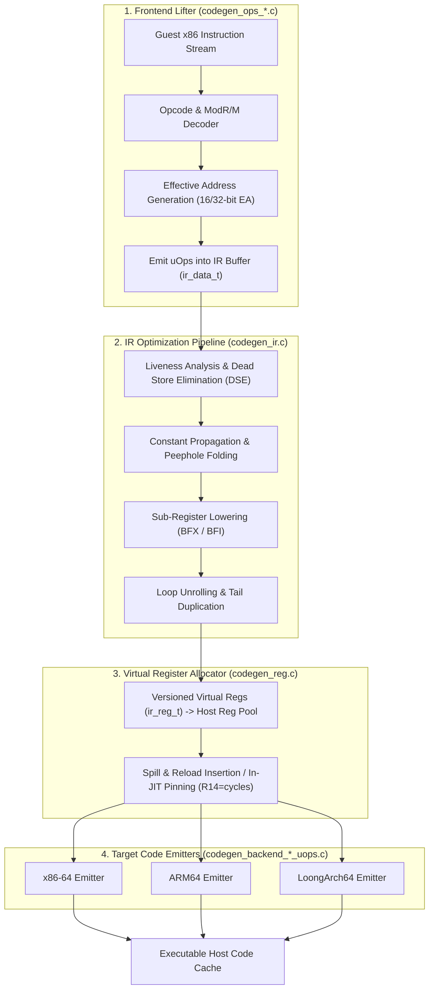

# 86Box Dynarec Intermediate Representation (IR) Architecture

This document provides a comprehensive technical reference for the intermediate representation (IR) utilized by the new dynamic recompiler (`codegen_new`) in 86Box. It details the IR design philosophy, data structures, register versioning model, complete micro-operation (`uop`) instruction set, optimization passes, backend lowering mechanics, and known architectural limitations.

---

## 1. Overview & Architectural Role

In the legacy dynamic recompiler (`src/codegen/`), guest x86 instructions were translated directly into host machine code bytes in a single, macro-driven pass. That architecture was rigidly tied to x86-64 hosts, made cross-instruction optimization impossible, and suffered from severe code duplication.

The new dynarec (`src/codegen_new/`) introduces a decoupled multi-tier compiler pipeline centered around an abstract linear micro-operation IR:



### Core Design Goals
1. **Target Independence**: Common IR stream lowered to multiple host architectures (`x86-64`, `ARM64`, `LoongArch64`).
2. **Cycle-Accurate x86 Emulation**: Preserves x86 CPU semantics, including wait-state cycle deductions, lazy flag evaluation, segment limits, memory barriers, and precise self-modifying code (SMC) tracking.
3. **Low Translation Latency**: Flat linear array of fixed-size structs with $O(1)$ allocation and zero dynamic memory allocations per basic block.
4. **Intra-Block Value Tracking**: Versioned virtual registers with reference counting allow Dead Store Elimination (DSE) and copy/constant propagation before host register allocation.

---

## 2. Core Data Structures & Encoding

The IR definitions reside primarily in [`src/codegen_new/codegen_ir_defs.h`](file:///home/marm/src/86Box/src/codegen_new/codegen_ir_defs.h), with register layouts in [`src/codegen_new/codegen_reg.h`](file:///home/marm/src/86Box/src/codegen_new/codegen_reg.h).

### 2.1 The Micro-Operation (`uop_t`)

Each compiled guest basic block compiles to a linear sequence of `uop_t` structures (up to `UOP_NR_MAX = 4096` per block):

```c
typedef struct uop_t {
    uint32_t      type;               /* Opcode ID and metadata bitflags */
    ir_reg_t      dest_reg_a;         /* Destination virtual register */
    ir_reg_t      src_reg_a;          /* Source virtual register A */
    ir_reg_t      src_reg_b;          /* Source virtual register B */
    ir_reg_t      src_reg_c;          /* Source virtual register C */
#if defined __ARM_EABI__ || defined __aarch64__ || defined __loongarch_lp64
    uintptr_t     imm_data;           /* 64-bit immediate operand on 64-bit RISC */
#else
    uint32_t      imm_data;           /* 32-bit immediate operand */
#endif
    void         *p;                  /* Target function pointer or absolute host address */
    ir_host_reg_t dest_reg_a_real;    /* Allocated physical host register */
    ir_host_reg_t src_reg_a_real;     /* Allocated physical host register */
    ir_host_reg_t src_reg_b_real;     /* Allocated physical host register */
    ir_host_reg_t src_reg_c_real;     /* Allocated physical host register */
    int           is_a16;             /* 1 = 16-bit address override active */
    int           jump_dest_uop;      /* Internal jump target (uOp index in ir_data_t) */
    int           jump_list_next;     /* Next pointer for jump patching chains */
    void         *jump_dest;          /* Concrete host code address after compilation */
    uint32_t      pc;                 /* Guest instruction pointer for this uOp */
    uint16_t      guest_insn_idx;     /* Index into codegen_instructions[] */
    uint16_t      guest_pc_off;       /* Byte offset within guest instruction */
} uop_t;
```

### 2.2 `uop->type` Bitfield Composition

The 32-bit `type` field encodes both the core operation (`UOP_MASK = 0xffff`) and execution semantics:

```
 31 30 29 28 27 26 25 24          16 15                           0
+--+--+--+--+--+--+--+--+-----------+------------------------------+
|B |I |P |R |O |J |D |  | Reserved  |     Opcode ID (0x00 - 0xd8)  |
+--+--+--+--+--+--+--+--+-----------+------------------------------+
```

| Bit Flag | Mask | Semantic Meaning |
| :--- | :--- | :--- |
| `UOP_TYPE_BARRIER` | `1u << 31` | **Full Execution Barrier**. All preceding uOps must complete, and all virtual registers must be flushed/committed to `cpu_state` memory and invalidated. Used before C callouts that may access arbitrary emulator state. |
| `UOP_TYPE_PARAMS_IMM` | `1 << 30` | uOp consumes an immediate operand from `uop->imm_data`. |
| `UOP_TYPE_PARAMS_POINTER` | `1 << 29` | uOp consumes a pointer operand from `uop->p`. |
| `UOP_TYPE_PARAMS_REGS` | `1 << 28` | uOp uses virtual register operands (`dest_reg_a`, `src_reg_a..c`). |
| `UOP_TYPE_ORDER_BARRIER` | `1 << 27` | **Memory Ordering Barrier**. All dirty registers must be written back to `cpu_state`, but host registers remain cached. Used for memory accesses (`UOP_MEM_*`) that might fault and exit the block. |
| `UOP_TYPE_JUMP` | `1 << 26` | uOp is an internal conditional or unconditional branch targeting `uop->jump_dest_uop`. |
| `UOP_TYPE_JUMP_DEST` | `1 << 25` | uOp serves as a branch target. Marks the boundary of conditionally executed code. |

---

## 3. The Virtual Register Model (`ir_reg_t`)

Virtual registers abstract both guest architectural state and internal compiler temporaries.

```c
typedef struct {
    uint16_t reg;       /* Register index (IREG_*) combined with size flags */
    uint16_t version;   /* Monotonically incrementing SSA-like version */
} ir_reg_t;
```

### 3.1 Register Encoding & Sizing

The `reg` field packs the base register identifier (`IREG_*`) and operand size:

```c
#define IREG_REG_MASK      0xff
#define IREG_SIZE_SHIFT    8
#define IREG_SIZE_MASK     (7 << IREG_SIZE_SHIFT)

#define IREG_SIZE_L        (0 << IREG_SIZE_SHIFT)  /* 32-bit dword */
#define IREG_SIZE_W        (1 << IREG_SIZE_SHIFT)  /* 16-bit word */
#define IREG_SIZE_B        (2 << IREG_SIZE_SHIFT)  /* 8-bit low byte (AL, CL, DL, BL) */
#define IREG_SIZE_BH       (3 << IREG_SIZE_SHIFT)  /* 8-bit high byte (AH, CH, DH, BH) */
#define IREG_SIZE_D        (4 << IREG_SIZE_SHIFT)  /* 64-bit IEEE double float */
#define IREG_SIZE_Q        (5 << IREG_SIZE_SHIFT)  /* 64-bit quadword (MMX / integer) */
```

### 3.2 Canonical `IREG_*` Register Allocations

| Virtual Register Range | Identifier | Usage & Semantic Contract |
| :--- | :--- | :--- |
| `0 .. 7` | `IREG_EAX` .. `IREG_EDI` | Guest x86 32-bit General Purpose Registers. Backed by `cpu_state.regs[i]`. |
| `8 .. 11` | `IREG_flags_op`, `res`, `op1`, `op2` | **Lazy Flags State**. `flags_op` stores the active operation (`FLAGS_ADD`, `FLAGS_SUB`, etc.), while `res`, `op1`, and `op2` hold raw operands for deferred flag resolution. |
| `12 .. 13` | `IREG_pc`, `IREG_oldpc` | Guest Instruction Pointers (`cpu_state.pc` and `cpu_state.oldpc`). |
| `14 .. 18` | `IREG_eaaddr`, `ea_seg`, `op32`, `ssegsx`, `rm_mod_reg` | Effective address temporaries, operand size overrides, segment overrides, and ModR/M decoding state. |
| `19 .. 20` | `IREG_cycles`, `IREG_exit_request` | **Execution Engine Control**. `IREG_cycles` tracks the remaining cycle budget for the time slice. `IREG_exit_request` flags block termination conditions. |
| `21 .. 26` | `IREG_CS_base` .. `IREG_SS_base` | Cached 32-bit physical base addresses of segment registers (`s->base`). |
| `27 .. 32` | `IREG_CS_seg` .. `IREG_SS_seg` | 16-bit selector values of segment registers (`s->seg`). |
| `33 .. 56` | `IREG_ST0`..`ST7`, `tag0`..`tag7`, `ST0_i64`..`ST7_i64` | Physical x87 FPU stack registers, tag words, and 64-bit integer views. Indexed via `IREG_ST(i)` using `cpu_state.TOP`. |
| `57 .. 64` | `IREG_MM0x` .. `IREG_MM7x` | 64-bit MMX vector registers. |
| `65 .. 66` | `IREG_NPXCx`, `IREG_NPXSx` | x87 FPU Control and Status words. |
| `67 .. 68` | `IREG_flagsx`, `IREG_eflagsx` | Fully materialized 16-bit FLAGS and 32-bit EFLAGS words. |
| `69 .. 80` | `IREG_CS_limit_low/high` .. `IREG_SS_limit_low/high` | Segment limit ranges used for hardware bounds validation. |
| `81 .. 85` | `IREG_eaa16`, `x87_op`, `FPU_TOP`, `fpu_op`, `fpu_CS` | Miscellaneous execution state and FPU exception metadata. |
| `86 .. 89` | `IREG_temp0` .. `IREG_temp3` | General-purpose 32-bit scratch registers. Lifetime scoped to local basic block; not flushed across block boundaries. |
| `90 .. 91` | `IREG_temp0d`, `IREG_temp1d` | 64-bit floating-point scratch registers. |
| `92 .. 94` | `IREG_bfx_t0` .. `IREG_bfx_t2` | Dedicated temporaries for sub-register bitfield extract/insert passes. |

### 3.3 Register Versioning & Reference Counting

Every time a virtual register is written (`codegen_reg_write()`), its version number is incremented:
```c
uop->dest_reg_a = codegen_reg_write(dest_reg, ir->wr_pos - 1);
```
Reads (`codegen_reg_read()`) bind to the most recent version and increment that version's reference count:
```c
uop->src_reg_a = codegen_reg_read(src_reg);
```
When a version's reference count drops to zero during middle-end optimization or code emission, the underlying host register can be immediately evicted or reused without spilling.

---

## 4. Complete Micro-Opcode Catalog

The IR comprises 182 micro-operations spanning integer execution, memory transactions, control flow, FPU, and SIMD extensions.

### 4.1 Function Call & ABI Marshaling

These uOps marshal arguments and invoke C runtime functions. They always trigger `UOP_TYPE_BARRIER`.

| Opcode | Hex | Param Flags | Semantics / Description |
| :--- | :---: | :--- | :--- |
| `UOP_LOAD_FUNC_ARG_0` .. `3` | `0x00`..`0x03` | `REGS` | Loads host argument register 0..3 from `src_reg_a` according to host C ABI. |
| `UOP_LOAD_FUNC_ARG_0_IMM` .. `3_IMM`| `0x08`..`0x0b` | `IMM, BARRIER` | Loads host argument register 0..3 with immediate constant `imm_data`. |
| `UOP_CALL_FUNC` | `0x10` | `PTR, BARRIER` | Flushes dirty registers to `cpu_state` and executes C function at `p`. |
| `UOP_CALL_INSTRUCTION_FUNC` | `0x11` | `PTR, IMM, BARRIER` | Invokes legacy instruction fallback `p(fetchdat)`. Exits block if return is non-zero. |
| `UOP_CALL_FUNC_RESULT` | `0x16` | `REGS, PTR, BARRIER` | Calls C function at `p`, storing host return value (`RAX`/`X0`) into `dest_reg_a`. |
| `UOP_LOAD_SEG` | `0x14` | `REGS, PTR, BARRIER` | Protected-mode segment reload: calls `loadseg(src_reg_a, p)`. Exits block on fault. |

### 4.2 Data Movement & Extension

| Opcode | Hex | Param Flags | Semantics / Operation |
| :--- | :---: | :--- | :--- |
| `UOP_MOV` | `0x22` | `REGS` | `dest_reg_a = src_reg_a` |
| `UOP_MOV_IMM` | `0x21` | `REGS, IMM` | `dest_reg_a = imm_data` |
| `UOP_MOV_PTR` | `0x20` | `REGS, PTR` | `dest_reg_a = (uintptr_t)p` |
| `UOP_MOVZX` | `0x23` | `REGS` | `dest_reg_a = zero_extend(src_reg_a)` (Byte/Word $\to$ Dword) |
| `UOP_MOVSX` | `0x24` | `REGS` | `dest_reg_a = sign_extend(src_reg_a)` (Byte/Word $\to$ Dword) |
| `UOP_MOV_REG_PTR` | `0x28` | `REGS, PTR` | `dest_reg_a = *(uint32_t *)p` |
| `UOP_MOVZX_REG_PTR_8` | `0x29` | `REGS, PTR` | `dest_reg_a = *(uint8_t *)p` |
| `UOP_MOVZX_REG_PTR_16`| `0x2a` | `REGS, PTR` | `dest_reg_a = *(uint16_t *)p` |
| `UOP_STORE_P_IMM` | `0x12` | `IMM` | `*(uint32_t *)p = imm_data` |
| `UOP_STORE_P_IMM_8` | `0x13` | `IMM` | `*(uint8_t *)p = (uint8_t)imm_data` |
| `UOP_STORE_P_IMM_16` | `0x19` | `IMM` | `*(uint16_t *)p = (uint16_t)imm_data` |
| `UOP_BSWAP` | `0xce` | `REGS` | `dest_reg_a = __builtin_bswap32(src_reg_a)` |
| `UOP_CMOV` | `0x74` | `REGS` | `dest_reg_a = (src_reg_c != 0) ? src_reg_b : src_reg_a` |
| `UOP_SETCC` | `0x75` | `REGS, IMM` | `dest_reg_a = (src_reg_a <cond> src_reg_b) ? 1 : 0` |

### 4.3 Integer Arithmetic & Bitwise Logic

| Opcode | Hex | Param Flags | Semantics / Operation |
| :--- | :---: | :--- | :--- |
| `UOP_ADD` / `UOP_ADD_IMM` | `0x30` / `0x31` | `REGS` / `REGS, IMM` | `dest = src_a + src_b` / `dest = src_a + imm` |
| `UOP_SUB` / `UOP_SUB_IMM` | `0x37` / `0x38` | `REGS` / `REGS, IMM` | `dest = src_a - src_b` / `dest = src_a - imm` |
| `UOP_IMUL` / `UOP_IMUL_IMM` | `0x3c` / `0x3d` | `REGS` / `REGS, IMM` | Signed multiply: `dest = src_a * src_b` / `dest = src_a * imm` |
| `UOP_MULUH` / `UOP_MULSH` | `0x3e` / `0x3f` | `REGS` | Widening 32×32 high multiply: `dest = ((uint64_t)(uint32_t)src_a * src_b) >> 32` / signed `((int64_t)(int32_t)src_a * src_b) >> 32` |
| `UOP_AND` / `UOP_AND_IMM` | `0x32` / `0x33` | `REGS` / `REGS, IMM` | Bitwise AND: `dest = src_a & src_b` / `dest = src_a & imm` |
| `UOP_OR` / `UOP_OR_IMM` | `0x35` / `0x36` | `REGS` / `REGS, IMM` | Bitwise OR: `dest = src_a \| src_b` / `dest = src_a \| imm` |
| `UOP_XOR` / `UOP_XOR_IMM` | `0x39` / `0x3a` | `REGS` / `REGS, IMM` | Bitwise XOR: `dest = src_a ^ src_b` / `dest = src_a ^ imm` |
| `UOP_ANDN` | `0x3b` | `REGS, IMM` | Bitwise AND-NOT: `dest = ~src_a & src_b` |

### 4.4 Shifts, Rotates & Scaled Addressing

| Opcode | Hex | Param Flags | Semantics / Operation |
| :--- | :---: | :--- | :--- |
| `UOP_SHL` / `UOP_SHL_IMM` | `0x52` / `0x53` | `REGS` / `REGS, IMM` | Logical left shift: `dest = src_a << count` |
| `UOP_SHR` / `UOP_SHR_IMM` | `0x54` / `0x55` | `REGS` / `REGS, IMM` | Logical right shift: `dest = src_a >> count` |
| `UOP_SAR` / `UOP_SAR_IMM` | `0x50` / `0x51` | `REGS` / `REGS, IMM` | Arithmetic right shift: `dest = (int)src_a >> count` |
| `UOP_ROL` / `UOP_ROL_IMM` | `0x56` / `0x57` | `REGS` / `REGS, IMM` | Rotate left: `dest = rotl(src_a, count)` |
| `UOP_ROR` / `UOP_ROR_IMM` | `0x58` / `0x59` | `REGS` / `REGS, IMM` | Rotate right: `dest = rotr(src_a, count)` |
| `UOP_ADD_LSHIFT` | `0x34` | `REGS, IMM` | SIB addressing math: `dest = src_a + (src_b << imm)` (`imm` $\in [0..3]$) |

### 4.5 Sub-Register Bitfield Manipulation

Added in Proposal 5 to eliminate architectural leaking of x86 high-byte (`AH`, `CH`, `DH`, `BH`) and 16-bit registers into backends:

| Opcode | Hex | Param Flags | Semantics / Operation |
| :--- | :---: | :--- | :--- |
| `UOP_BFX` | `0xd7` | `REGS, IMM` | **Bitfield Extract**: `dest = (src >> lsb) & ((1 << width) - 1)`. `imm_data` packs `(lsb & 0xff) \| ((width & 0xff) << 8) \| ((is_signed & 1) << 16)`. |
| `UOP_BFI` | `0xd8` | `REGS, IMM` | **Bitfield Insert**: `dest = (prev_dest & ~mask) \| ((val & mask) << lsb)`. Splices low byte or high byte into 32-bit register. |

### 4.6 Memory Access & Barriers

All memory uOps enforce `UOP_TYPE_ORDER_BARRIER` because unmapped memory, MMIO, or page faults can cause immediate block exit.

| Opcode | Hex | Param Flags | Semantics / Operation |
| :--- | :---: | :--- | :--- |
| `UOP_MEM_LOAD_ABS` | `0x40` | `REGS, IMM, ORDER` | `dest = readmem(src_a:[imm_data])` (Absolute address) |
| `UOP_MEM_LOAD_REG` | `0x41` | `REGS, IMM, ORDER` | `dest = readmem(src_a:[src_b])` (Segment base + EA) |
| `UOP_MEM_STORE_ABS` | `0x42` | `REGS, IMM, ORDER` | `writemem(src_a:[imm_data], src_b)` |
| `UOP_MEM_STORE_REG` | `0x43` | `REGS, ORDER` | `writemem(src_a:[src_b], src_c)` |
| `UOP_MEM_STORE_IMM_8` | `0x44` | `REGS, IMM, ORDER` | `writemem8(src_a:[src_b], (uint8_t)imm_data)` |
| `UOP_MEM_STORE_IMM_16`| `0x45` | `REGS, IMM, ORDER` | `writemem16(src_a:[src_b], (uint16_t)imm_data)` |
| `UOP_MEM_STORE_IMM_32`| `0x46` | `REGS, IMM, ORDER` | `writemem32(src_a:[src_b], imm_data)` |
| `UOP_MEM_LOAD_SINGLE` | `0x47` | `REGS, IMM, ORDER` | `dest = (float)readmem32(src_a:[src_b])` |
| `UOP_MEM_LOAD_DOUBLE` | `0x49` | `REGS, IMM, ORDER` | `dest = (double)readmem64(src_a:[src_b])` |
| `UOP_MEM_STORE_SINGLE`| `0x4a` | `REGS, ORDER` | `writemem32(src_a:[src_b], (float)src_c)` |
| `UOP_MEM_STORE_DOUBLE`| `0x4b` | `REGS, ORDER` | `writemem64(src_a:[src_b], (double)src_c)` |

### 4.7 Control Flow & Internal Conditional Jumps

The IR distinguishes between **internal jumps** (within the same block) and **terminal block exits** (to other compiled blocks or the C dispatcher).

```
Internal Branches (UOP_TYPE_JUMP)
Target: uop->jump_dest_uop (index within ir_data_t)
  |
  +--> UOP_CMP_IMM_JZ_DEST   (0x60): if (src_a == imm) jmp target
  +--> UOP_CMP_IMM_JNZ_DEST  (0x61): if (src_a != imm) jmp target
  +--> UOP_CMP_IMM_JLE_DEST  (0x6e): if ((int)src_a <= imm) jmp target
  +--> UOP_CMP_IMM_JNLE_DEST (0x6f): if ((int)src_a > imm) jmp target
  +--> UOP_CMP_JB_DEST       (0x62): if (src_a < src_b) jmp target (unsigned)
  +--> UOP_CMP_JNB_DEST      (0x63): if (src_a >= src_b) jmp target (unsigned)
  +--> UOP_CMP_JO_DEST       (0x64): if (overflow) jmp target
  +--> UOP_CMP_JNO_DEST      (0x65): if (!overflow) jmp target
  +--> UOP_CMP_JZ_DEST       (0x66): if (src_a == src_b) jmp target
  +--> UOP_CMP_JNZ_DEST      (0x67): if (src_a != src_b) jmp target
  +--> UOP_CMP_JL_DEST       (0x68): if ((int)src_a < (int)src_b) jmp target
  +--> UOP_CMP_JNL_DEST      (0x69): if ((int)src_a >= (int)src_b) jmp target
  +--> UOP_CMP_JBE_DEST      (0x6a): if (src_a <= src_b) jmp target (unsigned)
  +--> UOP_CMP_JNBE_DEST     (0x6b): if (src_a > src_b) jmp target (unsigned)
  +--> UOP_CMP_JLE_DEST      (0x6c): if ((int)src_a <= (int)src_b) jmp target
  +--> UOP_CMP_JNLE_DEST     (0x6d): if ((int)src_a > (int)src_b) jmp target
  +--> UOP_TEST_JNS_DEST     (0x70): if ((int)src_a >= 0) jmp target
  +--> UOP_TEST_JS_DEST      (0x71): if ((int)src_a < 0) jmp target
```

#### Block Exits & Loops
- `UOP_JMP` (`0x15`): Unconditional jump to target host pointer `p`.
- `UOP_JMP_DEST` (`0x17`): Unconditional jump to internal target `jump_dest_uop`.
- `UOP_LOOP_LABEL` (`0x72`): Designates loop head destination with barrier invalidation.
- `UOP_LOOP_JMP` (`0x73`): Backward jump to preceding `UOP_LOOP_LABEL`.
- `UOP_NOP_BARRIER` (`0x18`): Non-faulting ordering barrier that forces register writeback without emitting host machine instructions.
- `UOP_EXIT_BLOCK` (`0x1a`): Terminates execution of current basic block and enters dispatcher.
- `UOP_EXIT_BLOCK_RET` (`0x1b`): Terminates subroutine block with near RET linking optimization.

### 4.8 Floating-Point Unit (x87 FPU)

| Opcode | Hex | Param Flags | Semantics / Operation |
| :--- | :---: | :--- | :--- |
| `UOP_FP_ENTER` | `0x80` | `IMM, BARRIER` | Synchronizes x87 state and verifies FPU presence before FPU register access. |
| `UOP_FADD` / `UOP_FSUB` | `0x81` / `0x82` | `REGS` | Double float add / subtract: `dest = src_a ± src_b` |
| `UOP_FMUL` / `UOP_FDIV` | `0x83` / `0x84` | `REGS` | Double float multiply / divide: `dest = src_a * src_b` / `dest = src_a / src_b` |
| `UOP_FCOM` | `0x85` | `REGS` | Evaluates IEEE float compare, writing status flags to `dest_reg_a`. |
| `UOP_FABS` / `UOP_FCHS` | `0x86` / `0x87` | `REGS` | Float absolute value (`fabs`) / float negate (`-src_a`). |
| `UOP_FTST` | `0x88` | `REGS` | Tests float against 0.0, updating status word flags. |
| `UOP_FSQRT` | `0x89` | `REGS` | `dest = sqrt(src_a)` |
| `UOP_FROUND_S` | `0x8a` | `REGS` | Rounds 64-bit double to 32-bit single precision (`(double)(float)src_a`). |
| `UOP_MOV_DOUBLE_INT` | `0x25` | `REGS` | `dest_reg_a = (double)(int32_t)src_a` |
| `UOP_MOV_INT_DOUBLE` | `0x26` | `REGS` | Converts float to integer using rounding control in `src_b`/`src_c`. |

### 4.9 SIMD: MMX & AMD 3DNow!

#### MMX (64-bit Packed Integer)
- **Lifecycle**: `UOP_MMX_ENTER` (`0x90`, barrier setting FPU tag words to dirty).
- **Packed Arithmetic**: `UOP_PADDB`, `W`, `D` (`0x91..0x93`), with signed saturation (`UOP_PADDSB`, `W` `0x94..0x95`), unsigned saturation (`UOP_PADDUSB`, `W` `0x96..0x97`), and corresponding subtracts (`UOP_PSUB*` `0x98..0x9e`).
- **Packed Shifts**: Immediate shifts (`UOP_PSLLW_IMM` .. `UOP_PSRAQ_IMM` `0x9f..0xa7`) and variable register shifts (`UOP_PSRLW` .. `UOP_PSLLQ` `0xcf..0xd6`).
- **Packed Compares**: `UOP_PCMPEQB`, `W`, `D` (`0xa8..0xaa`), `UOP_PCMPGTB`, `W`, `D` (`0xab..0xad`).
- **Packing & Interleaving**: `UOP_PUNPCKLBW` .. `UOP_PUNPCKHDQ` (`0xae..0xb3`), `UOP_PACKSSWB`, `UOP_PACKSSDW`, `UOP_PACKUSWB`.
- **Multiplies**: `UOP_PMULLW` (`0xb7`), `UOP_PMULHW` (`0xb8`), `UOP_PMADDWD` (`0xb9`).

#### AMD 3DNow! (64-bit Packed Single-Precision Float)
- **Packed Float Math**: `UOP_PFADD` (`0xba`), `UOP_PFSUB` (`0xbb`), `UOP_PFMUL` (`0xbc`), `UOP_PFMAX` (`0xbd`), `UOP_PFMIN` (`0xbe`).
- **Float Compares**: `UOP_PFCMPEQ` (`0xbf`), `UOP_PFCMPGE` (`0xc0`), `UOP_PFCMPGT` (`0xc1`).
- **Conversions**: `UOP_PF2ID` (`0xc2`), `UOP_PI2FD` (`0xc3`), `UOP_PF2IW` (`0xc9`), `UOP_PI2FW` (`0xca`).
- **Fast Reciprocals**: `UOP_PFRCP` (`0xc4`, 24-bit reciprocal approximation), `UOP_PFRSQRT` (`0xc5`, reciprocal square root).
- **Accumulators**: `UOP_PFACC` (`0xc6`), `UOP_PFNACC` (`0xcb`), `UOP_PFPNACC` (`0xcc`).
- **Swaps & Byte Math**: `UOP_PSWAPD` (`0xcd`), `UOP_PMULHRW` (`0xc7`), `UOP_PAVGUSB` (`0xc8`).

---

## 5. Middle-End Optimization Pipeline

The middle-end operates on `ir_data_t` after the frontend finishes emitting instructions for a block, but before physical host register allocation:


### 5.1 Backward Liveness Analysis (`codegen_ir_optimize_liveness`)
Scans uOps backward from `ir->wr_pos - 1` to `0`:
1. **Lazy Flag DSE**: Tracks `flags_live`. When a uOp defines lazy flags (`uop_flags_modified()`), if subsequent code never reads flags before the next barrier or flags write, the flag calculation is suppressed.
2. **PC / OldPC Store Elimination**: Eager `uop_MOV_IMM(ir, IREG_oldpc, ...)` and `IREG_pc` stores preceding non-faulting instructions are marked dead and eliminated (`uop->type = UOP_INVALID`), saving tens of millions of memory writes during Windows 98 execution.
3. **General Register DSE**: Identifies virtual register definitions that have zero remaining reads before block termination or overwriting.

### 5.2 Constant Propagation & Peephole Optimizer (`codegen_ir_peephole`)
Maintains `const_val[IREG_COUNT]` and version tracking in a forward pass:
1. **Constant Folding**: Evaluates constant arithmetic at compile time:
   - `ADD_IMM(c1, c2)` $\to$ replaces with `MOV_IMM(c1 + c2)`.
   - `AND_IMM(c1, c2)` $\to$ replaces with `MOV_IMM(c1 & c2)`.
   - `SHL_IMM(c1, shift)` $\to$ replaces with `MOV_IMM(c1 << shift)`.
2. **Algebraic Identities**:
   - `ADD_IMM(r, 0)` $\to$ eliminated.
   - `SUB_IMM(r, 0)` $\to$ eliminated.
   - `IMUL_IMM(r, 1)` $\to$ eliminated.
   - `IMUL_IMM(r, 0)` $\to$ converted to `MOV_IMM(r, 0)`.
   - `AND_IMM(r, 0)` $\to$ converted to `MOV_IMM(r, 0)`.
   - `OR_IMM(r, 0)` $\to$ eliminated.
3. **Dead uOp Pruning (`peephole_kill_uop`)**:
   - Safely decrements source register reference counts (`reg_version[reg][ver].refcount--`) and sets `uop->type = UOP_INVALID`.

### 5.3 Sub-Register Lowering (`codegen_ir_lower_subregs`)
x86 supports overlapping sub-registers (`AL`, `AH`, `AX`, `EAX`). The middle-end decomposes sub-register updates into canonical 32-bit operations:
- A write to `AL` becomes:
  ```
  UOP_BFI(EAX, AL_val, lsb=0, width=8)
  ```
- A write to `AH` becomes:
  ```
  UOP_BFI(EAX, AH_val, lsb=8, width=8)
  ```
This insulates backends from ModR/M sub-register quirks and x86-64 REX high-byte encoding constraints.

---

## 6. Architectural Gotchas & Invariants

Working with the `codegen_new` IR requires adherence to six strict invariant rules:

### Gotcha 1: No Intra-Block Conditional Diamond Branches
- **The Issue**: The register allocator (`codegen_reg.c`) assumes strictly linear execution within a block.
- **Symptom**: FreeDOS `JemmEx: exception 0D` or corrupted GPR values.
- **Root Cause**: If an internal conditional jump skips a register assignment, the regalloc assumes the register was loaded linearly. The skipped path leaves uninitialized host registers.
- **Rule**: Never emit internal conditional diamonds around register modifications. Use native branchless primitives (`UOP_SETCC`, `UOP_CMOV`) or insert an explicit barrier flush (`codegen_reg_flush_invalidate`).

### Gotcha 2: Lazy Flags Op is Runtime State
- **The Issue**: `cpu_state.flags_op` is dynamic runtime state.
- **Rule**: Never switch on `cpu_state.flags_op` at compile time. Only query `codegen_last_flags_op`, which is tracked by the frontend and invalidated to `FLAGS_INVALID` across function calls and barriers.

### Gotcha 3: Cycle Synchronization Around Barriers
- **The Issue**: Deducting wait states or cycles inside C helper callouts.
- **Symptom**: Implausible benchmark scores (PCPBench 60 $\to$ 208 FPS).
- **Rule**: `IREG_cycles` must be committed to `cpu_state._cycles` before any slow-path callout or MMIO access (`UOP_TYPE_ORDER_BARRIER` / `BARRIER`), and reloaded immediately afterward.

### Gotcha 4: In-Block Loop CX/ECX Decrements
- **The Issue**: Win98 shutdown hang ("It's now safe to turn off your computer").
- **Root Cause**: `ropLOOP`/`LOOPE`/`LOOPNE` direct-linked (`BLOCK_EXIT_COND_2`) without emitting `uop_SUB_IMM(ir, count_reg, count_reg, 1)` prior to the branch test.
- **Rule**: Loop instructions must decrement the counter register in the IR before checking exit conditions.

### Gotcha 5: High-Byte Registers vs. x86-64 REX Prefixes
- **The Issue**: x86-64 ModR/M cannot encode high-byte registers (`AH`, `CH`, `DH`, `BH`) when a REX prefix is present (used for extended registers `R8..R15` or 64-bit operand sizes).
- **Rule**: High-byte registers must be extracted and inserted using shifts or bitfield operations (`UOP_BFX`/`UOP_BFI`) rather than directly allocating physical high-byte registers alongside REX prefixes.

### Gotcha 6: Apple Silicon / ARM64 W^X Memory Protection
- **The Issue**: Crash during dynamic code patching on macOS ARM64.
- **Rule**: Any runtime modification of branch offsets (`patch_jmp_disp`) must be wrapped with `pthread_jit_write_protect_np(0)/(1)` and flushed via `__builtin___clear_cache`.

---

## 7. Current Limitations & Future Evolution

While `codegen_new` achieves significant performance uplifts, its IR design exhibits several recognized architectural constraints:

### 7.1 Single Basic Block Scope
The IR only represents single basic blocks terminating at the first control-flow transfer. Superblock formation and loop-invariant code motion (LICM) are structurally impossible across block boundaries without multi-block trace formation (tracked in Proposal 2 / Task #46).

### 7.2 Coarse Barrier Granularity
Barriers (`UOP_TYPE_BARRIER`) currently force an all-or-nothing register writeback. Refining barrier masks so that memory operations only flush registers mapped to physical RAM rather than the entire register file will eliminate redundant host memory traffic (tracked in Proposal 3).

### 7.3 Three-Tier IR Orthogonalization (Proposal 5)
Currently, ~182 uOps exist, many of which duplicate operations across operand widths (e.g., `UOP_MEM_STORE_IMM_8`, `16`, `32`). Proposal 5 outlines orthogonalizing the instruction set into ~55 canonical 32/64-bit micro-operations with explicit width and sign attributes:
- Collapsing 17 compare-and-jump uOps into a single `UOP_BR_COND(cond)`.
- Canonicalizing all sub-register writes through `UOP_BFX` and `UOP_BFI`.
- Sharing runtime dispatch and event loop logic across backends in a unified `codegen_backend_common.c`.
